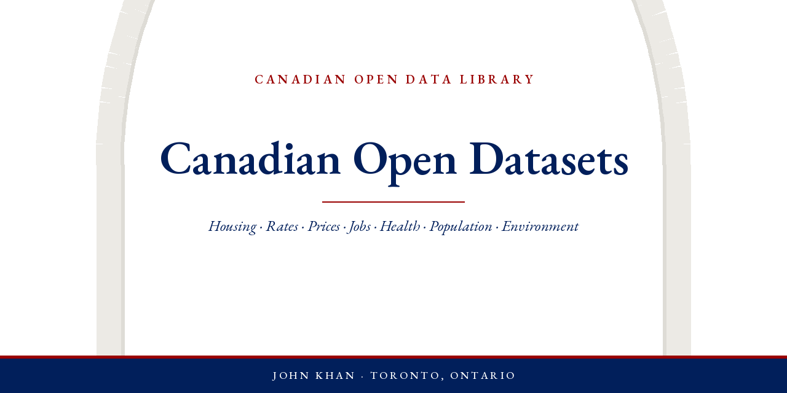
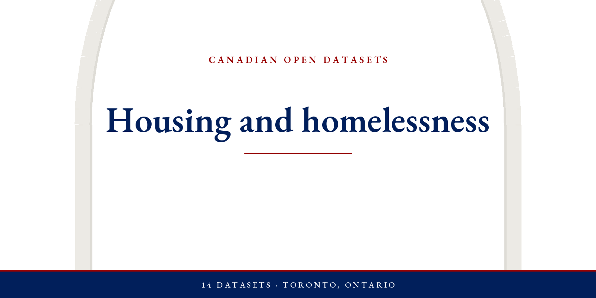
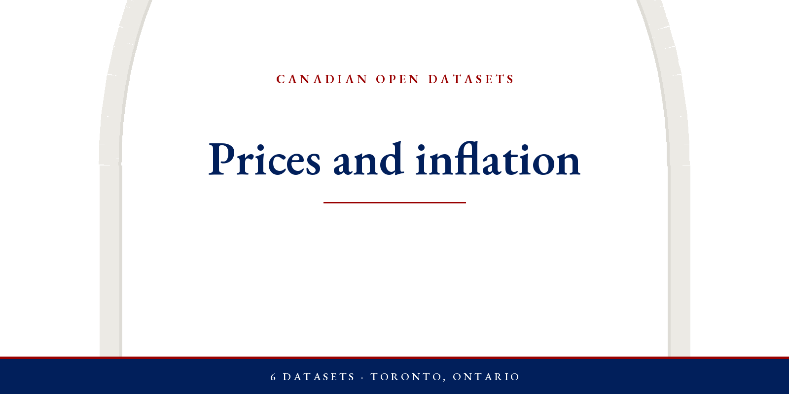
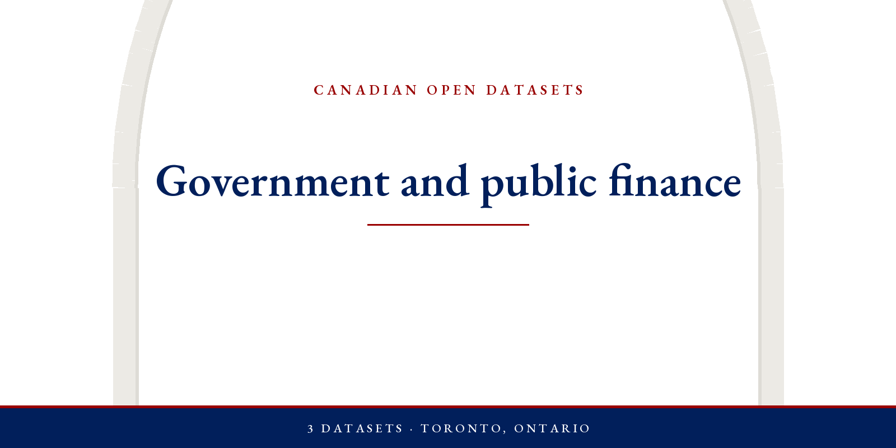
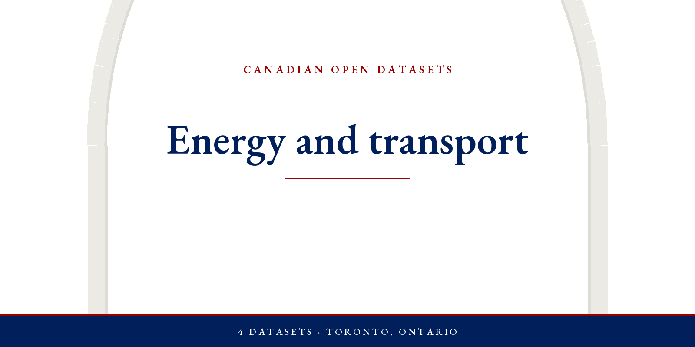
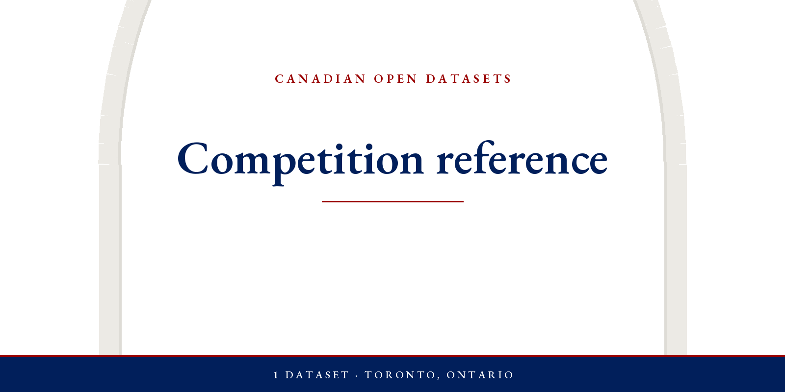

<p align="center"></p>

# Canadian Open Datasets

**103 cleaned, documented datasets about Canada, Ontario and Toronto**, compiled by John Khan in Toronto, Ontario. Every dataset has its own folder with the data files, a README that explains what it is and who it helps, a table of every column, the source and licence, the coverage dates and a ready-made citation.

Every dataset is also published on Kaggle: <https://www.kaggle.com/johnnykhan1/datasets>

| Datasets | Themes | Files | Fully in this repository | With large files on the release page | Link only |
|---:|---:|---:|---:|---:|---:|
| 103 | 12 | 623 | 93 | 9 | 1 |

## Themes

- [Housing and homelessness](#housing-and-homelessness) (14)
- [Interest rates, credit and markets](#interest-rates-credit-and-markets) (11)
- [Prices and inflation](#prices-and-inflation) (6)
- [Jobs, wages and income](#jobs-wages-and-income) (13)
- [Economy, trade and business](#economy-trade-and-business) (8)
- [Government and public finance](#government-and-public-finance) (3)
- [Population and immigration](#population-and-immigration) (8)
- [Health, disability and wellbeing](#health-disability-and-wellbeing) (8)
- [Public safety and city services](#public-safety-and-city-services) (10)
- [Environment, climate and natural hazards](#environment-climate-and-natural-hazards) (17)
- [Energy and transport](#energy-and-transport) (4)
- [Competition reference](#competition-reference) (1)

## Housing and homelessness



*Who it helps:* Home buyers, renters, mortgage brokers and agents, housing researchers, shelter planners and city staff in Toronto, across Ontario and the rest of Canada.

| Dataset | Coverage | Licence | Data | Kaggle |
|---|---|---|---|---|
| [Canada asking rent and paid rent](datasets/canada-asking-and-paid-rent/) | January 2019 to April 2026 | StatCan Open Licence | In repo | [link](https://www.kaggle.com/datasets/johnnykhan1/canada-asking-and-paid-rent) |
| [Canada building construction investment](datasets/canada-building-construction-investment/) | 2017 to 2026 | StatCan Open Licence | In repo | [link](https://www.kaggle.com/datasets/johnnykhan1/canada-building-construction-investment) |
| [Canada building permits monthly](datasets/canada-building-permits-monthly/) | 2018 to 2026 | StatCan Open Licence | In repo | [link](https://www.kaggle.com/datasets/johnnykhan1/canada-building-permits-monthly) |
| [Canada core housing need by CMA](datasets/canada-core-housing-need-cma/) | 2018, 2021, 2022 and 2024 | StatCan Open Licence | In repo | [link](https://www.kaggle.com/datasets/johnnykhan1/canada-core-housing-need-cma) |
| [Canada homeless shelter capacity](datasets/canada-homeless-shelter-capacity/) | 2016 to 2025 | StatCan Open Licence | In repo | [link](https://www.kaggle.com/datasets/johnnykhan1/canada-homeless-shelter-capacity) |
| [Canada Housing Affordability Index 1980 to 2026](datasets/canada-housing-affordability-repo-import/) | 1980 to 2026 | StatCan Open Licence, Bank of Canada terms | In repo | [link](https://www.kaggle.com/datasets/johnnykhan1/canada-housing-affordability-repo-import) |
| [Canada housing completions (CMHC)](datasets/canada-housing-completions-cmhc/) | January 1948 to July 2026 | StatCan Open Licence | In repo | [link](https://www.kaggle.com/datasets/johnnykhan1/canada-housing-completions-cmhc) |
| [Canada housing starts (CMHC)](datasets/canada-housing-starts-cmhc/) | June 1990 to September 2026 | StatCan Open Licence | In repo | [link](https://www.kaggle.com/datasets/johnnykhan1/canada-housing-starts-cmhc) |
| [Canada housing stock by dwelling and tenure](datasets/canada-housing-stock-by-dwelling-and-tenure/) | April 2016 to April 2026 | StatCan Open Licence | In repo | [link](https://www.kaggle.com/datasets/johnnykhan1/canada-housing-stock-by-dwelling-and-tenure) |
| [Canada New Housing Price Index](datasets/canada-new-housing-price-index/) | January 1981 to September 2026 | StatCan Open Licence | In repo | [link](https://www.kaggle.com/datasets/johnnykhan1/canada-new-housing-price-index) |
| [Canada rental vacancy rates](datasets/canada-rental-vacancy-rates/) | 1989 to 2025 | StatCan Open Licence | In repo | [link](https://www.kaggle.com/datasets/johnnykhan1/canada-rental-vacancy-rates) |
| [Toronto apartment building evaluations](datasets/toronto-apartment-building-evaluations/) | 2017 to 2026 | OGL – Toronto | In repo | [link](https://www.kaggle.com/datasets/johnnykhan1/toronto-apartment-building-evaluations) |
| [Toronto Building Permits 2000 to 2026](datasets/toronto-building-permits/) | 2000 to 2026 | OGL – Toronto | In repo + release | [link](https://www.kaggle.com/datasets/johnnykhan1/toronto-building-permits) |
| [Toronto Shelter Occupancy and System Flow](datasets/toronto-shelter-occupancy-and-flow/) | 2021 to 2026 | OGL – Toronto | In repo | [link](https://www.kaggle.com/datasets/johnnykhan1/toronto-shelter-occupancy-and-flow) |

## Interest rates, credit and markets


*Who it helps:* Borrowers, mortgage professionals, lenders, investors, finance students and economists tracking Canadian rates, credit and the dollar.

| Dataset | Coverage | Licence | Data | Kaggle |
|---|---|---|---|---|
| [Canada and US Government Bond Yields 1990 to 2026](datasets/canada-us-government-bond-yields/) | 1990 to 2026 | Bank of Canada terms | In repo | [link](https://www.kaggle.com/datasets/johnnykhan1/canada-us-government-bond-yields) |
| [Canada bank mortgage and HELOC lending](datasets/canada-bank-mortgage-and-heloc-lending/) | January 1982 to April 2026 | StatCan Open Licence | In repo | [link](https://www.kaggle.com/datasets/johnnykhan1/canada-bank-mortgage-and-heloc-lending) |
| [Canada bank mortgage and other lending](datasets/canada-chartered-bank-lending/) | January 2013 to August 2026 | Bank of Canada terms | In repo | [link](https://www.kaggle.com/datasets/johnnykhan1/canada-chartered-bank-lending) |
| [Canada CORRA overnight rate](datasets/canada-corra-overnight-rate/) | 12 August 1997 to 10 November 2026 | Bank of Canada terms | In repo | [link](https://www.kaggle.com/datasets/johnnykhan1/canada-corra-overnight-rate) |
| [Canada household credit liabilities](datasets/canada-household-credit-liabilities/) | 1990 to 2026 | StatCan Open Licence | In repo | [link](https://www.kaggle.com/datasets/johnnykhan1/canada-household-credit-liabilities) |
| [Canada Household Debt, Debt Service and Wealth](datasets/canada-household-debt-and-wealth/) | 1990 to 2026 | StatCan Open Licence | In repo | [link](https://www.kaggle.com/datasets/johnnykhan1/canada-household-debt-and-wealth) |
| [Canada insolvency statistics](datasets/canada-insolvency-statistics/) | 1987 to 2024 | OGL – Canada | In repo | [link](https://www.kaggle.com/datasets/johnnykhan1/canada-insolvency-statistics) |
| [Canada monetary aggregates M1 M2 M3](datasets/canada-monetary-aggregates-m1-m2-m3/) | 1953 to 2026 | StatCan Open Licence | In repo | [link](https://www.kaggle.com/datasets/johnnykhan1/canada-monetary-aggregates-m1-m2-m3) |
| [Canada Mortgage and Interest Rates 1969 to 2026](datasets/canada-mortgage-interest-rates/) | 1969 to 2026 | StatCan Open Licence, Bank of Canada terms | In repo | [link](https://www.kaggle.com/datasets/johnnykhan1/canada-mortgage-interest-rates) |
| [Canada Senior Loan Officer Survey](datasets/canada-senior-loan-officer-survey/) | April 1999 to April 2026 | Bank of Canada terms | In repo | [link](https://www.kaggle.com/datasets/johnnykhan1/canada-senior-loan-officer-survey) |
| [Canadian Dollar Exchange Rates 2007 to 2026](datasets/canadian-dollar-exchange-rates/) | 2007 to 2026 | Bank of Canada terms | In repo | [link](https://www.kaggle.com/datasets/johnnykhan1/canadian-dollar-exchange-rates) |

## Prices and inflation



*Who it helps:* Households watching the cost of living, budget planners, journalists, analysts and students studying inflation in Canada.

| Dataset | Coverage | Licence | Data | Kaggle |
|---|---|---|---|---|
| [Bank of Canada Commodity Price Index 1972 to 2026](datasets/bank-of-canada-commodity-price-index/) | 1972 to 2026 | Bank of Canada terms | In repo | [link](https://www.kaggle.com/datasets/johnnykhan1/bank-of-canada-commodity-price-index) |
| [Canada core inflation measures](datasets/canada-core-inflation-measures/) | January 1995 to September 2026 | Bank of Canada terms | In repo | [link](https://www.kaggle.com/datasets/johnnykhan1/canada-core-inflation-measures) |
| [Canada CPI by item and province](datasets/canada-cpi-by-component-province/) | January 1914 to September 2026 | StatCan Open Licence | In repo + release | [link](https://www.kaggle.com/datasets/johnnykhan1/canada-cpi-by-component-province) |
| [Canada industrial and raw materials prices](datasets/canada-industrial-and-raw-materials-price-indexes/) | 1956 to 2026 | StatCan Open Licence | In repo | [link](https://www.kaggle.com/datasets/johnnykhan1/canada-industrial-and-raw-materials-price-indexes) |
| [Canada monthly average retail food prices](datasets/canada-monthly-average-retail-food-prices/) | 2017 to 2026 | StatCan Open Licence | In repo | [link](https://www.kaggle.com/datasets/johnnykhan1/canada-monthly-average-retail-food-prices) |
| [Canada monthly gasoline and fuel pump prices](datasets/canada-monthly-gasoline-and-fuel-pump-prices/) | 1979 to 2026 | StatCan Open Licence | In repo | [link](https://www.kaggle.com/datasets/johnnykhan1/canada-monthly-gasoline-and-fuel-pump-prices) |

## Jobs, wages and income


*Who it helps:* Job seekers, employers, unions, policy analysts, poverty researchers and students looking at work and income across Canada.

| Dataset | Coverage | Licence | Data | Kaggle |
|---|---|---|---|---|
| [Canada adjusted household disposable income](datasets/canada-adjusted-household-disposable-income/) | 2008 to 2025 | StatCan Open Licence | In repo | [link](https://www.kaggle.com/datasets/johnnykhan1/canada-adjusted-household-disposable-income) |
| [Canada education and employment income](datasets/canada-education-employment-income/) | 2020 income year (2021 Census) | StatCan Open Licence | In repo | [link](https://www.kaggle.com/datasets/johnnykhan1/canada-education-employment-income) |
| [Canada employee wages by industry](datasets/canada-employee-wages-by-industry/) | 1997 to 2025 | StatCan Open Licence | In repo + release | [link](https://www.kaggle.com/datasets/johnnykhan1/canada-employee-wages-by-industry) |
| [Canada Employment Insurance beneficiaries](datasets/canada-employment-insurance-beneficiaries/) | January 1997 to August 2026 | StatCan Open Licence | In repo | [link](https://www.kaggle.com/datasets/johnnykhan1/canada-employment-insurance-beneficiaries) |
| [Canada Household Spending, 2010 to 2023](datasets/canada-household-spending-survey/) | 2010 to 2023 | StatCan Open Licence | In repo + release | [link](https://www.kaggle.com/datasets/johnnykhan1/canada-household-spending-survey) |
| [Canada income of individuals by source](datasets/canada-income-of-individuals-by-source/) | 1976 to 2024 | StatCan Open Licence | In repo | [link](https://www.kaggle.com/datasets/johnnykhan1/canada-income-of-individuals-by-source) |
| [Canada job vacancies by industry](datasets/canada-job-vacancies-monthly/) | 2015 to 2026 | StatCan Open Licence | In repo | [link](https://www.kaggle.com/datasets/johnnykhan1/canada-job-vacancies-monthly) |
| [Canada labour force survey monthly](datasets/canada-labour-force-survey-monthly/) | January 1976 to October 2026 | StatCan Open Licence | In repo + release | [link](https://www.kaggle.com/datasets/johnnykhan1/canada-labour-force-survey-monthly) |
| [Canada labour productivity by province](datasets/canada-labour-productivity-by-province/) | 2011 to 2025 | StatCan Open Licence | In repo | [link](https://www.kaggle.com/datasets/johnnykhan1/canada-labour-productivity-by-province) |
| [Canada Low Income and Income Inequality](datasets/canada-low-income-and-income-inequality/) | 1976 to 2024 | StatCan Open Licence | In repo + release | [link](https://www.kaggle.com/datasets/johnnykhan1/canada-low-income-and-income-inequality) |
| [Canada Market Basket Measure poverty lines](datasets/canada-market-basket-measure-poverty-lines/) | 2002 to 2025 | StatCan Open Licence | In repo | [link](https://www.kaggle.com/datasets/johnnykhan1/canada-market-basket-measure-poverty-lines) |
| [Canada payroll jobs and weekly earnings](datasets/canada-payroll-jobs-and-weekly-earnings/) | January 2001 to August 2026 | StatCan Open Licence | In repo | [link](https://www.kaggle.com/datasets/johnnykhan1/canada-payroll-jobs-and-weekly-earnings) |
| [Canada union membership and coverage](datasets/canada-union-membership-and-coverage/) | 1997 to 2025 | StatCan Open Licence | In repo | [link](https://www.kaggle.com/datasets/johnnykhan1/canada-union-membership-and-coverage) |

## Economy, trade and business


*Who it helps:* Business owners, exporters, economists, investors and students following Canada's output, trade and business activity.

| Dataset | Coverage | Licence | Data | Kaggle |
|---|---|---|---|---|
| [Canada balance of payments current account](datasets/canada-balance-of-payments-current-account/) | January 1981 to April 2026 | StatCan Open Licence | In repo | [link](https://www.kaggle.com/datasets/johnnykhan1/canada-balance-of-payments-current-account) |
| [Canada business openings and closures](datasets/canada-business-openings-closures/) | 2015 to 2026 | StatCan Open Licence | In repo | [link](https://www.kaggle.com/datasets/johnnykhan1/canada-business-openings-closures) |
| [Canada GDP by Expenditure and Industry](datasets/canada-gdp-expenditure-and-industry/) | 1961 to 2026 | StatCan Open Licence | In repo | [link](https://www.kaggle.com/datasets/johnnykhan1/canada-gdp-expenditure-and-industry) |
| [Canada GDP per capita quarterly](datasets/canada-gdp-per-capita-quarterly/) | January 1981 to April 2026 | StatCan Open Licence | In repo | [link](https://www.kaggle.com/datasets/johnnykhan1/canada-gdp-per-capita-quarterly) |
| [Canada Manufacturing and Wholesale Trade](datasets/canada-manufacturing-and-wholesale-trade/) | 1992 to 2026 | StatCan Open Licence | In repo | [link](https://www.kaggle.com/datasets/johnnykhan1/canada-manufacturing-and-wholesale-trade) |
| [Canada merchandise trade by country](datasets/canada-merchandise-trade-by-country/) | 1997 to 2026 | StatCan Open Licence | In repo | [link](https://www.kaggle.com/datasets/johnnykhan1/canada-merchandise-trade-by-country) |
| [Canada provincial GDP by industry](datasets/canada-provincial-gdp-by-industry/) | 1997 to 2024 | StatCan Open Licence | In repo | [link](https://www.kaggle.com/datasets/johnnykhan1/canada-provincial-gdp-by-industry) |
| [Canada retail trade sales monthly](datasets/canada-retail-trade-sales-monthly/) | January 2017 to August 2026 | StatCan Open Licence | In repo | [link](https://www.kaggle.com/datasets/johnnykhan1/canada-retail-trade-sales-monthly) |

## Government and public finance



*Who it helps:* Taxpayers, journalists, charity and non-profit staff, and public finance researchers.

| Dataset | Coverage | Licence | Data | Kaggle |
|---|---|---|---|---|
| [Canada charities 2024 (CRA)](datasets/canada-charities-2024-cra/) | 2024 | OGL – Canada | In repo | [link](https://www.kaggle.com/datasets/johnnykhan1/canada-charities-2024-cra) |
| [Canada defence expenditure (CCOFOG)](datasets/canada-defence-expenditure-ccofog/) | 2008 to 2024 | StatCan Open Licence | In repo | [link](https://www.kaggle.com/datasets/johnnykhan1/canada-defence-expenditure-ccofog) |
| [Canada Government Finance Statistics](datasets/canada-government-finance-statistics/) | 1990 to 2026 | StatCan Open Licence | In repo | [link](https://www.kaggle.com/datasets/johnnykhan1/canada-government-finance-statistics) |

## Population and immigration


*Who it helps:* Newcomers, settlement agencies, planners, school boards, businesses choosing locations and demographers.

| Dataset | Coverage | Licence | Data | Kaggle |
|---|---|---|---|---|
| [Canada interprovincial migration](datasets/canada-interprovincial-migration/) | July 1961 to April 2026 | StatCan Open Licence | In repo | [link](https://www.kaggle.com/datasets/johnnykhan1/canada-interprovincial-migration) |
| [Canada IRCC permits and asylum claims](datasets/canada-ircc-permits-asylum-claims/) | 2000 to 2026 (monthly from January 2015) | OGL – Canada | In repo | [link](https://www.kaggle.com/datasets/johnnykhan1/canada-ircc-permits-asylum-claims) |
| [Canada non permanent residents](datasets/canada-non-permanent-residents/) | January 2021 to July 2026 | StatCan Open Licence | In repo | [link](https://www.kaggle.com/datasets/johnnykhan1/canada-non-permanent-residents) |
| [Canada permanent residents (IRCC)](datasets/canada-permanent-residents-ircc/) | January 2015 to August 2026 | OGL – Canada | In repo | [link](https://www.kaggle.com/datasets/johnnykhan1/canada-permanent-residents-ircc) |
| [Canada population by age and gender](datasets/canada-population-by-age-and-gender/) | 1971 to 2026 | StatCan Open Licence | In repo | [link](https://www.kaggle.com/datasets/johnnykhan1/canada-population-by-age-and-gender) |
| [Canada Population Growth Components](datasets/canada-population-growth-components/) | 1946 to 2026 | StatCan Open Licence | In repo | [link](https://www.kaggle.com/datasets/johnnykhan1/canada-population-growth-components) |
| [Canada quarterly population estimates](datasets/canada-population-estimates-quarterly/) | January 1946 to July 2026 | StatCan Open Licence | In repo | [link](https://www.kaggle.com/datasets/johnnykhan1/canada-population-estimates-quarterly) |
| [Toronto Neighbourhood Profiles Census 2021](datasets/toronto-neighbourhood-profiles-2021/) | 2021 | OGL – Toronto | In repo | [link](https://www.kaggle.com/datasets/johnnykhan1/toronto-neighbourhood-profiles-2021) |

## Health, disability and wellbeing


*Who it helps:* Patients and caregivers, disability advocates, public health teams, pharmacists, food security groups and health researchers.

| Dataset | Coverage | Licence | Data | Kaggle |
|---|---|---|---|---|
| [Canada cancer incidence rates and counts](datasets/canada-cancer-incidence-ccr/) | 1992 to 2023 | StatCan Open Licence | In repo + release | [link](https://www.kaggle.com/datasets/johnnykhan1/canada-cancer-incidence-ccr) |
| [Canada disability income, poverty and work](datasets/canada-disability-income-poverty-and-work/) | 2013 to 2025 | StatCan Open Licence | In repo | [link](https://www.kaggle.com/datasets/johnnykhan1/canada-disability-income-poverty-and-work) |
| [Canada Drug Product Database](datasets/canada-drug-product-database/) | Snapshot of 9 November 2026 | OGL – Canada | In repo | [link](https://www.kaggle.com/datasets/johnnykhan1/canada-drug-product-database) |
| [Canada FluWatch respiratory detections](datasets/canada-fluwatch-virus-detections/) | 2013 to 2026 | OGL – Canada | In repo | [link](https://www.kaggle.com/datasets/johnnykhan1/canada-fluwatch-virus-detections) |
| [Canada household food insecurity](datasets/canada-food-insecurity-cis/) | 2018 to 2024 | StatCan Open Licence | In repo | [link](https://www.kaggle.com/datasets/johnnykhan1/canada-food-insecurity-cis) |
| [Canada opioid and stimulant harms](datasets/canada-opioid-stimulant-harms/) | January 2016 to September 2026 | OGL – Canada | In repo | [link](https://www.kaggle.com/datasets/johnnykhan1/canada-opioid-stimulant-harms) |
| [Canada Survey on Disability, 2017 and 2022](datasets/canada-survey-on-disability-2017-2022/) | 2017 to 2022 | StatCan Open Licence | In repo + release | [link](https://www.kaggle.com/datasets/johnnykhan1/canada-survey-on-disability-2017-2022) |
| [Toronto Accessibility and Disability Data](datasets/toronto-accessibility-and-disability-data/) | Snapshot of 9 November 2026 | OGL – Toronto | In repo | [link](https://www.kaggle.com/datasets/johnnykhan1/toronto-accessibility-and-disability-data) |

## Public safety and city services


*Who it helps:* Residents, community groups, road safety advocates, city councillors, reporters and researchers in Toronto and other Canadian cities.

| Dataset | Coverage | Licence | Data | Kaggle |
|---|---|---|---|---|
| [Calgary traffic incidents](datasets/calgary-traffic-incidents/) | 1 December 2016 to 9 November 2026 | OGL – Calgary | In repo | [link](https://www.kaggle.com/datasets/johnnykhan1/calgary-traffic-incidents) |
| [Canada and Toronto religion hate crimes](datasets/canada-toronto-religion-hate-crimes/) | 2014 to 2025 | StatCan Open Licence, OGL – Toronto | In repo | [link](https://www.kaggle.com/datasets/johnnykhan1/canada-toronto-religion-hate-crimes) |
| [Canada education and crime severity](datasets/canada-education-and-crime/) | 2021 to 2025 | StatCan Open Licence, OGL – Toronto | In repo | [link](https://www.kaggle.com/datasets/johnnykhan1/canada-education-and-crime) |
| [Montreal criminal acts](datasets/montreal-criminal-acts/) | 1 January 2015 to 7 November 2026 | CC BY 4.0 | In repo | [link](https://www.kaggle.com/datasets/johnnykhan1/montreal-criminal-acts) |
| [Toronto 311 Service Requests 2020 to 2026](datasets/toronto-311-service-requests/) | 2020 to 2026 | OGL – Toronto | In repo + release | [link](https://www.kaggle.com/datasets/johnnykhan1/toronto-311-service-requests) |
| [Toronto Bicycle Thefts by Neighbourhood](datasets/toronto-bicycle-thefts-by-neighbourhood/) | 1975 to 2026 | OGL – Toronto | In repo | [link](https://www.kaggle.com/datasets/johnnykhan1/toronto-bicycle-thefts-by-neighbourhood) |
| [Toronto Hate Crimes 2018 to 2026](datasets/toronto-hate-crimes-2018-2026/) | 2018 to 2026 | OGL – Toronto | In repo | [link](https://www.kaggle.com/datasets/johnnykhan1/toronto-hate-crimes-2018-2026) |
| [Toronto KSI Traffic Collisions 2006 to 2026](datasets/toronto-ksi-traffic-collisions/) | 2006 to 2026 | OGL – Toronto | In repo | [link](https://www.kaggle.com/datasets/johnnykhan1/toronto-ksi-traffic-collisions) |
| [Toronto Neighbourhood Crime Rates 2014 to 2025](datasets/toronto-neighbourhood-crime-rates-2014-2025/) | 2014 to 2025 | OGL – Toronto | In repo | [link](https://www.kaggle.com/datasets/johnnykhan1/toronto-neighbourhood-crime-rates-2014-2025) |
| [Toronto Shootings and Firearm Discharges](datasets/toronto-shootings-firearm-discharges/) | 2004 to 2026 | OGL – Toronto | In repo | [link](https://www.kaggle.com/datasets/johnnykhan1/toronto-shootings-firearm-discharges) |

## Environment, climate and natural hazards


*Who it helps:* Climate researchers, farmers, emergency planners, insurers, conservation groups, teachers and students.

| Dataset | Coverage | Licence | Data | Kaggle |
|---|---|---|---|---|
| [BC lightstation SST and salinity](datasets/bc-lightstation-sst-salinity/) | 1914 to 2026 | OGL – Canada | In repo | [link](https://www.kaggle.com/datasets/johnnykhan1/bc-lightstation-sst-salinity) |
| [Canada AHCCD temperature and precipitation](datasets/canada-ahccd-temp-precipitation/) | 1840 to 2023 (precipitation to December 2017) | OGL – Canada | In repo | [link](https://www.kaggle.com/datasets/johnnykhan1/canada-ahccd-temp-precipitation) |
| [Canada climate normals 1981 to 2010](datasets/canada-climate-normals-1981-2010/) | 1981 to 2010 | OGL – Canada | In repo | [link](https://www.kaggle.com/datasets/johnnykhan1/canada-climate-normals-1981-2010) |
| [Canada crop yields by agricultural region](datasets/canada-crop-yields-by-car/) | 1987 to 2025 | OGL – Canada | In repo | [link](https://www.kaggle.com/datasets/johnnykhan1/canada-crop-yields-by-car) |
| [Canada earthquakes 1985 to 2019](datasets/canada-earthquakes-1985-2019/) | 1985 to 2019 | OGL – Canada | In repo | [link](https://www.kaggle.com/datasets/johnnykhan1/canada-earthquakes-1985-2019) |
| [Canada GHGRP facility emissions](datasets/canada-ghgrp-facility-emissions/) | 2004 to 2024 | OGL – Canada | In repo | [link](https://www.kaggle.com/datasets/johnnykhan1/canada-ghgrp-facility-emissions) |
| [Canada Great Lakes monthly levels](datasets/canada-great-lakes-monthly-levels/) | 1918 to 2025 | OGL – Canada | In repo | [link](https://www.kaggle.com/datasets/johnnykhan1/canada-great-lakes-monthly-levels) |
| [Canada greenhouse gas inventory](datasets/canada-ghg-inventory-nir/) | 1990 to 2024 | StatCan Open Licence, OGL – Canada | In repo | [link](https://www.kaggle.com/datasets/johnnykhan1/canada-ghg-inventory-nir) |
| [Canada historical flood events](datasets/canada-historical-flood-events/) | 1800s to 2025 | OGL – Canada | In repo | [link](https://www.kaggle.com/datasets/johnnykhan1/canada-historical-flood-events) |
| [Canada hydrometric daily flow selected](datasets/canada-hydrometric-daily-flow-selected/) | 2000 to 2024 | OGL – Canada | In repo | [link](https://www.kaggle.com/datasets/johnnykhan1/canada-hydrometric-daily-flow-selected) |
| [Canada NAPS annual air quality](datasets/canada-naps-air-quality-annual/) | 2016 to 2024 | OGL – Canada | In repo | [link](https://www.kaggle.com/datasets/johnnykhan1/canada-naps-air-quality-annual) |
| [Canada NFI standard forest estimates](datasets/canada-nfi-standard-forest-estimates/) | 2000 to 2017 | OGL – Canada | In repo | [link](https://www.kaggle.com/datasets/johnnykhan1/canada-nfi-standard-forest-estimates) |
| [Canada NPRI air releases 2015 to 2024](datasets/canada-npri-air-releases-2015-2024/) | 2015 to 2024 | OGL – Canada | In repo | [link](https://www.kaggle.com/datasets/johnnykhan1/canada-npri-air-releases-2015-2024) |
| [Canada summer sea ice area 1968 to 2024](datasets/canada-summer-sea-ice-1968-2024/) | 1968 to 2024 | OGL – Canada | In repo | [link](https://www.kaggle.com/datasets/johnnykhan1/canada-summer-sea-ice-1968-2024) |
| [Canada wave buoys, selected stations](datasets/canada-wave-buoys-selected/) | 1 January 1987 to 28 March 2025 | OGL – Canada | In repo | [link](https://www.kaggle.com/datasets/johnnykhan1/canada-wave-buoys-selected) |
| [Canada wildfire area burned by cause](datasets/canada-wildfire-area-burned-cause/) | 1990 to 2020 | OGL – Canada | In repo | [link](https://www.kaggle.com/datasets/johnnykhan1/canada-wildfire-area-burned-cause) |
| [Canadian Disaster Database](datasets/canada-disaster-database/) | 10 January 1900 to 22 December 2022 | OGL – Canada | In repo | [link](https://www.kaggle.com/datasets/johnnykhan1/canada-disaster-database) |

## Energy and transport



*Who it helps:* Drivers and fleet owners, energy analysts, rail and road safety staff, and anyone tracking Canada's power and fuel mix.

| Dataset | Coverage | Licence | Data | Kaggle |
|---|---|---|---|---|
| [Canada crude oil exports (CER)](datasets/canada-crude-oil-exports-cer/) | June 1985 to August 2026 | OGL – Canada | In repo | [link](https://www.kaggle.com/datasets/johnnykhan1/canada-crude-oil-exports-cer) |
| [Canada electricity generation and capacity](datasets/canada-electricity-generation-capacity/) | 2005 to 2025 | StatCan Open Licence | In repo | [link](https://www.kaggle.com/datasets/johnnykhan1/canada-electricity-generation-capacity) |
| [Canada new vehicle registrations by fuel](datasets/canada-vehicle-registrations-fuel/) | 2017 to 2026 | StatCan Open Licence | In repo | [link](https://www.kaggle.com/datasets/johnnykhan1/canada-vehicle-registrations-fuel) |
| [Canada railway grade crossings](datasets/canada-railway-grade-crossings/) | 2022 inventory update, downloaded 9 November 2026 | OGL – Canada | In repo | [link](https://www.kaggle.com/datasets/johnnykhan1/canada-railway-grade-crossings) |

## Competition reference



*Who it helps:* Kaggle competitors checking where medal lines sit on public leaderboards.

| Dataset | Coverage | Licence | Data | Kaggle |
|---|---|---|---|---|
| [Featured Kaggle leaderboard medal lines](datasets/featured-kaggle-leaderboards-medal-lines-oct-2026/) | 29 October and 9 November 2026 | CC0 1.0 | Kaggle only | [link](https://www.kaggle.com/datasets/johnnykhan1/featured-kaggle-leaderboards-medal-lines-oct-2026) |

## Licences

This is open data, but it does not all come under one licence. **Each dataset folder keeps the licence of its own source** in its `LICENSE.md` and README, with the attribution wording the source asks for. Please keep that attribution when you reuse a file. The top-level [LICENSE](LICENSE) explains how the pieces fit together.

| Licence | Datasets |
|---|---:|
| Statistics Canada Open Licence | 57 |
| Open Government Licence – Canada 2.0 | 26 |
| Open Government Licence – Toronto | 13 |
| Bank of Canada terms of use | 9 |
| Open Government Licence – City of Calgary | 1 |
| CC0 1.0 (as set on Kaggle) | 1 |
| Creative Commons Attribution 4.0 International (City of Montréal open data) | 1 |

Some datasets combine two sources and carry both licences.

**Link only:** [Featured Kaggle leaderboard medal lines](datasets/featured-kaggle-leaderboards-medal-lines-oct-2026/): The snapshot is drawn from Kaggle competition leaderboards, which fall under Kaggle's own terms of use rather than an open government licence, so the files stay on Kaggle and this folder links to them.

## Large files

Files over 50 MB are not stored in git. They are gzipped and attached to the [data release](https://github.com/ALENZACODES/canadian-open-datasets/releases/tag/data-2026-11-15), and each dataset README links straight to its download.

## Quick start

```python
import pandas as pd

base = "https://raw.githubusercontent.com/ALENZACODES/canadian-open-datasets/main/datasets"
rates = pd.read_csv(f"{base}/canada-mortgage-interest-rates/data/canada_mortgage_monthly_panel.csv")
print(rates.tail())
```

## How to cite

Cite the individual dataset using the BibTeX block in its folder README. To cite the whole catalogue, use [CITATION.cff](CITATION.cff) (GitHub shows a "Cite this repository" button) or:

```bibtex
@misc{khan2026canadianopendatasets,
  author = {Khan, John},
  title  = {Canadian Open Datasets},
  year   = {2026},
  address = {Toronto, Ontario, Canada},
  url    = {https://github.com/ALENZACODES/canadian-open-datasets}
}
```

## Disclaimer

These are adaptations of official open data. They are not official products of, and are not endorsed by, Statistics Canada, the Bank of Canada, the Government of Canada, the City of Toronto, the City of Calgary, the City of Montréal or any other source agency. Values were not changed except where a dataset README says how. Always check the source before making a decision that matters.

---
Compiled by John Khan · Toronto, Ontario · [Kaggle](https://www.kaggle.com/johnnykhan1)
