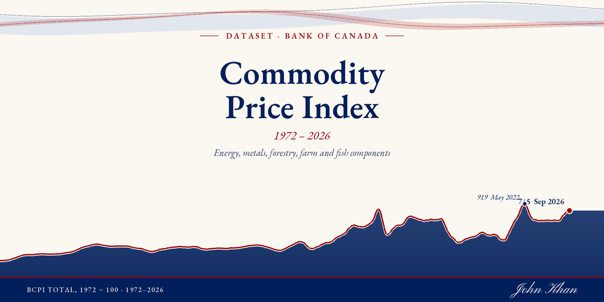

<p align="center"></p>

# Bank of Canada Commodity Price Index 1972 to 2026

*Weekly, monthly and annual BCPI with energy, metals, forestry, farm and fish*

**Theme:** [Prices and inflation](../../README.md#prices-and-inflation) · **Coverage:** 1 January 1972 to 14 October 2026 · **Kaggle:** [https://www.kaggle.com/datasets/johnnykhan1/bank-of-canada-commodity-price-index](https://www.kaggle.com/datasets/johnnykhan1/bank-of-canada-commodity-price-index)

## What it is

The Bank of Canada commodity price index (BCPI) is a chain Fisher price index of the US dollar prices of 26 commodities produced in Canada and sold on world markets. This dataset, pulled from the Bank of Canada Valet API on October 17, 2026, has the total index and six sub indices: excluding energy, energy, metals and minerals, forestry, agriculture and fish. Each comes monthly from January 1972 to September 2026 with a 12 month change, weekly to October 2026, and as annual averages to 2025. A separate file gives the yearly weights from 1972 to 2026, which sum to 100 each year.

## Who it helps

Households watching the cost of living, budget planners, journalists, analysts and students studying inflation in Canada.

## Files

| File | Size | Where |
|---|---:|---|
| [`KAGGLE_NOTES.md`](data/KAGGLE_NOTES.md) | 4 KB | in this repository |
| [`bcpi_annual_1972_2025.csv`](data/bcpi_annual_1972_2025.csv) | 3 KB | in this repository |
| [`bcpi_monthly_1972_2026.csv`](data/bcpi_monthly_1972_2026.csv) | 64 KB | in this repository |
| [`bcpi_weekly_1972_2026.csv`](data/bcpi_weekly_1972_2026.csv) | 171 KB | in this repository |
| [`bcpi_weights_1972_2026.csv`](data/bcpi_weights_1972_2026.csv) | 4 KB | in this repository |
| [`scripts/build_dataset.py`](data/scripts/build_dataset.py) | 4 KB | in this repository |
| [`series_catalog.csv`](data/series_catalog.csv) | 5 KB | in this repository |

## Columns

### `bcpi_annual_1972_2025.csv`

Annual average BCPI total and six sub-indices

| Column | Type | Description |
|---|---|---|
| `year` | Integer | — |
| `total` | Float | Weekly Bank of Canada commodity price index - Total |
| `ex_energy` | Float | Weekly Bank of Canada commodity price index - Excluding Energy |
| `energy` | Float | Weekly Bank of Canada commodity price index - Energy |
| `metals_minerals` | Float | Weekly Bank of Canada commodity price index - Metals and Minerals |
| `forestry` | Float | Weekly Bank of Canada commodity price index - Forestry |
| `agriculture` | Float | Weekly Bank of Canada commodity price index - Agriculture |
| `fish` | Float | Weekly Bank of Canada commodity price index - Fish |

### `bcpi_monthly_1972_2026.csv`

Monthly BCPI total and six sub-indices with 12-month % changes

| Column | Type | Description |
|---|---|---|
| `date` | Date | Period (YYYY-MM for monthly, YYYY-MM-DD Wednesday for weekly) |
| `total` | Float | BCPI total index (Jan 1972 = 100, US$ terms) |
| `ex_energy` | Float | BCPI excluding energy |
| `energy` | Float | Energy sub-index: crude oil, natural gas, coal |
| `metals_minerals` | Float | Metals and minerals sub-index |
| `forestry` | Float | Forestry sub-index: pulp, lumber, newsprint |
| `agriculture` | Float | Agriculture sub-index |
| `fish` | Float | Fish sub-index |
| `total_yoy_pct` | Float | % change from 12 months earlier: BCPI total index (Jan 1972 = 100, US$ terms) |
| `ex_energy_yoy_pct` | Float | % change from 12 months earlier: BCPI excluding energy |
| `energy_yoy_pct` | Float | % change from 12 months earlier: Energy sub-index: crude oil, natural gas, coal |
| `metals_minerals_yoy_pct` | Float | % change from 12 months earlier: Metals and minerals sub-index |
| `forestry_yoy_pct` | Float | % change from 12 months earlier: Forestry sub-index: pulp, lumber, newsprint |
| `agriculture_yoy_pct` | Float | % change from 12 months earlier: Agriculture sub-index |
| `fish_yoy_pct` | Float | % change from 12 months earlier: Fish sub-index |

### `bcpi_weekly_1972_2026.csv`

Weekly BCPI total and six sub-indices

| Column | Type | Description |
|---|---|---|
| `date` | Date | — |
| `total` | Float | Weekly Bank of Canada commodity price index - Total |
| `ex_energy` | Float | Weekly Bank of Canada commodity price index - Excluding Energy |
| `energy` | Float | Weekly Bank of Canada commodity price index - Energy |
| `metals_minerals` | Float | Weekly Bank of Canada commodity price index - Metals and Minerals |
| `forestry` | Float | Weekly Bank of Canada commodity price index - Forestry |
| `agriculture` | Float | Weekly Bank of Canada commodity price index - Agriculture |
| `fish` | Float | Weekly Bank of Canada commodity price index - Fish |

### `bcpi_weights_1972_2026.csv`

Annual BCPI weights (%), summing to 100

| Column | Type | Description |
|---|---|---|
| `year` | Integer | — |
| `wti_crude` | Float | BCPI Weights West Texas Intermediate - (US$/barrel) West Texas Intermediate front month futures, New York mercantile Exchange (NYMEX) |
| `western_canadian_select` | Float | BCPI Weights Western Canada Select - (US$/barrel) front month futures of Net Energy Canadian Heavy Crude Oil index, Chicago Mercantile Exchange (CME) |
| `brent_crude` | Float | BCPI Weights Brent - (US$/barrel) Brent front month futures, Intercontinental Exchange (ICE) |
| `natural_gas` | Float | BCPI Weights Natural Gas - (US$/MMBtu) Henry Hub natural gas front month futures, New York Mercantile Exchange (NYMEX) |
| `coal` | Float | BCPI Weights Coal - (US$/tonne) long-term contract price for Canadian exports of metallurgical coal |
| `agriculture` | Float | Weekly Bank of Canada commodity price index - Agriculture |
| `metals_minerals` | Float | Weekly Bank of Canada commodity price index - Metals and Minerals |
| `forestry` | Float | Weekly Bank of Canada commodity price index - Forestry |
| `fish` | Float | Weekly Bank of Canada commodity price index - Fish |

### `series_catalog.csv`

Column to Bank of Canada series ID mapping with labels and source descriptions

| Column | Type | Description |
|---|---|---|
| `file` | Text | — |
| `column` | Text | — |
| `series_id` | Text | — |
| `label` | Text | — |
| `description` | Text | — |

## Source and licence

**Source:** Bank of Canada Valet API, https://www.bankofcanada.ca/valet/docs (groups BCPI_WEEKLY, BCPI_MONTHLY, BCPI_ANNUAL, BCPI_WEIGHTS). Methodology: https://www.bankofcanada.ca/rates/price-indexes/bcpi/. Collected by John Khan on 2026-10-17 with scripts/build_dataset.py; JSON converted to CSV and columns renamed, no values changed.

- **Licence:** [Bank of Canada terms of use](https://www.bankofcanada.ca/terms/). Source: Bank of Canada. Content may be used, copied and distributed for free with credit to the Bank of Canada and a note of changes made. Not endorsed by the Bank of Canada.

The published values were not changed beyond what is described here. The full licence terms for this folder are in [LICENSE.md](LICENSE.md).

## Citation

No DOI has been minted for this dataset yet; please cite the Kaggle page.

```bibtex
@misc{khan2026bankofcanadacommoditypriceindex,
  author    = {Khan, John},
  title     = {Bank of Canada Commodity Price Index 1972 to 2026},
  year      = {2026},
  publisher = {Kaggle},
  address   = {Toronto, Ontario, Canada},
  url       = {https://www.kaggle.com/datasets/johnnykhan1/bank-of-canada-commodity-price-index}
}
```

APA: Khan, J. (2026). *Bank of Canada Commodity Price Index 1972 to 2026* [Data set]. Kaggle. https://www.kaggle.com/datasets/johnnykhan1/bank-of-canada-commodity-price-index

<details><summary>Full notes from the Kaggle page</summary>

## What this is

The Bank of Canada commodity price index (BCPI) is a chain Fisher price index of the US dollar prices of 26 commodities produced in Canada and sold on world markets. This dataset, pulled from the Bank of Canada Valet API on October 17, 2026, has the total index and six sub indices: excluding energy, energy, metals and minerals, forestry, agriculture and fish. Each comes monthly from January 1972 to September 2026 with a 12 month change, weekly to October 2026, and as annual averages to 2025. A separate file gives the yearly weights from 1972 to 2026, which sum to 100 each year.

## Files

| File | Frequency | Coverage | What is in it |
|---|---|---|---|
| `bcpi_monthly_1972_2026.csv` | Monthly | January 1972 to September 2026 | `total`, `ex_energy`, `energy`, `metals_minerals`, `forestry`, `agriculture`, `fish`, plus a 12 month percent change for each (`*_yoy_pct`) |
| `bcpi_weekly_1972_2026.csv` | Weekly (Wednesday) | January 1972 to October 2026 | The same seven indices, each the average of the five business days ending Wednesday |
| `bcpi_annual_1972_2025.csv` | Annual | 1972 to 2025 | The same seven indices as annual averages |
| `bcpi_weights_1972_2026.csv` | Annual | 1972 to 2026 | Weights in percent, summing to 100 each year: WTI, Western Canadian Select and Brent crude, natural gas, coal, metals and minerals, forestry, agriculture, fish |
| `series_catalog.csv` | | | Each column with its Bank of Canada series ID, label and description |
| `scripts/build_dataset.py` | | | Rebuilds every file from the public API (`--refresh` to download again) |

All indices equal 100 in January 1972 and are in US dollar terms.

## What is in each component

* **Energy:** crude oil (WTI, Western Canadian Select, Brent), natural gas (Henry Hub), metallurgical coal
* **Metals and minerals:** gold, silver, nickel, copper, aluminium, zinc, potash, lead, iron
* **Forestry:** pulp, lumber, newsprint
* **Agriculture:** potatoes, cattle, hogs, wheat, barley, canola, corn
* **Fish:** finfish and shellfish

The price source for each commodity is listed in `series_catalog.csv` and on the Bank's BCPI page.

## How it was built

The build script calls the Valet API groups `BCPI_WEEKLY`, `BCPI_MONTHLY`, `BCPI_ANNUAL` and `BCPI_WEIGHTS`, converts the JSON to CSV and renames the columns. Nothing is interpolated or adjusted. The only additions are the 12 month changes in the monthly file, and weights are rounded to 4 decimals.

## Method notes from the Bank of Canada

* Weights come mainly from Statistics Canada input output tables, which arrive with a lag. They are projected forward with price and volume proxies, and the current year's weights are reassessed four times a year.
* Before 1996 the split between the crude oil benchmarks is held at its 1996 shares.
* When a source price is not yet available, the latest value is repeated and revised later, so recent weeks and months can change.
* Source changes: lumber moved to CME futures in July 2022 (revised back to January 2010), barley changed source in 2018 and again in 2020, and Western Canadian Select changed source in March 2025.

## Sources

* Bank of Canada Valet API, https://www.bankofcanada.ca/valet/docs
* BCPI methodology, https://www.bankofcanada.ca/rates/price-indexes/bcpi/

## Updates

This is a snapshot pulled on October 17, 2026 (weekly to October 14, 2026, monthly to September 2026, annual to 2025). Run the build script with internet on to pull newer values.

## Notebooks that use it

* [Canada's Commodity Prices, 1972 to 2026](https://www.kaggle.com/code/johnnykhan1/canada-commodity-prices-1972-2026-eda)
* [Rate Spreads and the Loonie, 2007 to 2026](https://www.kaggle.com/code/johnnykhan1/rate-spreads-and-the-loonie-in-r) (R)
* [canada-macro-utils](https://www.kaggle.com/code/johnnykhan1/canada-macro-utils), a small loader script for this and my three other Bank of Canada datasets

The companion dataset [Canadian Dollar Exchange Rates 2007 to 2026](https://www.kaggle.com/datasets/johnnykhan1/canadian-dollar-exchange-rates) joins on date.

## Suggested uses

* Studying commodity cycles and the Canadian dollar
* Nowcasting the monthly index from the weekly series
* Teaching index numbers and chain weighting

## Licence

Bank of Canada content may be used, copied and distributed for free with credit to the Bank of Canada as the source and a note of changes made, without implying endorsement ([Bank of Canada terms of use](https://www.bankofcanada.ca/terms/)). Changes made here: JSON converted to CSV, columns renamed, weights rounded to 4 decimals and 12 month changes added to the monthly file. This dataset is not endorsed by the Bank of Canada.

Author: John Khan

</details>

---
Compiled by John Khan, Toronto, Ontario. Part of the [Canadian Open Datasets](../../README.md) catalogue.
