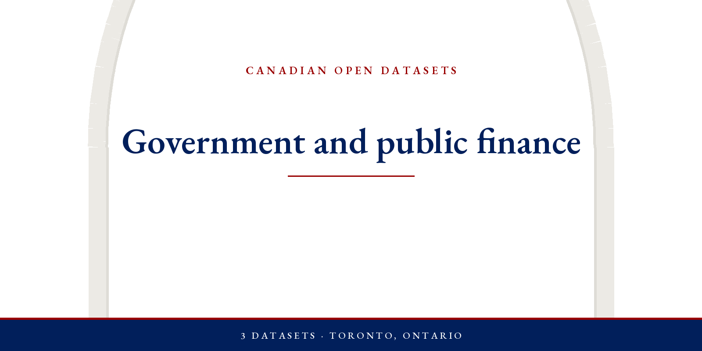

<p align="center"></p>

# Canada charities 2024 (CRA)

*CRA 2024 registered charities identification and T3010 finances*

**Theme:** [Government and public finance](../../README.md#government-and-public-finance) · **Coverage:** 2024 to 2024 · **Kaggle:** [https://www.kaggle.com/datasets/johnnykhan1/canada-charities-2024-cra](https://www.kaggle.com/datasets/johnnykhan1/canada-charities-2024-cra)

## What it is

Registered charities from the Canada Revenue Agency 2024 List of charities open data release, with identification, a plain-named financial summary, the full coded financial file, and general information.

Portal: [2024 List of charities](https://open.canada.ca/data/en/dataset/80c00cdb-1358-415c-bb8b-0de7f12675b8).

## Who it helps

Taxpayers, journalists, charity and non-profit staff, and public finance researchers.

## Files

| File | Size | Where |
|---|---:|---|
| [`charities_financial_all_codes.csv`](data/charities_financial_all_codes.csv) | 24.4 MB | in this repository |
| [`charities_financial_summary.csv`](data/charities_financial_summary.csv) | 7.6 MB | in this repository |
| [`charities_general_information.csv`](data/charities_general_information.csv) | 10.6 MB | in this repository |
| [`charities_identification.csv`](data/charities_identification.csv) | 12.0 MB | in this repository |
| [`data_dictionary.csv`](data/data_dictionary.csv) | 21 KB | in this repository |
| [`financial_field_codes.csv`](data/financial_field_codes.csv) | 1 KB | in this repository |

## Columns

### `charities_financial_all_codes.csv`

Full financial open data file with original numeric field codes.

| Column | Type | Description |
|---|---|---|
| `bn` | Text | Business Number of the charity. |
| `fpe` | Date | Fiscal period end date for the T3010 return. |
| `form_id` | Text | Form identifier for the return. |
| `section_used` | Text | Which financial section of the return was used. |
| `4020` | Text | CRA financial field code 4020. See financial_field_codes.csv for common codes. |
| `4050` | Boolean | CRA financial field code 4050. See financial_field_codes.csv for common codes. |
| `4100` | Float | CRA financial field code 4100. See financial_field_codes.csv for common codes. |
| `4110` | Float | CRA financial field code 4110. See financial_field_codes.csv for common codes. |
| `4120` | Float | CRA financial field code 4120. See financial_field_codes.csv for common codes. |
| `4130` | Float | CRA financial field code 4130. See financial_field_codes.csv for common codes. |
| `4140` | Float | CRA financial field code 4140. See financial_field_codes.csv for common codes. |
| `4150` | Float | CRA financial field code 4150. See financial_field_codes.csv for common codes. |
| `4155` | Float | CRA financial field code 4155. See financial_field_codes.csv for common codes. |
| `4160` | Float | CRA financial field code 4160. See financial_field_codes.csv for common codes. |
| `4165` | Float | CRA financial field code 4165. See financial_field_codes.csv for common codes. |
| `4166` | Float | CRA financial field code 4166. See financial_field_codes.csv for common codes. |
| `4170` | Float | CRA financial field code 4170. See financial_field_codes.csv for common codes. |
| `4180` | Text | CRA financial field code 4180. See financial_field_codes.csv for common codes. |
| `4200` | Float | CRA financial field code 4200. See financial_field_codes.csv for common codes. |
| `4250` | Float | CRA financial field code 4250. See financial_field_codes.csv for common codes. |
| `4300` | Float | CRA financial field code 4300. See financial_field_codes.csv for common codes. |
| `4310` | Float | CRA financial field code 4310. See financial_field_codes.csv for common codes. |
| `4320` | Float | CRA financial field code 4320. See financial_field_codes.csv for common codes. |
| `4330` | Float | CRA financial field code 4330. See financial_field_codes.csv for common codes. |
| `4350` | Float | CRA financial field code 4350. See financial_field_codes.csv for common codes. |
| `4400` | Boolean | CRA financial field code 4400. See financial_field_codes.csv for common codes. |
| `4490` | Boolean | CRA financial field code 4490. See financial_field_codes.csv for common codes. |
| `4500` | Float | CRA financial field code 4500. See financial_field_codes.csv for common codes. |
| `5610` | Float | CRA financial field code 5610. See financial_field_codes.csv for common codes. |
| `4505` | Text | CRA financial field code 4505. See financial_field_codes.csv for common codes. |
| `4510` | Float | CRA financial field code 4510. See financial_field_codes.csv for common codes. |
| `4530` | Float | CRA financial field code 4530. See financial_field_codes.csv for common codes. |
| `4540` | Float | CRA financial field code 4540. See financial_field_codes.csv for common codes. |
| `4550` | Float | CRA financial field code 4550. See financial_field_codes.csv for common codes. |
| `4560` | Float | CRA financial field code 4560. See financial_field_codes.csv for common codes. |
| `4565` | Boolean | CRA financial field code 4565. See financial_field_codes.csv for common codes. |
| `4570` | Float | CRA financial field code 4570. See financial_field_codes.csv for common codes. |
| `4571` | Float | CRA financial field code 4571. See financial_field_codes.csv for common codes. |
| `4575` | Float | CRA financial field code 4575. See financial_field_codes.csv for common codes. |
| `4580` | Float | CRA financial field code 4580. See financial_field_codes.csv for common codes. |
| `4590` | Float | CRA financial field code 4590. See financial_field_codes.csv for common codes. |
| `4600` | Float | CRA financial field code 4600. See financial_field_codes.csv for common codes. |
| `4610` | Float | CRA financial field code 4610. See financial_field_codes.csv for common codes. |
| `4620` | Float | CRA financial field code 4620. See financial_field_codes.csv for common codes. |
| `4630` | Float | CRA financial field code 4630. See financial_field_codes.csv for common codes. |
| `4640` | Float | CRA financial field code 4640. See financial_field_codes.csv for common codes. |
| `4650` | Float | CRA financial field code 4650. See financial_field_codes.csv for common codes. |
| `4655` | Text | CRA financial field code 4655. See financial_field_codes.csv for common codes. |
| `4700` | Float | CRA financial field code 4700. See financial_field_codes.csv for common codes. |
| `4800` | Float | CRA financial field code 4800. See financial_field_codes.csv for common codes. |
| `4810` | Float | CRA financial field code 4810. See financial_field_codes.csv for common codes. |
| `4820` | Float | CRA financial field code 4820. See financial_field_codes.csv for common codes. |
| `4830` | Float | CRA financial field code 4830. See financial_field_codes.csv for common codes. |
| `4840` | Float | CRA financial field code 4840. See financial_field_codes.csv for common codes. |
| `4850` | Float | CRA financial field code 4850. See financial_field_codes.csv for common codes. |
| `4860` | Float | CRA financial field code 4860. See financial_field_codes.csv for common codes. |
| `4870` | Float | CRA financial field code 4870. See financial_field_codes.csv for common codes. |
| `4880` | Float | CRA financial field code 4880. See financial_field_codes.csv for common codes. |
| `4890` | Float | CRA financial field code 4890. See financial_field_codes.csv for common codes. |
| `4891` | Float | CRA financial field code 4891. See financial_field_codes.csv for common codes. |
| `4900` | Float | CRA financial field code 4900. See financial_field_codes.csv for common codes. |
| `4910` | Float | CRA financial field code 4910. See financial_field_codes.csv for common codes. |
| `4920` | Float | CRA financial field code 4920. See financial_field_codes.csv for common codes. |
| `4930` | Text | CRA financial field code 4930. See financial_field_codes.csv for common codes. |
| `4950` | Float | CRA financial field code 4950. See financial_field_codes.csv for common codes. |
| `5000` | Float | CRA financial field code 5000. See financial_field_codes.csv for common codes. |
| `5010` | Float | CRA financial field code 5010. See financial_field_codes.csv for common codes. |
| `5020` | Float | CRA financial field code 5020. See financial_field_codes.csv for common codes. |
| `5030` | Text | CRA financial field code 5030. See financial_field_codes.csv for common codes. |
| `5040` | Float | CRA financial field code 5040. See financial_field_codes.csv for common codes. |
| `5050` | Float | CRA financial field code 5050. See financial_field_codes.csv for common codes. |
| `5100` | Float | CRA financial field code 5100. See financial_field_codes.csv for common codes. |
| `5500` | Float | CRA financial field code 5500. See financial_field_codes.csv for common codes. |
| `5510` | Float | CRA financial field code 5510. See financial_field_codes.csv for common codes. |
| `5750` | Float | CRA financial field code 5750. See financial_field_codes.csv for common codes. |
| `5900` | Float | CRA financial field code 5900. See financial_field_codes.csv for common codes. |
| `5910` | Float | CRA financial field code 5910. See financial_field_codes.csv for common codes. |
| `5045` | Float | CRA financial field code 5045. See financial_field_codes.csv for common codes. |
| `4101` | Float | CRA financial field code 4101. See financial_field_codes.csv for common codes. |
| `4102` | Float | CRA financial field code 4102. See financial_field_codes.csv for common codes. |
| `4157` | Float | CRA financial field code 4157. See financial_field_codes.csv for common codes. |
| `4158` | Float | CRA financial field code 4158. See financial_field_codes.csv for common codes. |
| `4190` | Float | CRA financial field code 4190. See financial_field_codes.csv for common codes. |
| `4576` | Float | CRA financial field code 4576. See financial_field_codes.csv for common codes. |
| `4577` | Float | CRA financial field code 4577. See financial_field_codes.csv for common codes. |

### `charities_financial_summary.csv`

Selected T3010 financial fields with plain column names.

| Column | Type | Description |
|---|---|---|
| `bn` | Text | Business Number of the charity. |
| `fpe` | Date | Fiscal period end date for the T3010 return. |
| `form_id` | Text | Form identifier for the return. |
| `section_used` | Text | Which financial section of the return was used. |
| `total_revenue` | Text | T3010 financial field: total revenue. |
| `total_expenditures` | Text | T3010 financial field: total expenditures. |
| `cash_bank_accounts_and_short_term_investments` | Float | T3010 financial field: cash bank accounts and short term investments. |
| `amounts_receivable_from_non_arm_s_length_parties` | Float | T3010 financial field: amounts receivable from non arm s length parties. |
| `amounts_receivable_from_all_others` | Float | T3010 financial field: amounts receivable from all others. |
| `investments_in_non_arm_s_length_parties` | Float | T3010 financial field: investments in non arm s length parties. |
| `long_term_investments` | Float | T3010 financial field: long term investments. |
| `inventories` | Float | T3010 financial field: inventories. |
| `land_and_buildings_in_canada` | Float | T3010 financial field: land and buildings in canada. |
| `other_capital_assets_in_canada` | Float | T3010 financial field: other capital assets in canada. |
| `capital_assets_outside_canada` | Float | T3010 financial field: capital assets outside canada. |
| `accumulated_amortization_of_capital_assets` | Float | T3010 financial field: accumulated amortization of capital assets. |
| `other_assets` | Float | T3010 financial field: other assets. |
| `total_assets` | Text | T3010 financial field: total assets. |
| `accounts_payable_and_accrued_liabilities` | Float | T3010 financial field: accounts payable and accrued liabilities. |
| `deferred_revenue` | Float | T3010 financial field: deferred revenue. |
| `amounts_owing_to_non_arm_s_length_parties` | Float | T3010 financial field: amounts owing to non arm s length parties. |
| `other_liabilities` | Float | T3010 financial field: other liabilities. |
| `total_liabilities` | Float | T3010 financial field: total liabilities. |
| `total_net_assets_or_fund_balances` | Text | T3010 financial field: total net assets or fund balances. |

### `charities_general_information.csv`

General information / program description fields.

| Column | Type | Description |
|---|---|---|
| `bn` | Text | Business Number of the charity. |
| `fpe` | Date | Fiscal period end date for the T3010 return. |
| `form_id` | Text | Form identifier for the return. |
| `program_num1_code` | Text | program num1 code from the CRA general information file. |
| `program_num1_pct` | Float | program num1 pct from the CRA general information file. |
| `program_num1_desc` | Text | program num1 desc from the CRA general information file. |
| `program_num2_code` | Text | program num2 code from the CRA general information file. |
| `program_num2_pct` | Float | program num2 pct from the CRA general information file. |
| `program_num2_desc` | Text | program num2 desc from the CRA general information file. |
| `program_num3_code` | Text | program num3 code from the CRA general information file. |
| `program_num3_pct` | Float | program num3 pct from the CRA general information file. |
| `program_num3_desc` | Text | program num3 desc from the CRA general information file. |
| `n_1510` | Boolean | n 1510 from the CRA general information file. |
| `n_1510_bn` | Text | n 1510 bn from the CRA general information file. |
| `n_1510_name` | Text | n 1510 name from the CRA general information file. |
| `n_1570` | Boolean | n 1570 from the CRA general information file. |
| `n_1600` | Boolean | n 1600 from the CRA general information file. |
| `n_1800` | Boolean | n 1800 from the CRA general information file. |
| `n_2000` | Boolean | n 2000 from the CRA general information file. |
| `n_2100` | Boolean | n 2100 from the CRA general information file. |
| `n_2400` | Text | n 2400 from the CRA general information file. |
| `n_5030` | Text | n 5030 from the CRA general information file. |
| `n_5031` | Text | n 5031 from the CRA general information file. |
| `n_5032` | Text | n 5032 from the CRA general information file. |
| `n_2500` | Boolean | n 2500 from the CRA general information file. |
| `n_2510` | Boolean | n 2510 from the CRA general information file. |
| `n_2530` | Boolean | n 2530 from the CRA general information file. |
| `n_2540` | Boolean | n 2540 from the CRA general information file. |
| `n_2550` | Boolean | n 2550 from the CRA general information file. |
| `n_2560` | Boolean | n 2560 from the CRA general information file. |
| `n_2570` | Boolean | n 2570 from the CRA general information file. |
| `n_2575` | Boolean | n 2575 from the CRA general information file. |
| `n_2580` | Boolean | n 2580 from the CRA general information file. |
| `n_2590` | Boolean | n 2590 from the CRA general information file. |
| `n_2600` | Boolean | n 2600 from the CRA general information file. |
| `n_2610` | Boolean | n 2610 from the CRA general information file. |
| `n_2620` | Boolean | n 2620 from the CRA general information file. |
| `n_2630` | Boolean | n 2630 from the CRA general information file. |
| `n_2640` | Boolean | n 2640 from the CRA general information file. |
| `n_2650` | Boolean | n 2650 from the CRA general information file. |
| `n_2660` | Text | n 2660 from the CRA general information file. |
| `n_2700` | Boolean | n 2700 from the CRA general information file. |
| `n_5450` | Float | n 5450 from the CRA general information file. |
| `n_5460` | Float | n 5460 from the CRA general information file. |
| `n_2730` | Boolean | n 2730 from the CRA general information file. |
| `n_2740` | Text | n 2740 from the CRA general information file. |
| `n_2750` | Text | n 2750 from the CRA general information file. |
| `n_2760` | Boolean | n 2760 from the CRA general information file. |
| `n_2770` | Text | n 2770 from the CRA general information file. |
| `n_2780` | Boolean | n 2780 from the CRA general information file. |
| `n_2790` | Text | n 2790 from the CRA general information file. |
| `n_2800` | Boolean | n 2800 from the CRA general information file. |
| `n_3200` | Boolean | n 3200 from the CRA general information file. |
| `n_3400` | Boolean | n 3400 from the CRA general information file. |
| `n_3900` | Boolean | n 3900 from the CRA general information file. |
| `n_4000` | Boolean | n 4000 from the CRA general information file. |
| `n_5800` | Boolean | n 5800 from the CRA general information file. |
| `n_5810` | Boolean | n 5810 from the CRA general information file. |
| `n_5820` | Boolean | n 5820 from the CRA general information file. |
| `n_5830` | Boolean | n 5830 from the CRA general information file. |
| `n_5840` | Boolean | n 5840 from the CRA general information file. |
| `n_5841` | Boolean | n 5841 from the CRA general information file. |
| `n_5842` | Float | n 5842 from the CRA general information file. |
| `n_5843` | Float | n 5843 from the CRA general information file. |
| `n_5850` | Boolean | n 5850 from the CRA general information file. |
| `n_5860` | Boolean | n 5860 from the CRA general information file. |
| `n_5861` | Float | n 5861 from the CRA general information file. |
| `n_5862` | Float | n 5862 from the CRA general information file. |
| `n_5863` | Float | n 5863 from the CRA general information file. |
| `n_5864` | Float | n 5864 from the CRA general information file. |

### `charities_identification.csv`

Charity identification and address fields from the 2024 CRA list.

| Column | Type | Description |
|---|---|---|
| `bn` | Text | Business Number of the charity. |
| `category` | Integer | Charity category as published by CRA. |
| `sub_category` | Integer | Charity sub-category as published by CRA. |
| `designation` | Text | Designation such as charitable organization, public foundation or private foundation. |
| `legal_name` | Text | Legal name of the charity. |
| `account_name` | Text | Account name as published. |
| `address_line_1` | Text | Address line 1. |
| `address_line_2` | Text | Address line 2. |
| `city` | Text | City. |
| `province` | Text | Province or territory. |
| `postal_code` | Text | Postal code. |
| `country` | Text | Country. |

### `data_dictionary.csv`

Column dictionary for every CSV in this dataset.

| Column | Type | Description |
|---|---|---|
| `column` | Text | Column name. |
| `file` | Text | CSV file the column belongs to. |
| `type` | Text | Field type. |
| `description` | Text | What the column contains. |

### `financial_field_codes.csv`

Lookup for commonly used financial field codes.

| Column | Type | Description |
|---|---|---|
| `field_code` | Integer | Numeric field code from the CRA charities open data financial file. |
| `field_name` | Text | Plain snake_case name used in charities_financial_summary.csv. |
| `description` | Text | Plain-language description of the financial field. |

## Source and licence

**Source:** Canada Revenue Agency, 2024 List of charities on open.canada.ca (https://open.canada.ca/data/en/dataset/80c00cdb-1358-415c-bb8b-0de7f12675b8). Identification, financial and general information CSVs downloaded November 9, 2026. Prepared by John Khan in Toronto, Ontario. Open Government Licence – Canada: https://open.canada.ca/en/open-government-licence-canada. Downloaded from the official open data release and reshaped into tidy CSV files by John Khan, November 2026.

- **Licence:** [Open Government Licence – Canada 2.0](https://open.canada.ca/en/open-government-licence-canada). Contains information licensed under the Open Government Licence – Canada.

The published values were not changed beyond what is described here. The full licence terms for this folder are in [LICENSE.md](LICENSE.md).

## Citation

No DOI has been minted for this dataset yet; please cite the Kaggle page.

```bibtex
@misc{khan2026canadacharities2024cra,
  author    = {Khan, John},
  title     = {Canada charities 2024 (CRA)},
  year      = {2026},
  publisher = {Kaggle},
  address   = {Toronto, Ontario, Canada},
  url       = {https://www.kaggle.com/datasets/johnnykhan1/canada-charities-2024-cra}
}
```

APA: Khan, J. (2026). *Canada charities 2024 (CRA)* [Data set]. Kaggle. https://www.kaggle.com/datasets/johnnykhan1/canada-charities-2024-cra

<details><summary>Full notes from the Kaggle page</summary>

## What this is

Registered charities from the Canada Revenue Agency 2024 List of charities open data release, with identification, a plain-named financial summary, the full coded financial file, and general information.

Portal: [2024 List of charities](https://open.canada.ca/data/en/dataset/80c00cdb-1358-415c-bb8b-0de7f12675b8).

## Coverage

Tax year / list vintage 2024 as published by CRA. 83,761 identification rows in this snapshot.

## Updates

Snapshot from November 9, 2026. CRA publishes these lists periodically. This upload is not auto refreshed.

## A few numbers from this snapshot

* Identification file has 83,761 charity accounts.
* Financial summary keeps 20 commonly used T3010 fields with plain names.
* Top province by count in this snapshot: ON with 30,570 charities.

## Example uses

* Map charities by province and category.
* Study revenue and expenditure distributions.
* Join to Census geography via postal code (with care).

## Caveats

* Financial figures are as filed on T3010 returns and can be missing or zero for some accounts.
* The full financial file uses numeric field codes. `financial_field_codes.csv` documents common ones only.
* Address fields are public registry information for organizations, not private individuals.
* This is not a substitute for the official CRA charity listing for legal due diligence.

## Licence

Shared under the [Open Government Licence – Canada](https://open.canada.ca/en/open-government-licence-canada). Source: Canada Revenue Agency. Not an official CRA product.

Author: John Khan, Toronto, Ontario.

</details>

---
Compiled by John Khan, Toronto, Ontario. Part of the [Canadian Open Datasets](../../README.md) catalogue.
