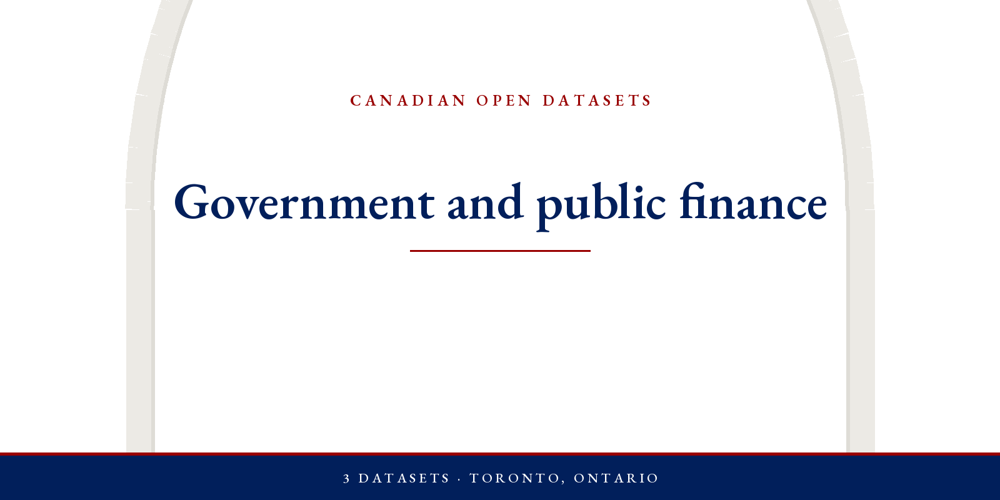

<p align="center"></p>

# Canada defence expenditure (CCOFOG)

*Government defence spending by function, 2008 to 2024*

**Theme:** [Government and public finance](../../README.md#government-and-public-finance) · **Coverage:** 2008 to 2024 · **Kaggle:** [https://www.kaggle.com/datasets/johnnykhan1/canada-defence-expenditure-ccofog](https://www.kaggle.com/datasets/johnnykhan1/canada-defence-expenditure-ccofog)

## What it is

Government expenditure by function from the Canadian Classification of Functions of Government (CCOFOG), tidied from Statistics Canada Table 10-10-0024. The table identifies the federal government separately from provincial and territorial governments, municipalities, school boards, and other public sector components. A second file keeps only the defence functions so they are easy to chart against the rest of the budget.

Source table: [10-10-0024-01](https://www150.statcan.gc.ca/t1/tbl1/en/tv.action?pid=1010002401).

## Who it helps

Taxpayers, journalists, charity and non-profit staff, and public finance researchers.

## Files

| File | Size | Where |
|---|---:|---|
| [`ccofog_expenditure.csv`](data/ccofog_expenditure.csv) | 2.8 MB | in this repository |
| [`data_dictionary.csv`](data/data_dictionary.csv) | 4 KB | in this repository |
| [`dataset-metadata.FIXED.json`](data/dataset-metadata.FIXED.json) | 14 KB | in this repository |
| [`defence_expenditure.csv`](data/defence_expenditure.csv) | 216 KB | in this repository |
| [`statcan_table_metadata.csv`](data/statcan_table_metadata.csv) | 9 KB | in this repository |

## Columns

### `ccofog_expenditure.csv`

All Canadian Classification of Functions of Government spending by public sector component and geography, from Table 10-10-0024.

| Column | Type | Description |
|---|---|---|
| `ref_date` | Date | Reference period as published by Statistics Canada. Monthly tables use the first day of the month, quarterly tables use the first day of the quarter, and annual tables use the calendar year. |
| `geo` | Text | Geography name as published by Statistics Canada, with extra whitespace removed. |
| `dguid` | Text | Statistics Canada Dissemination Geography Unique Identifier for the geography. |
| `public_sector_component` | Text | Which part of the public sector the spending belongs to, for example the federal government or provincial and territorial governments. |
| `ccofog` | Text | Function of government from the Canadian Classification of Functions of Government, including the published code. |
| `unit_of_measure` | Text | Unit of measure for value, as published. |
| `unit_of_measure_id` | Text | Statistics Canada numeric code for the unit of measure. |
| `scalar_factor` | Text | Scale of value (for example units, thousands or millions). Value is already expressed at this scale. |
| `scalar_id` | Text | Statistics Canada numeric code for the scalar factor. |
| `vector` | Text | Statistics Canada vector identifier for the series. Useful if you want to pull the same series again. |
| `coordinate` | Text | Statistics Canada coordinate string that locates the series inside the table. |
| `value` | Integer | The published value. Empty when Statistics Canada did not publish a figure for that period (see status and symbol). |
| `status` | Text | Statistics Canada status symbol when a value is missing or qualified. Empty means a regular published value. See the symbol legend in the official metadata file. |
| `symbol` | Text | Additional Statistics Canada symbol when present, otherwise empty. |
| `terminated` | Text | t if Statistics Canada has terminated this series, otherwise empty. |
| `decimals` | Integer | Number of decimal places Statistics Canada uses when displaying the value. |

### `data_dictionary.csv`

Column dictionary for every CSV in this dataset.

| Column | Type | Description |
|---|---|---|
| `column` | Text | Column name. |
| `file` | Text | CSV file the column belongs to. |
| `type` | Text | Field type. |
| `description` | Text | What the column contains. |

### `defence_expenditure.csv`

Rows whose CCOFOG function is defence, including military defence, civil defence, foreign military aid and residual defence categories.

| Column | Type | Description |
|---|---|---|
| `ref_date` | Date | Reference period as published by Statistics Canada. Monthly tables use the first day of the month, quarterly tables use the first day of the quarter, and annual tables use the calendar year. |
| `geo` | Text | Geography name as published by Statistics Canada, with extra whitespace removed. |
| `dguid` | Text | Statistics Canada Dissemination Geography Unique Identifier for the geography. |
| `public_sector_component` | Text | Which part of the public sector the spending belongs to, for example the federal government or provincial and territorial governments. |
| `ccofog` | Text | Function of government from the Canadian Classification of Functions of Government, including the published code. |
| `unit_of_measure` | Text | Unit of measure for value, as published. |
| `unit_of_measure_id` | Text | Statistics Canada numeric code for the unit of measure. |
| `scalar_factor` | Text | Scale of value (for example units, thousands or millions). Value is already expressed at this scale. |
| `scalar_id` | Text | Statistics Canada numeric code for the scalar factor. |
| `vector` | Text | Statistics Canada vector identifier for the series. Useful if you want to pull the same series again. |
| `coordinate` | Text | Statistics Canada coordinate string that locates the series inside the table. |
| `value` | Integer | The published value. Empty when Statistics Canada did not publish a figure for that period (see status and symbol). |
| `status` | Text | Statistics Canada status symbol when a value is missing or qualified. Empty means a regular published value. See the symbol legend in the official metadata file. |
| `symbol` | Text | Additional Statistics Canada symbol when present, otherwise empty. |
| `terminated` | Text | t if Statistics Canada has terminated this series, otherwise empty. |
| `decimals` | Integer | Number of decimal places Statistics Canada uses when displaying the value. |

### `statcan_table_metadata.csv`

Official Statistics Canada cube metadata shipped with Table 10-10-0024-01, including notes and the symbol legend. Layout is as published, not tidied.

| Column | Type | Description |
|---|---|---|
| `Cube Title` | Text | Column Cube Title from the official source metadata file, as published. |
| `Product Id` | Text | Column Product Id from the official source metadata file, as published. |
| `CANSIM Id` | Text | Column CANSIM Id from the official source metadata file, as published. |
| `URL` | Text | Column URL from the official source metadata file, as published. |
| `Cube Notes` | Text | Column Cube Notes from the official source metadata file, as published. |
| `Archive Status` | Text | Column Archive Status from the official source metadata file, as published. |
| `Frequency` | Text | Column Frequency from the official source metadata file, as published. |
| `Start Reference Period` | Text | Column Start Reference Period from the official source metadata file, as published. |
| `End Reference Period` | Date | Column End Reference Period from the official source metadata file, as published. |
| `Total number of dimensions` | Integer | Column Total number of dimensions from the official source metadata file, as published. |

## Source and licence

**Source:** Statistics Canada Table 10-10-0024-01 (https://www150.statcan.gc.ca/t1/tbl1/en/tv.action?pid=1010002401, https://www150.statcan.gc.ca/n1/tbl/csv/10100024-eng.zip). Full table CSV downloaded on November 12, 2026. Prepared by John Khan in Toronto, Ontario. Shared under the Statistics Canada Open Licence, https://www.statcan.gc.ca/en/terms-conditions/open-licence.

- **Licence:** [Statistics Canada Open Licence](https://www.statcan.gc.ca/en/terms-conditions/open-licence). Source: Statistics Canada. This is an adaptation of Statistics Canada data; it does not constitute an endorsement by Statistics Canada.

The published values were not changed beyond what is described here. The full licence terms for this folder are in [LICENSE.md](LICENSE.md).

## Citation

No DOI has been minted for this dataset yet; please cite the Kaggle page.

```bibtex
@misc{khan2026canadadefenceexpenditureccofog,
  author    = {Khan, John},
  title     = {Canada defence expenditure (CCOFOG)},
  year      = {2026},
  publisher = {Kaggle},
  address   = {Toronto, Ontario, Canada},
  url       = {https://www.kaggle.com/datasets/johnnykhan1/canada-defence-expenditure-ccofog}
}
```

APA: Khan, J. (2026). *Canada defence expenditure (CCOFOG)* [Data set]. Kaggle. https://www.kaggle.com/datasets/johnnykhan1/canada-defence-expenditure-ccofog

<details><summary>Full notes from the Kaggle page</summary>

## What this is

Government expenditure by function from the Canadian Classification of Functions of Government (CCOFOG), tidied from Statistics Canada Table 10-10-0024. The table identifies the federal government separately from provincial and territorial governments, municipalities, school boards, and other public sector components. A second file keeps only the defence functions so they are easy to chart against the rest of the budget.

Source table: [10-10-0024-01](https://www150.statcan.gc.ca/t1/tbl1/en/tv.action?pid=1010002401).

## Coverage

Annual figures from 2008 to 2024 for Canada and the provinces and territories, by public sector component and CCOFOG function.

## Updates

This upload is a snapshot from November 12, 2026 and is not refreshed on a schedule. Statistics Canada updates the table annually. Download the table again for a later year.

## A few numbers from this snapshot

* Federal defence expenditure in Canada was 28,106 dollars (scale: millions) in 2024, function Defence [702].
* Military defence [7021] on the same basis was 25,792.
* The status flag on the latest Defence [702] figure is blank (a regular published value).
* The full CCOFOG file has 18,260 rows from 2008 to 2024, across 14 geographies and 8 public sector components. The defence extract has 1,558 rows.

## Example uses

* Follow federal defence spending and its military, civil and residual components.
* Compare defence with health, education or public order in the full CCOFOG file.
* Put provincial public-order spending next to federal defence where that comparison is useful.

## Caveats

Values are already expressed at the published scalar factor, usually millions of dollars. Check the scalar_factor column before you sum or compare. The latest year can be marked preliminary (status p) and is subject to revision. CCOFOG defence is a government-finance classification. It is not a Canadian Armed Forces headcount or a list of operations. Provincial and territorial rows have little or no military defence; most defence spending sits in the federal government component.

## Files

* `ccofog_expenditure.csv`: All functions and public sector components.
* `defence_expenditure.csv`: Defence functions only.
* `data_dictionary.csv`: Column dictionary.
* `statcan_table_metadata.csv`: Official Statistics Canada notes.
* `cover.png`: Cover chart of federal defence expenditure.

## Licence

This dataset is shared under the [Statistics Canada Open Licence](https://www.statcan.gc.ca/en/terms-conditions/open-licence). Source: Statistics Canada, Table 10-10-0024-01. The published values were not changed. Columns were renamed, the file layout was tidied, and some dimensions were filtered as described above. This is not an official Statistics Canada product and Statistics Canada does not endorse it.

Author: John Khan, Toronto, Ontario.

</details>

---
Compiled by John Khan, Toronto, Ontario. Part of the [Canadian Open Datasets](../../README.md) catalogue.
