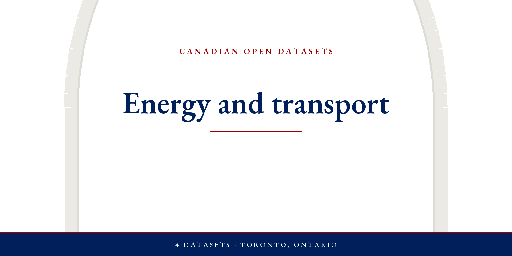

<p align="center"></p>

# Canada electricity generation and capacity

*Observed StatCan generation and capacity, 2005 to 2025*

**Theme:** [Energy and transport](../../README.md#energy-and-transport) · **Coverage:** 1 January 2005 to 19 October 2026 · **Kaggle:** [https://www.kaggle.com/datasets/johnnykhan1/canada-electricity-generation-capacity](https://www.kaggle.com/datasets/johnnykhan1/canada-electricity-generation-capacity)

## What it is

Observed electricity generation and installed capacity for Canada and the provinces, tidied from [Table 25-10-0020-01](https://www150.statcan.gc.ca/t1/tbl1/en/tv.action?pid=2510002001), [Table 25-10-0022-01](https://www150.statcan.gc.ca/t1/tbl1/en/tv.action?pid=2510002201) and [Table 25-10-0023-01](https://www150.statcan.gc.ca/t1/tbl1/en/tv.action?pid=2510002301). A documented technology crosswalk supports generation share and capacity share calculations, plus a reconciliation check against official totals. No capacity factor is calculated, and no Canadian Energy Regulator files are included.

## Who it helps

Drivers and fleet owners, energy analysts, rail and road safety staff, and anyone tracking Canada's power and fuel mix.

## Files

| File | Size | Where |
|---|---:|---|
| [`CITATION.txt`](data/CITATION.txt) | 1 KB | in this repository |
| [`METHODS.md`](data/METHODS.md) | 3 KB | in this repository |
| [`SOURCE_MANIFEST.csv`](data/SOURCE_MANIFEST.csv) | 1 KB | in this repository |
| [`capacity_shares.csv`](data/capacity_shares.csv) | 611 KB | in this repository |
| [`cover.png`](data/cover.png) | 60 KB | in this repository |
| [`data_dictionary.csv`](data/data_dictionary.csv) | 19 KB | in this repository |
| [`electricity_capacity.csv`](data/electricity_capacity.csv) | 1.4 MB | in this repository |
| [`electricity_generation.csv`](data/electricity_generation.csv) | 1.6 MB | in this repository |
| [`generation_shares.csv`](data/generation_shares.csv) | 991 KB | in this repository |
| [`statcan_metadata_25-10-0020.csv`](data/statcan_metadata_25-10-0020.csv) | 5 KB | in this repository |
| [`statcan_metadata_25-10-0022.csv`](data/statcan_metadata_25-10-0022.csv) | 5 KB | in this repository |
| [`statcan_metadata_25-10-0023.csv`](data/statcan_metadata_25-10-0023.csv) | 4 KB | in this repository |
| [`technology_crosswalk.csv`](data/technology_crosswalk.csv) | 3 KB | in this repository |
| [`thermal_capacity_by_fuel.csv`](data/thermal_capacity_by_fuel.csv) | 1.8 MB | in this repository |

## Columns

### `SOURCE_MANIFEST.csv`

| Column | Type | Description |
|---|---|---|
| `source_id` | Text | — |
| `title` | Text | — |
| `url` | Text | — |
| `licence` | Text | — |
| `release_date` | Date | — |
| `retrieval_date` | Date | — |
| `file_name` | Text | — |
| `checksum_sha256` | Text | — |
| `notes` | Text | How the type is used in shares and reconciliation. |

### `capacity_shares.csv`

| Column | Type | Description |
|---|---|---|
| `ref_date` | Date | Reference period as published by Statistics Canada. Monthly tables use the first day of the month, quarterly tables use the first day of the quarter, and annual tables use the calendar year. |
| `geo` | Text | Geography name as published by Statistics Canada, with extra whitespace removed. |
| `dguid` | Text | Dissemination Geography Unique Identifier as published by Statistics Canada, when the source provides one. |
| `class_of_electricity_producer` | Text | Class of electricity producer as published. |
| `type_of_electricity_generation` | Text | Official Statistics Canada type of electricity generation or capacity. |
| `unit_of_measure` | Text | Unit of measure for value, as published. |
| `unit_of_measure_id` | Text | Statistics Canada numeric code for the unit of measure. |
| `scalar_factor` | Text | Scale of value (for example units, thousands or millions). Value is already expressed at this scale. |
| `scalar_id` | Text | Statistics Canada numeric code for the scalar factor. |
| `vector` | Text | Statistics Canada vector identifier for the series. Useful if you want to pull the same series again. |
| `coordinate` | Text | Statistics Canada coordinate string that locates the series inside the table. |
| `value` | Float | The published value. Empty when Statistics Canada did not publish a figure for that period (see status and symbol). |
| `status` | Text | Statistics Canada status symbol when a value is missing or qualified. Empty means a regular published value. See the symbol legend in the official metadata file. |
| `symbol` | Text | Additional Statistics Canada symbol when present, otherwise empty. |
| `terminated` | Text | t if Statistics Canada has terminated this series, otherwise empty. |
| `decimals` | Integer | Number of decimal places Statistics Canada uses when displaying the value. |
| `ref_period` | Date | Reference period as published. |
| `year` | Integer | Calendar year of the reference period. |
| `technology_group` | Text | Documented group from technology_crosswalk.csv, for convenience. It is not an official Statistics Canada label. |
| `series_role` | Text | total for the official total, subtotal for an official published subtotal, and exclusive for a mutually exclusive type used in the reconciliation sum. |
| `iso3166_2` | Text | ISO 3166-2:CA code for a province or territory, such as CA-ON. Empty for Canada and for geography groups that are not a single province or territory. |
| `sgc` | Integer | Standard Geographic Classification code. 11124 is Canada. Two-digit codes are provinces or territories. Empty when a code is not available for this geography. |
| `value_kw` | Float | Official capacity in kilowatts, as published. |
| `value_mw` | Float | Official capacity in kilowatts divided by 1,000, giving megawatts. This conversion is adapted and is not a separately published Statistics Canada series. |
| `official_total` | Float | Official total for the same geography, year and class of producer (all types for generation, total installed capacity for capacity). |
| `capacity_share` | Float | This official capacity value divided by official total installed capacity. Adapted share, not an official share table. |
| `index` | Integer | index as published or derived in generation_shares.csv. |
| `sum_of_exclusive_types` | Float | Sum of mutually exclusive published types, as listed in the crosswalk, for the same geography, year and class. |
| `reconciliation_method` | Text | How the exclusive sum was formed. When official combustible-fuel leaf types are suppressed, the official combustible fuels total is used in their place. |
| `combustible_fuels_used_in_reconciliation` | Boolean | True when the official combustible fuels total was used in the exclusive sum because the published thermal leaf types were suppressed. |
| `reconciliation_residual` | Float | sum_of_exclusive_types minus the official total. A non-zero residual should be read as a check, not as a new official residual series. |
| `reconciliation_residual_share` | Float | reconciliation_residual divided by the official total. |

### `data_dictionary.csv`

| Column | Type | Description |
|---|---|---|
| `column` | Text | — |
| `file` | Text | — |
| `type` | Text | — |
| `description` | Text | — |

### `electricity_capacity.csv`

| Column | Type | Description |
|---|---|---|
| `ref_date` | Date | Reference period as published by Statistics Canada. Monthly tables use the first day of the month, quarterly tables use the first day of the quarter, and annual tables use the calendar year. |
| `geo` | Text | Geography name as published by Statistics Canada, with extra whitespace removed. |
| `dguid` | Text | Dissemination Geography Unique Identifier as published by Statistics Canada, when the source provides one. |
| `class_of_electricity_producer` | Text | Class of electricity producer as published. |
| `type_of_electricity_generation` | Text | Official Statistics Canada type of electricity generation or capacity. |
| `unit_of_measure` | Text | Unit of measure for value, as published. |
| `unit_of_measure_id` | Text | Statistics Canada numeric code for the unit of measure. |
| `scalar_factor` | Text | Scale of value (for example units, thousands or millions). Value is already expressed at this scale. |
| `scalar_id` | Text | Statistics Canada numeric code for the scalar factor. |
| `vector` | Text | Statistics Canada vector identifier for the series. Useful if you want to pull the same series again. |
| `coordinate` | Text | Statistics Canada coordinate string that locates the series inside the table. |
| `value` | Float | The published value. Empty when Statistics Canada did not publish a figure for that period (see status and symbol). |
| `status` | Text | Statistics Canada status symbol when a value is missing or qualified. Empty means a regular published value. See the symbol legend in the official metadata file. |
| `symbol` | Text | Additional Statistics Canada symbol when present, otherwise empty. |
| `terminated` | Text | t if Statistics Canada has terminated this series, otherwise empty. |
| `decimals` | Integer | Number of decimal places Statistics Canada uses when displaying the value. |
| `ref_period` | Date | Reference period as published. |
| `year` | Integer | Calendar year of the reference period. |
| `technology_group` | Text | Documented group from technology_crosswalk.csv, for convenience. It is not an official Statistics Canada label. |
| `series_role` | Text | total for the official total, subtotal for an official published subtotal, and exclusive for a mutually exclusive type used in the reconciliation sum. |
| `iso3166_2` | Text | ISO 3166-2:CA code for a province or territory, such as CA-ON. Empty for Canada and for geography groups that are not a single province or territory. |
| `sgc` | Integer | Standard Geographic Classification code. 11124 is Canada. Two-digit codes are provinces or territories. Empty when a code is not available for this geography. |
| `value_kw` | Float | Official capacity in kilowatts, as published. |
| `value_mw` | Float | Official capacity in kilowatts divided by 1,000, giving megawatts. This conversion is adapted and is not a separately published Statistics Canada series. |

### `electricity_generation.csv`

| Column | Type | Description |
|---|---|---|
| `ref_date` | Date | Reference period as published by Statistics Canada. Monthly tables use the first day of the month, quarterly tables use the first day of the quarter, and annual tables use the calendar year. |
| `geo` | Text | Geography name as published by Statistics Canada, with extra whitespace removed. |
| `dguid` | Text | Dissemination Geography Unique Identifier as published by Statistics Canada, when the source provides one. |
| `class_of_electricity_producer` | Text | Class of electricity producer as published. |
| `type_of_electricity_generation` | Text | Official Statistics Canada type of electricity generation or capacity. |
| `unit_of_measure` | Text | Unit of measure for value, as published. |
| `unit_of_measure_id` | Text | Statistics Canada numeric code for the unit of measure. |
| `scalar_factor` | Text | Scale of value (for example units, thousands or millions). Value is already expressed at this scale. |
| `scalar_id` | Text | Statistics Canada numeric code for the scalar factor. |
| `vector` | Text | Statistics Canada vector identifier for the series. Useful if you want to pull the same series again. |
| `coordinate` | Text | Statistics Canada coordinate string that locates the series inside the table. |
| `value` | Float | The published value. Empty when Statistics Canada did not publish a figure for that period (see status and symbol). |
| `status` | Text | Statistics Canada status symbol when a value is missing or qualified. Empty means a regular published value. See the symbol legend in the official metadata file. |
| `symbol` | Text | Additional Statistics Canada symbol when present, otherwise empty. |
| `terminated` | Text | t if Statistics Canada has terminated this series, otherwise empty. |
| `decimals` | Integer | Number of decimal places Statistics Canada uses when displaying the value. |
| `ref_period` | Date | Reference period as published. |
| `year` | Integer | Calendar year of the reference period. |
| `technology_group` | Text | Documented group from technology_crosswalk.csv, for convenience. It is not an official Statistics Canada label. |
| `series_role` | Text | total for the official total, subtotal for an official published subtotal, and exclusive for a mutually exclusive type used in the reconciliation sum. |
| `iso3166_2` | Text | ISO 3166-2:CA code for a province or territory, such as CA-ON. Empty for Canada and for geography groups that are not a single province or territory. |
| `sgc` | Integer | Standard Geographic Classification code. 11124 is Canada. Two-digit codes are provinces or territories. Empty when a code is not available for this geography. |
| `value_mwh` | Float | Official generation in megawatt hours. Same as value on the generation file. |

### `generation_shares.csv`

| Column | Type | Description |
|---|---|---|
| `ref_date` | Date | Reference period as published by Statistics Canada. Monthly tables use the first day of the month, quarterly tables use the first day of the quarter, and annual tables use the calendar year. |
| `geo` | Text | Geography name as published by Statistics Canada, with extra whitespace removed. |
| `dguid` | Text | Dissemination Geography Unique Identifier as published by Statistics Canada, when the source provides one. |
| `class_of_electricity_producer` | Text | Class of electricity producer as published. |
| `type_of_electricity_generation` | Text | Official Statistics Canada type of electricity generation or capacity. |
| `unit_of_measure` | Text | Unit of measure for value, as published. |
| `unit_of_measure_id` | Text | Statistics Canada numeric code for the unit of measure. |
| `scalar_factor` | Text | Scale of value (for example units, thousands or millions). Value is already expressed at this scale. |
| `scalar_id` | Text | Statistics Canada numeric code for the scalar factor. |
| `vector` | Text | Statistics Canada vector identifier for the series. Useful if you want to pull the same series again. |
| `coordinate` | Text | Statistics Canada coordinate string that locates the series inside the table. |
| `value` | Float | The published value. Empty when Statistics Canada did not publish a figure for that period (see status and symbol). |
| `status` | Text | Statistics Canada status symbol when a value is missing or qualified. Empty means a regular published value. See the symbol legend in the official metadata file. |
| `symbol` | Text | Additional Statistics Canada symbol when present, otherwise empty. |
| `terminated` | Text | t if Statistics Canada has terminated this series, otherwise empty. |
| `decimals` | Integer | Number of decimal places Statistics Canada uses when displaying the value. |
| `ref_period` | Date | Reference period as published. |
| `year` | Integer | Calendar year of the reference period. |
| `technology_group` | Text | Documented group from technology_crosswalk.csv, for convenience. It is not an official Statistics Canada label. |
| `series_role` | Text | total for the official total, subtotal for an official published subtotal, and exclusive for a mutually exclusive type used in the reconciliation sum. |
| `iso3166_2` | Text | ISO 3166-2:CA code for a province or territory, such as CA-ON. Empty for Canada and for geography groups that are not a single province or territory. |
| `sgc` | Integer | Standard Geographic Classification code. 11124 is Canada. Two-digit codes are provinces or territories. Empty when a code is not available for this geography. |
| `value_mwh` | Float | Official generation in megawatt hours. Same as value on the generation file. |
| `official_total` | Float | Official total for the same geography, year and class of producer (all types for generation, total installed capacity for capacity). |
| `generation_share` | Float | This official generation value divided by the official total all types figure. Adapted share, not an official share table. |
| `index` | Integer | index as published or derived in generation_shares.csv. |
| `sum_of_exclusive_types` | Float | Sum of mutually exclusive published types, as listed in the crosswalk, for the same geography, year and class. |
| `reconciliation_method` | Text | How the exclusive sum was formed. When official combustible-fuel leaf types are suppressed, the official combustible fuels total is used in their place. |
| `combustible_fuels_used_in_reconciliation` | Boolean | True when the official combustible fuels total was used in the exclusive sum because the published thermal leaf types were suppressed. |
| `reconciliation_residual` | Float | sum_of_exclusive_types minus the official total. A non-zero residual should be read as a check, not as a new official residual series. |
| `reconciliation_residual_share` | Float | reconciliation_residual divided by the official total. |

### `statcan_metadata_25-10-0020.csv`

| Column | Type | Description |
|---|---|---|
| `Cube Title` | Text | — |
| `Product Id` | Text | — |
| `CANSIM Id` | Text | — |
| `URL` | Text | — |
| `Cube Notes` | Text | — |
| `Archive Status` | Text | — |
| `Frequency` | Text | — |
| `Start Reference Period` | Text | — |
| `End Reference Period` | Date | — |
| `Total number of dimensions` | Integer | — |

### `statcan_metadata_25-10-0022.csv`

| Column | Type | Description |
|---|---|---|
| `Cube Title` | Text | — |
| `Product Id` | Text | — |
| `CANSIM Id` | Text | — |
| `URL` | Text | — |
| `Cube Notes` | Text | — |
| `Archive Status` | Text | — |
| `Frequency` | Text | — |
| `Start Reference Period` | Text | — |
| `End Reference Period` | Date | — |
| `Total number of dimensions` | Integer | — |

### `statcan_metadata_25-10-0023.csv`

| Column | Type | Description |
|---|---|---|
| `Cube Title` | Text | — |
| `Product Id` | Text | — |
| `CANSIM Id` | Text | — |
| `URL` | Text | — |
| `Cube Notes` | Text | — |
| `Archive Status` | Text | — |
| `Frequency` | Text | — |
| `Start Reference Period` | Text | — |
| `End Reference Period` | Date | — |
| `Total number of dimensions` | Integer | — |

### `technology_crosswalk.csv`

| Column | Type | Description |
|---|---|---|
| `official_type` | Text | Official Statistics Canada type name used in the generation or capacity cubes. |
| `technology_group` | Text | Documented group from technology_crosswalk.csv, for convenience. It is not an official Statistics Canada label. |
| `series_role` | Text | total for the official total, subtotal for an official published subtotal, and exclusive for a mutually exclusive type used in the reconciliation sum. |
| `applies_to` | Text | Whether the official type appears on the generation file, the capacity file, both, or the thermal capacity file. |
| `notes` | Text | How the type is used in shares and reconciliation. |

### `thermal_capacity_by_fuel.csv`

| Column | Type | Description |
|---|---|---|
| `ref_date` | Date | Reference period as published by Statistics Canada. Monthly tables use the first day of the month, quarterly tables use the first day of the quarter, and annual tables use the calendar year. |
| `geo` | Text | Geography name as published by Statistics Canada, with extra whitespace removed. |
| `dguid` | Text | Dissemination Geography Unique Identifier as published by Statistics Canada, when the source provides one. |
| `class_of_electricity_producer` | Text | Class of electricity producer as published. |
| `type_of_electricity_generation` | Text | Official Statistics Canada type of electricity generation or capacity. |
| `principal_fuel` | Text | Principal fuel for conventional thermal capacity, as published. |
| `unit_of_measure` | Text | Unit of measure for value, as published. |
| `unit_of_measure_id` | Text | Statistics Canada numeric code for the unit of measure. |
| `scalar_factor` | Text | Scale of value (for example units, thousands or millions). Value is already expressed at this scale. |
| `scalar_id` | Text | Statistics Canada numeric code for the scalar factor. |
| `vector` | Text | Statistics Canada vector identifier for the series. Useful if you want to pull the same series again. |
| `coordinate` | Text | Statistics Canada coordinate string that locates the series inside the table. |
| `value` | Float | The published value. Empty when Statistics Canada did not publish a figure for that period (see status and symbol). |
| `status` | Text | Statistics Canada status symbol when a value is missing or qualified. Empty means a regular published value. See the symbol legend in the official metadata file. |
| `symbol` | Text | Additional Statistics Canada symbol when present, otherwise empty. |
| `terminated` | Text | t if Statistics Canada has terminated this series, otherwise empty. |
| `decimals` | Integer | Number of decimal places Statistics Canada uses when displaying the value. |
| `ref_period` | Date | Reference period as published. |
| `year` | Integer | Calendar year of the reference period. |
| `iso3166_2` | Text | ISO 3166-2:CA code for a province or territory, such as CA-ON. Empty for Canada and for geography groups that are not a single province or territory. |
| `sgc` | Integer | Standard Geographic Classification code. 11124 is Canada. Two-digit codes are provinces or territories. Empty when a code is not available for this geography. |
| `value_kw` | Float | Official capacity in kilowatts, as published. |
| `value_mw` | Float | Official capacity in kilowatts divided by 1,000, giving megawatts. This conversion is adapted and is not a separately published Statistics Canada series. |

## Source and licence

- **Licence:** [Statistics Canada Open Licence](https://www.statcan.gc.ca/en/terms-conditions/open-licence). Source: Statistics Canada. This is an adaptation of Statistics Canada data; it does not constitute an endorsement by Statistics Canada.

The published values were not changed beyond what is described here. The full licence terms for this folder are in [LICENSE.md](LICENSE.md).

## Citation

No DOI has been minted for this dataset yet; please cite the Kaggle page.

```bibtex
@misc{khan2026canadaelectricitygenerationcapacity,
  author    = {Khan, John},
  title     = {Canada electricity generation and capacity},
  year      = {2026},
  publisher = {Kaggle},
  address   = {Toronto, Ontario, Canada},
  url       = {https://www.kaggle.com/datasets/johnnykhan1/canada-electricity-generation-capacity}
}
```

APA: Khan, J. (2026). *Canada electricity generation and capacity* [Data set]. Kaggle. https://www.kaggle.com/datasets/johnnykhan1/canada-electricity-generation-capacity

<details><summary>Full notes from the Kaggle page</summary>

## What this is

Observed electricity generation and installed capacity for Canada and the provinces, tidied from [Table 25-10-0020-01](https://www150.statcan.gc.ca/t1/tbl1/en/tv.action?pid=2510002001), [Table 25-10-0022-01](https://www150.statcan.gc.ca/t1/tbl1/en/tv.action?pid=2510002201) and [Table 25-10-0023-01](https://www150.statcan.gc.ca/t1/tbl1/en/tv.action?pid=2510002301). A documented technology crosswalk supports generation share and capacity share calculations, plus a reconciliation check against official totals. No capacity factor is calculated, and no Canadian Energy Regulator files are included.

## Coverage

Generation 2005 to 2025. Capacity 2006 to 2025. Canada, the provinces and the territories as published.

## Updates

This upload is a snapshot downloaded on 15 November 2026. Table release dates were 2026-10-16 for generation and 2026-10-19 for capacity.

## A few numbers from this snapshot

* The generation file has 7,263 official rows from 2005 to 2025, matching table 25-10-0020. Capacity tables match 25-10-0022 and 25-10-0023. No Canadian Energy Regulator files are included.
* In 2025, Canada produced 639,456,390 megawatt hours, total all types, total all classes of electricity producer, as published in table 25-10-0020.
* The same official total was 604,369,965 megawatt hours in 2005.
* For Canada in 2025, the sum of mutually exclusive published generation types minus the official total was 0.0 megawatt hours. That residual is a check against the official total, not a new official figure.

## Example uses

* Use official megawatt hour generation and official capacity, with megawatts provided as a documented conversion.
* Compare technology shares against official totals.
* Check that exclusive published types reconcile to the official total.

## Caveats

Generation share, capacity share, the megawatt conversion and the reconciliation residual are adapted figures. Official subtotals should not be added to exclusive types, or the official total will be double counted. Capacity figures end in a different year than generation when that is what the official cubes contain. No capacity factor is included.

## Files

* `electricity_generation.csv`: Official annual electricity generation by type and class of producer, in megawatt hours, from table 25-10-0020, with a documented technology group.
* `electricity_capacity.csv`: Official annual installed capacity by type and class of producer, with the official kilowatt value and a documented conversion to megawatts, from table 25-10-0022.
* `thermal_capacity_by_fuel.csv`: Official annual conventional thermal capacity by principal fuel, with official kilowatts and a conversion to megawatts, from table 25-10-0023.
* `generation_shares.csv`: Generation shares and a reconciliation of exclusive types against the official total, for all classes of producer. No capacity factor is calculated.
* `capacity_shares.csv`: Capacity shares and a reconciliation of exclusive types against official total installed capacity, for all classes of producer. No capacity factor is calculated.
* `technology_crosswalk.csv`: Documented mapping from official Statistics Canada generation or capacity types to a technology group and a series role used for shares and reconciliation.
* `SOURCE_MANIFEST.csv`: Source table identifiers, release dates, retrieval date and checksums.
* `data_dictionary.csv`: Column dictionary.
* `METHODS.md`: Methods note.
* `CITATION.txt`: Suggested citation, with DOI pending.
* `statcan_metadata_25-10-0020.csv`: Official Statistics Canada cube metadata for Table 25-10-0020-01.
* `statcan_metadata_25-10-0022.csv`: Official Statistics Canada cube metadata for Table 25-10-0022-01.
* `statcan_metadata_25-10-0023.csv`: Official Statistics Canada cube metadata for Table 25-10-0023-01.

## Licence

This dataset contains information licensed under the Statistics Canada Open Licence (https://www.statcan.gc.ca/en/reference/licence). Source: Statistics Canada, Table 25-10-0020, 25-10-0022 and 25-10-0023. This file is adapted from Statistics Canada official tables. Published values were not changed. Derived columns, such as shares, gaps, indexes or per capita figures, are calculated here and are not official Statistics Canada estimates. This is not an official Statistics Canada product and Statistics Canada does not endorse it.

Suggested citation: John Khan. 2026. Canada electricity generation and capacity [Data set]. Kaggle. https://www.kaggle.com/datasets/johnnykhan1/canada-electricity-generation-capacity. DOI pending.

</details>

---
Compiled by John Khan, Toronto, Ontario. Part of the [Canadian Open Datasets](../../README.md) catalogue.
