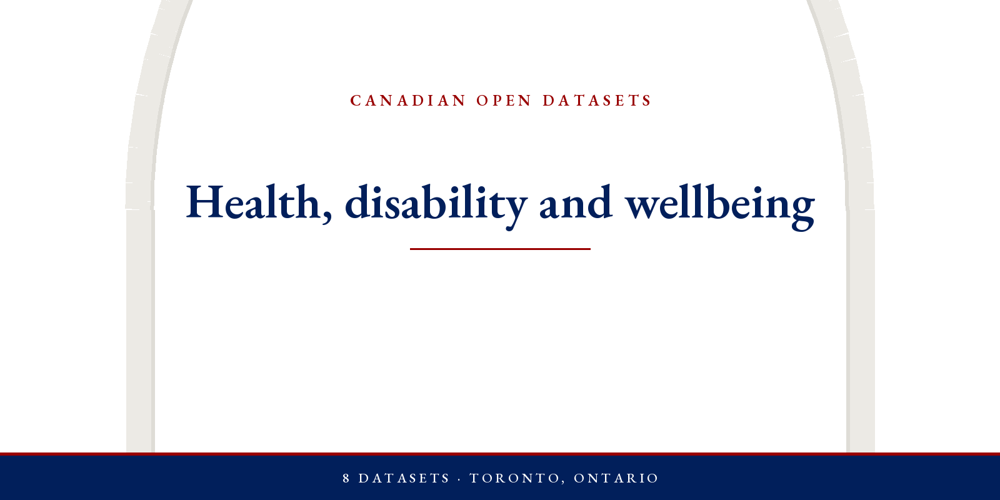

<p align="center"></p>

# Canada FluWatch respiratory detections

*Weekly lab detections, baselines and earlier FluWatch seasons*

**Theme:** [Health, disability and wellbeing](../../README.md#health-disability-and-wellbeing) · **Coverage:** 2013 to 2026 · **Kaggle:** [https://www.kaggle.com/datasets/johnnykhan1/canada-fluwatch-virus-detections](https://www.kaggle.com/datasets/johnnykhan1/canada-fluwatch-virus-detections)

## What it is

Laboratory detections and related FluWatch+ tables from the Public Health Agency of Canada's respiratory virus surveillance report, plus national weekly detections from older FluWatch open data seasons. The current-season file has tests, detections and percent positive by province or region and virus. Companion files hold season baselines, outbreak counts, hospitalization counts and rates from provincial and territorial severe outcomes surveillance, and the 2013-2014 to 2016-2017 national weekly tables.

FluWatch+ explore page: https://health-infobase.canada.ca/respiratory-virus-surveillance/explore.html

About FluWatch: https://www.canada.ca/en/public-health/services/diseases/flu-influenza/influenza-surveillance/about-fluwatch.html

Older season CSVs were pulled from https://health.canada.ca/apps/open-data/fluwatch/

Current-season laboratory, baseline, outbreak and hospitalization files were pulled on November 9, 2026. The laboratory update stamp in the source file is 2026-11-06 11:1:59.

## Who it helps

Patients and caregivers, disability advocates, public health teams, pharmacists, food security groups and health researchers.

## Files

| File | Size | Where |
|---|---:|---|
| [`cover.png`](data/cover.png) | 61 KB | in this repository |
| [`data_dictionary.csv`](data/data_dictionary.csv) | 5 KB | in this repository |
| [`historical_national_detections.csv`](data/historical_national_detections.csv) | 97 KB | in this repository |
| [`hospitalizations_ptsos.csv`](data/hospitalizations_ptsos.csv) | 8 KB | in this repository |
| [`outbreaks.csv`](data/outbreaks.csv) | 5 KB | in this repository |
| [`season_baselines_long.csv`](data/season_baselines_long.csv) | 288 KB | in this repository |
| [`weekly_detections.csv`](data/weekly_detections.csv) | 46 KB | in this repository |

## Columns

### `data_dictionary.csv`

Column dictionary for every CSV in this dataset.

| Column | Type | Description |
|---|---|---|
| `file` | Text | File that contains the column |
| `column` | Text | Name of the column being described |
| `type` | Text | Data type of the column |
| `description` | Text | Plain-language description of the column |

### `historical_national_detections.csv`

National weekly tests and detections from older FluWatch open data seasons 2013-2014 through 2016-2017.

| Column | Type | Description |
|---|---|---|
| `season` | Text | Older FluWatch season label, for example 2016-2017. |
| `year` | Integer | Calendar year associated with the surveillance week. |
| `week` | Integer | Epidemiological week number. |
| `virus` | Text | Virus name as published. In the current laboratory file this includes SARS-CoV-2, Influenza, Influenza A, Influenza B, RSV, HPIV, ADV, HMPV, EV/RV and HCoV. Historical names follow the older FluWatch tables. |
| `tests` | Float | Number of specimens tested for that virus and week. |
| `detections` | Float | Number of specimens positive for that virus and week. |

### `hospitalizations_ptsos.csv`

Weekly hospitalization counts and rates per 100,000 from provincial and territorial severe outcomes surveillance (PTSOS).

| Column | Type | Description |
|---|---|---|
| `year_week` | Integer | Six digit year and epidemiological week code (YYYYWW). |
| `week` | Integer | Epidemiological week number. |
| `week_ending_date` | Date | Date of the last day of the surveillance week (YYYY-MM-DD). Surveillance weeks run from Sunday to Saturday. |
| `virus` | Text | Virus name as published. In the current laboratory file this includes SARS-CoV-2, Influenza, Influenza A, Influenza B, RSV, HPIV, ADV, HMPV, EV/RV and HCoV. Historical names follow the older FluWatch tables. |
| `age_group` | Text | Age group as published, including All. |
| `hospitalization_count` | Integer | Number of hospitalizations from provincial and territorial severe outcomes surveillance (PTSOS) for that virus, age group and week. |
| `hospitalization_rate_per_100000` | Float | Hospitalization rate per 100,000 population from the PTSOS table, as published. |

### `outbreaks.csv`

Weekly outbreak counts by virus and setting from FluWatch+.

| Column | Type | Description |
|---|---|---|
| `virus` | Text | Virus name as published. In the current laboratory file this includes SARS-CoV-2, Influenza, Influenza A, Influenza B, RSV, HPIV, ADV, HMPV, EV/RV and HCoV. Historical names follow the older FluWatch tables. |
| `setting` | Text | Outbreak setting as published (for example Acute care). |
| `year_week` | Integer | Six digit year and epidemiological week code (YYYYWW). |
| `week` | Integer | Epidemiological week number. |
| `week_ending_date` | Date | Date of the last day of the surveillance week (YYYY-MM-DD). Surveillance weeks run from Sunday to Saturday. |
| `outbreak_count` | Integer | Number of outbreaks reported for that virus, setting and week. |

### `season_baselines_long.csv`

Canada-level percent positive baselines by virus and week, including recent seasons and pre-pandemic comparison series.

| Column | Type | Description |
|---|---|---|
| `region` | Text | Region name as published, including Canada, provincial groups such as Prairies or Atlantic, and individual provinces or territories. |
| `week` | Integer | Epidemiological week number. |
| `weekorder` | Integer | Order of the week within the current FluWatch+ season file. |
| `current_year_week` | Text | Current season year and week label as published (for example 2026-35). |
| `week_ending_date` | Date | Date of the last day of the surveillance week (YYYY-MM-DD). Surveillance weeks run from Sunday to Saturday. |
| `virus` | Text | Virus name as published. In the current laboratory file this includes SARS-CoV-2, Influenza, Influenza A, Influenza B, RSV, HPIV, ADV, HMPV, EV/RV and HCoV. Historical names follow the older FluWatch tables. |
| `series` | Text | Comparison series from the FluWatch+ baseline file, such as Season_2025_2026 or PrePandemicAverage. |
| `percent_positive` | Float | Percent of tests positive: detections divided by tests, times 100, as published. |

### `weekly_detections.csv`

Current FluWatch+ season weekly laboratory tests, detections and percent positive by province or region and virus.

| Column | Type | Description |
|---|---|---|
| `region` | Text | Region name as published, including Canada, provincial groups such as Prairies or Atlantic, and individual provinces or territories. |
| `province` | Text | Province, territory, regional group or Canada, as published in the FluWatch+ laboratory file. |
| `week` | Integer | Epidemiological week number. |
| `weekorder` | Integer | Order of the week within the current FluWatch+ season file. |
| `year` | Integer | Calendar year associated with the surveillance week. |
| `date` | Date | Week ending date (Saturday) in the current-season laboratory file (YYYY-MM-DD). |
| `virus` | Text | Virus name as published. In the current laboratory file this includes SARS-CoV-2, Influenza, Influenza A, Influenza B, RSV, HPIV, ADV, HMPV, EV/RV and HCoV. Historical names follow the older FluWatch tables. |
| `tests` | Float | Number of specimens tested for that virus and week. |
| `detections` | Float | Number of specimens positive for that virus and week. |
| `percent_positive` | Float | Percent of tests positive: detections divided by tests, times 100, as published. |

## Source and licence

**Source:** Public Health Agency of Canada, FluWatch / FluWatch+ Canadian respiratory virus surveillance report, https://health-infobase.canada.ca/respiratory-virus-surveillance/explore.html. About FluWatch: https://www.canada.ca/en/public-health/services/diseases/flu-influenza/influenza-surveillance/about-fluwatch.html. Current laboratory, baseline, outbreak and PTSOS hospitalization CSVs downloaded on November 9, 2026 from health-infobase.canada.ca. Historical national weekly CSVs for 2013-2014 through 2016-2017 from https://health.canada.ca/apps/open-data/fluwatch/. Prepared by John Khan in Toronto, Ontario. Contains information licensed under the Open Government Licence – Canada, https://open.canada.ca/en/open-government-licence-canada.

- **Licence:** [Open Government Licence – Canada 2.0](https://open.canada.ca/en/open-government-licence-canada). Contains information licensed under the Open Government Licence – Canada.

The published values were not changed beyond what is described here. The full licence terms for this folder are in [LICENSE.md](LICENSE.md).

## Citation

No DOI has been minted for this dataset yet; please cite the Kaggle page.

```bibtex
@misc{khan2026canadafluwatchvirusdetections,
  author    = {Khan, John},
  title     = {Canada FluWatch respiratory detections},
  year      = {2026},
  publisher = {Kaggle},
  address   = {Toronto, Ontario, Canada},
  url       = {https://www.kaggle.com/datasets/johnnykhan1/canada-fluwatch-virus-detections}
}
```

APA: Khan, J. (2026). *Canada FluWatch respiratory detections* [Data set]. Kaggle. https://www.kaggle.com/datasets/johnnykhan1/canada-fluwatch-virus-detections

<details><summary>Full notes from the Kaggle page</summary>

## What this is

Laboratory detections and related FluWatch+ tables from the Public Health Agency of Canada's respiratory virus surveillance report, plus national weekly detections from older FluWatch open data seasons. The current-season file has tests, detections and percent positive by province or region and virus. Companion files hold season baselines, outbreak counts, hospitalization counts and rates from provincial and territorial severe outcomes surveillance, and the 2013-2014 to 2016-2017 national weekly tables.

FluWatch+ explore page: https://health-infobase.canada.ca/respiratory-virus-surveillance/explore.html

About FluWatch: https://www.canada.ca/en/public-health/services/diseases/flu-influenza/influenza-surveillance/about-fluwatch.html

Older season CSVs were pulled from https://health.canada.ca/apps/open-data/fluwatch/

Current-season laboratory, baseline, outbreak and hospitalization files were pulled on November 9, 2026. The laboratory update stamp in the source file is 2026-11-06 11:1:59.

## Coverage

The current laboratory file has 720 rows, with weeks ending 2026-09-05 through 2026-10-31. Viruses include SARS-CoV-2, influenza (including A and B), RSV, human parainfluenza (HPIV), adenovirus (ADV), human metapneumovirus (HMPV), enterovirus/rhinovirus (EV/RV) and seasonal coronavirus (HCoV, not including SARS-CoV-2). Some rows are Canada totals or regional groups (Atlantic, Prairies, Territories) rather than a single province. The baseline file compares current weeks with recent seasons and a pre-pandemic average, maximum and minimum at the Canada level. Historical national tables cover FluWatch seasons 2013-2014 through 2016-2017. Later official season CSVs were not present in that open data folder when checked on November 9, 2026.

## Updates

This upload is a snapshot from November 9, 2026 and is not refreshed on a schedule. FluWatch+ is updated through the respiratory virus surveillance report. For later weeks, download the files from the explore page above.

## A few numbers from this snapshot

* The current laboratory file runs from week-ending 2026-09-05 to 2026-10-31.
* For Canada overall, 10.8 percent of influenza tests were positive in the week ending 2026-10-31.

## Example uses

* Follow influenza and SARS-CoV-2 percent positive through the current season.
* Compare this year's Canada curve with the baseline season series.
* Look at hospitalizations by age group or outbreaks by setting.

## Caveats

Current-season laboratory rows include both jurisdictions and regional aggregates; do not add provinces and the Canada row together. Some laboratories do not test for every virus every week. Influenza A subtype counts can be lower than total influenza A when subtyping is done in a different laboratory, as noted by PHAC. Hospitalization rates are per 100,000 population as published in the PTSOS table. Historical seasons use older column names and are national weekly totals, not provincial. Baseline percent positive values are Canada-level series, not provincial. This is not an official Government of Canada product and the Public Health Agency of Canada does not endorse it.

## Files

* `weekly_detections.csv`: Current FluWatch+ season weekly laboratory tests, detections and percent positive by province or region and virus.
* `season_baselines_long.csv`: Canada-level percent positive baselines by virus and week, including recent seasons and pre-pandemic comparison series.
* `outbreaks.csv`: Weekly outbreak counts by virus and setting from FluWatch+.
* `hospitalizations_ptsos.csv`: Weekly hospitalization counts and rates per 100,000 from provincial and territorial severe outcomes surveillance (PTSOS).
* `historical_national_detections.csv`: National weekly tests and detections from older FluWatch open data seasons 2013-2014 through 2016-2017.
* `data_dictionary.csv`: column dictionary.
* `cover.png`: cover chart drawn from this snapshot.

## Licence

Contains information licensed under the [Open Government Licence – Canada](https://open.canada.ca/en/open-government-licence-canada). Source: Public Health Agency of Canada, FluWatch and the Canadian respiratory virus surveillance report (FluWatch+). The published values were not changed. Columns were renamed and some tables were reshaped into long form. The Public Health Agency of Canada does not endorse this upload.

Author: John Khan, Toronto, Ontario.

</details>

---
Compiled by John Khan, Toronto, Ontario. Part of the [Canadian Open Datasets](../../README.md) catalogue.
