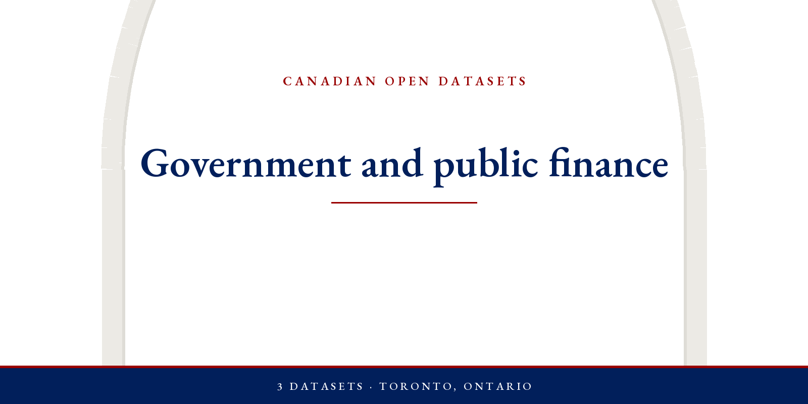

<p align="center"></p>

# Canada Government Finance Statistics

*Government revenue, spending, debt and net worth, 1990 to 2026*

**Theme:** [Government and public finance](../../README.md#government-and-public-finance) · **Coverage:** 1990 to 2026 · **Kaggle:** [https://www.kaggle.com/datasets/johnnykhan1/canada-government-finance-statistics](https://www.kaggle.com/datasets/johnnykhan1/canada-government-finance-statistics)

## What it is

A tidy extract of two official Statistics Canada government finance statistics tables. Together they show what Canadian governments collect, what they spend, how much they borrow, and what they own and owe. The quarterly table runs from the first quarter of 1990 to the second quarter of 2026 by level of government. The annual table runs from 2007 to 2024 with much more line detail, for Canada and for each province and territory.

Source tables:

* [10-10-0015-01](https://www150.statcan.gc.ca/t1/tbl1/en/tv.action?pid=1010001501): Statement of government operations and balance sheet, government finance statistics, quarterly.
* [10-10-0147-01](https://www150.statcan.gc.ca/t1/tbl1/en/tv.action?pid=1010014701): Canadian government finance statistics (CGFS), statement of operations and balance sheet for consolidated governments.

The official English CSV files were downloaded from Statistics Canada on November 10, 2026. Both tables follow the Canadian Government Finance Statistics framework, which is based on the IMF Government Finance Statistics Manual, so the numbers line up across levels of government and with other countries that use the same standard.

## Who it helps

Taxpayers, journalists, charity and non-profit staff, and public finance researchers.

## Files

| File | Size | Where |
|---|---:|---|
| [`annual_consolidated_government_finances.csv`](data/annual_consolidated_government_finances.csv) | 15.6 MB | in this repository |
| [`cover.png`](data/cover.png) | 46 KB | in this repository |
| [`data_dictionary.csv`](data/data_dictionary.csv) | 7 KB | in this repository |
| [`official_metadata_10100015.csv`](data/official_metadata_10100015.csv) | 5 KB | in this repository |
| [`official_metadata_10100147.csv`](data/official_metadata_10100147.csv) | 22 KB | in this repository |
| [`quarterly_government_operations.csv`](data/quarterly_government_operations.csv) | 6.6 MB | in this repository |

## Columns

### `annual_consolidated_government_finances.csv`

Official annual detailed statement of operations and balance sheet for consolidated Canadian general government (Canada only) and consolidated provincial, territorial and local governments (Canada and each province and territory), split into stocks and flows, in millions of dollars, 2007 to 2024.

| Column | Type | Description |
|---|---|---|
| `ref_date` | Date | Reference period stored as a date. In quarterly_government_operations.csv it is the first day of the calendar quarter (1990-01-01 is the first quarter of 1990, 2026-04-01 is the second quarter of 2026). In annual_consolidated_government_finances.csv it is January 1 of the reference year (2007-01-01 to 2024-01-01), where the official notes say the year means the end of the fiscal year closest to December 31. |
| `geo` | Text | Geography as published. The quarterly file has Canada only. The annual file has Canada plus each province and territory for consolidated provincial, territorial and local governments, and Canada only for consolidated Canadian general government. |
| `dguid` | Text | Statistics Canada Dissemination Geography Unique Identifier for the geography. |
| `public_sector_component` | Text | Annual file only. Consolidated Canadian general government (federal, provincial, territorial and local governments, health and social service institutions, universities and colleges, and school boards, without the CPP and QPP; Canada only) or Consolidated provincial-territorial and local governments (Canada and each province and territory). |
| `display_value` | Text | Annual file only. Stocks are holdings of assets and liabilities at the end of the accounting period. Transactions and other economic flows are amounts that occur during the period. Each line item is published under one or both. |
| `line_item` | Text | Line of the statement of operations or balance sheet as published, for example Revenue, Taxes, Expense, Interest, Net operating balance, Net lending or borrowing, Financial assets, Liabilities or Net financial worth. In the annual file the official Government Finance Statistics classification codes are kept in square brackets. Child lines are parts of their parent lines, so do not add parents and children together. |
| `unit_of_measure` | Text | Unit of measure for value, as published: Dollars. |
| `unit_of_measure_id` | Text | Statistics Canada numeric code for the unit of measure. |
| `scalar_factor` | Text | Scale of value as published: millions. A value of 1000 means 1,000 million dollars, or 1 billion dollars. |
| `scalar_id` | Text | Statistics Canada numeric code for the scalar factor. |
| `vector` | Text | Statistics Canada vector identifier for the series. Useful if you want to pull the same series again. |
| `coordinate` | Text | Statistics Canada coordinate string that locates the series inside the official table. |
| `value` | Float | The published value in millions of current dollars. Empty when Statistics Canada did not publish a figure (status ..). Negative values are deficits, net borrowing, or net liabilities where the line item is a balance. Official values were not altered. |
| `status` | Text | Statistics Canada status symbol. .. means not available for that reference period and value is empty. Empty status means a regular published value. |
| `symbol` | Text | Annual file: r means revised and p means preliminary, as published. Empty when no symbol was given. |
| `terminated` | Text | t if Statistics Canada has terminated this series, otherwise empty. |
| `decimals` | Integer | Number of decimal places Statistics Canada uses when displaying the value. |

### `data_dictionary.csv`

Column dictionary for every tidy CSV in this dataset.

| Column | Type | Description |
|---|---|---|
| `file` | Text | CSV file the column belongs to. |
| `column` | Text | Column name in that file. |
| `type` | Text | Field type (datetime, string, numeric or integer). |
| `description` | Text | What the column contains. |

### `official_metadata_10100015.csv`

Official Statistics Canada metadata, notes and symbol legend for table 10-10-0015-01.

| Column | Type | Description |
|---|---|---|
| `Cube Title` | Text | Official table title. Later rows in this file hold the dimension and note sections of the official metadata download. |
| `Product Id` | Text | Statistics Canada product identifier for the table. |
| `CANSIM Id` | Text | Former CANSIM identifier for the table. |
| `URL` | Text | Link to the table on the Statistics Canada website. |
| `Cube Notes` | Text | Note numbers that apply to the whole table. |
| `Archive Status` | Text | Whether the table is current or archived. |
| `Frequency` | Text | Release frequency of the table. |
| `Start Reference Period` | Text | First reference period in the table. |
| `End Reference Period` | Date | Last reference period in the table at download time. |
| `Total number of dimensions` | Integer | Number of dimensions in the table. |

### `official_metadata_10100147.csv`

Official Statistics Canada metadata, notes and symbol legend for table 10-10-0147-01.

| Column | Type | Description |
|---|---|---|
| `Cube Title` | Text | Official table title. Later rows in this file hold the dimension and note sections of the official metadata download. |
| `Product Id` | Text | Statistics Canada product identifier for the table. |
| `CANSIM Id` | Text | Former CANSIM identifier for the table. |
| `URL` | Text | Link to the table on the Statistics Canada website. |
| `Cube Notes` | Text | Note numbers that apply to the whole table. |
| `Archive Status` | Text | Whether the table is current or archived. |
| `Frequency` | Text | Release frequency of the table. |
| `Start Reference Period` | Text | First reference period in the table. |
| `End Reference Period` | Date | Last reference period in the table at download time. |
| `Total number of dimensions` | Integer | Number of dimensions in the table. |

### `quarterly_government_operations.csv`

Official quarterly statement of operations and balance sheet for Canadian governments: revenue, expense, operating balances, net lending or borrowing, financial transactions, assets, liabilities and net worth, for consolidated government, the federal government, provincial and territorial governments, local governments, and the CPP and QPP, in millions of dollars, first quarter of 1990 to second quarter of 2026.

| Column | Type | Description |
|---|---|---|
| `ref_date` | Date | Reference period stored as a date. In quarterly_government_operations.csv it is the first day of the calendar quarter (1990-01-01 is the first quarter of 1990, 2026-04-01 is the second quarter of 2026). In annual_consolidated_government_finances.csv it is January 1 of the reference year (2007-01-01 to 2024-01-01), where the official notes say the year means the end of the fiscal year closest to December 31. |
| `geo` | Text | Geography as published. The quarterly file has Canada only. The annual file has Canada plus each province and territory for consolidated provincial, territorial and local governments, and Canada only for consolidated Canadian general government. |
| `dguid` | Text | Statistics Canada Dissemination Geography Unique Identifier for the geography. |
| `government_sector` | Text | Quarterly file only. Government sector as published: Consolidated government, Federal government, Provincial and territorial government, Local government (which includes Indigenous governments), or Canada Pension Plan (CPP) and Quebec Pension Plan (QPP). |
| `line_item` | Text | Line of the statement of operations or balance sheet as published, for example Revenue, Taxes, Expense, Interest, Net operating balance, Net lending or borrowing, Financial assets, Liabilities or Net financial worth. In the annual file the official Government Finance Statistics classification codes are kept in square brackets. Child lines are parts of their parent lines, so do not add parents and children together. |
| `unit_of_measure` | Text | Unit of measure for value, as published: Dollars. |
| `unit_of_measure_id` | Text | Statistics Canada numeric code for the unit of measure. |
| `scalar_factor` | Text | Scale of value as published: millions. A value of 1000 means 1,000 million dollars, or 1 billion dollars. |
| `scalar_id` | Text | Statistics Canada numeric code for the scalar factor. |
| `vector` | Text | Statistics Canada vector identifier for the series. Useful if you want to pull the same series again. |
| `coordinate` | Date | Statistics Canada coordinate string that locates the series inside the official table. |
| `value` | Integer | The published value in millions of current dollars. Empty when Statistics Canada did not publish a figure (status ..). Negative values are deficits, net borrowing, or net liabilities where the line item is a balance. Official values were not altered. |
| `status` | Text | Statistics Canada status symbol. .. means not available for that reference period and value is empty. Empty status means a regular published value. |
| `symbol` | Text | Annual file: r means revised and p means preliminary, as published. Empty when no symbol was given. |
| `terminated` | Text | t if Statistics Canada has terminated this series, otherwise empty. |
| `decimals` | Integer | Number of decimal places Statistics Canada uses when displaying the value. |

## Source and licence

**Source:** Statistics Canada, Canadian Government Finance Statistics. Official tables downloaded on November 10, 2026 from the Statistics Canada full table CSV zips: 10-10-0015-01 (https://www150.statcan.gc.ca/t1/tbl1/en/tv.action?pid=1010001501, https://www150.statcan.gc.ca/n1/tbl/csv/10100015-eng.zip) 10-10-0147-01 (https://www150.statcan.gc.ca/t1/tbl1/en/tv.action?pid=1010014701, https://www150.statcan.gc.ca/n1/tbl/csv/10100147-eng.zip) Prepared by John Khan in Toronto, Ontario. Shared under the Statistics Canada Open Licence, https://www.statcan.gc.ca/en/terms-conditions/open-licence. Downloaded from the official open data release and reshaped into tidy CSV files by John Khan, November 2026.

- **Licence:** [Statistics Canada Open Licence](https://www.statcan.gc.ca/en/terms-conditions/open-licence). Source: Statistics Canada. This is an adaptation of Statistics Canada data; it does not constitute an endorsement by Statistics Canada.

The published values were not changed beyond what is described here. The full licence terms for this folder are in [LICENSE.md](LICENSE.md).

## Citation

No DOI has been minted for this dataset yet; please cite the Kaggle page.

```bibtex
@misc{khan2026canadagovernmentfinancestatistics,
  author    = {Khan, John},
  title     = {Canada Government Finance Statistics},
  year      = {2026},
  publisher = {Kaggle},
  address   = {Toronto, Ontario, Canada},
  url       = {https://www.kaggle.com/datasets/johnnykhan1/canada-government-finance-statistics}
}
```

APA: Khan, J. (2026). *Canada Government Finance Statistics* [Data set]. Kaggle. https://www.kaggle.com/datasets/johnnykhan1/canada-government-finance-statistics

<details><summary>Full notes from the Kaggle page</summary>

## What this is

A tidy extract of two official Statistics Canada government finance statistics tables. Together they show what Canadian governments collect, what they spend, how much they borrow, and what they own and owe. The quarterly table runs from the first quarter of 1990 to the second quarter of 2026 by level of government. The annual table runs from 2007 to 2024 with much more line detail, for Canada and for each province and territory.

Source tables:

* [10-10-0015-01](https://www150.statcan.gc.ca/t1/tbl1/en/tv.action?pid=1010001501): Statement of government operations and balance sheet, government finance statistics, quarterly.
* [10-10-0147-01](https://www150.statcan.gc.ca/t1/tbl1/en/tv.action?pid=1010014701): Canadian government finance statistics (CGFS), statement of operations and balance sheet for consolidated governments.

The official English CSV files were downloaded from Statistics Canada on November 10, 2026. Both tables follow the Canadian Government Finance Statistics framework, which is based on the IMF Government Finance Statistics Manual, so the numbers line up across levels of government and with other countries that use the same standard.

## Files

* quarterly_government_operations.csv: 44,530 rows. 61 line items for 5 government sectors over 146 quarters.
* annual_consolidated_government_finances.csv: 74,460 rows. 139 line items, split into stocks and flows, for consolidated Canadian general government and for consolidated provincial, territorial and local governments in each province and territory.
* data_dictionary.csv: every column in every file, with its type and meaning.
* official_metadata_*.csv: the official Statistics Canada notes, member lists and symbol legend for each table.

All values are in millions of current dollars.

## A few numbers from this snapshot

* In 2024, consolidated Canadian general government revenue was 1,167.8 billion dollars and expense was 1,236.2 billion dollars, for a net operating balance of -68.5 billion dollars.
* At the end of 2024, liabilities of consolidated Canadian general government stood at 3,385.2 billion dollars and net financial worth at -1,605.2 billion dollars.
* In the second quarter of 2026, consolidated government net lending or borrowing was 4.8 billion dollars, and the federal government paid 13.9 billion dollars in interest that quarter.
* Consolidated government net lending or borrowing reached its lowest quarter in this table at -105.0 billion dollars in the second quarter of 2020.
* Among provinces at the end of 2024, consolidated provincial, territorial and local net financial worth was -292.0 billion dollars in Ontario, -161.4 billion dollars in Quebec and -9.9 billion dollars in Alberta.

## Caveats

* The two tables measure different things. The quarterly table shows sectors before full consolidation across levels and includes the CPP and QPP as their own sector. The annual consolidated Canadian general government excludes the CPP and QPP and removes flows between units. Do not mix the two without reading the official notes.
* Annual figures refer to the fiscal year ending closest to December 31. Quarterly figures are calendar quarters.
* For 2007 the annual table has only balance sheet stocks, which Statistics Canada presents as opening stocks for 2008. Flow rows for 2007, and some other cells, are kept with status .. and an empty value.
* Line items are nested. A parent such as Taxes already includes its children, so add only items at the same level.
* Recent periods are revised as new source data arrive. In the annual file, symbol r marks revised values and p marks preliminary ones. The memorandum items in the annual file are not part of the totals.
* Values are in current dollars, not adjusted for inflation or population.

## Example uses

* Track deficits, surpluses and debt across the business cycle, the 2008 to 2009 recession and the pandemic.
* Compare provincial and local finances: tax mix, resource royalties, interest costs and net financial worth.
* Study how much of government spending goes to interest, social benefits and wages.
* Join with GDP, population or bond yield data to build debt to GDP or per person measures.
* Teach hierarchical accounting data and stocks versus flows.

## Updates

This upload is a snapshot from November 10, 2026 and is not refreshed on a schedule. Statistics Canada updates the quarterly table each quarter and the annual table once a year.

## Methodology

Downloaded from the official open data release and reshaped into tidy CSV files by John Khan, November 2026.

Column names were changed to snake_case and reference periods were stored as dates. Official values, status symbols and revision symbols were not altered. No rows were added or removed.

## Licence

This dataset is shared under the [Statistics Canada Open Licence](https://www.statcan.gc.ca/en/terms-conditions/open-licence). Credit: Statistics Canada, tables 10-10-0015-01 and 10-10-0147-01. The published values were not changed. Columns were renamed and the file layout was tidied. This is not an official Statistics Canada product and Statistics Canada does not endorse it.

Author: John Khan, Toronto, Ontario.


</details>

---
Compiled by John Khan, Toronto, Ontario. Part of the [Canadian Open Datasets](../../README.md) catalogue.
