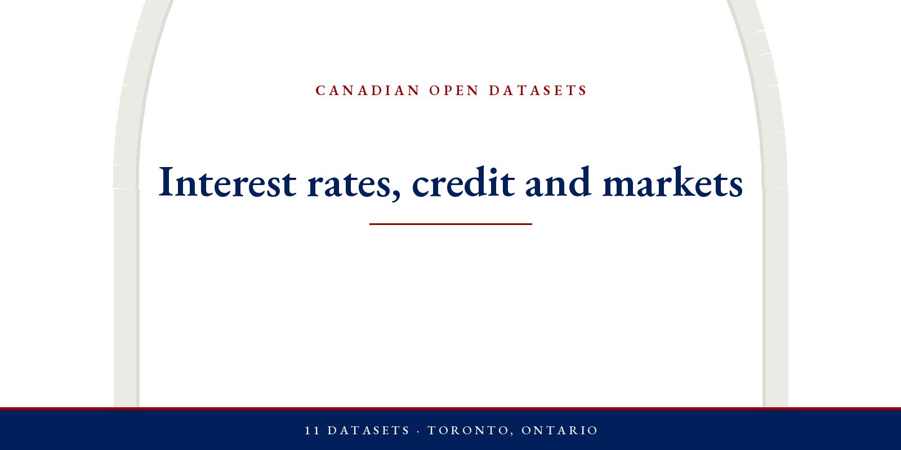

<p align="center"></p>

# Canada insolvency statistics

*Annual insolvency volumes, assets and liabilities from OSB*

**Theme:** [Interest rates, credit and markets](../../README.md#interest-rates-credit-and-markets) · **Coverage:** 1987 to 2024 · **Kaggle:** [https://www.kaggle.com/datasets/johnnykhan1/canada-insolvency-statistics](https://www.kaggle.com/datasets/johnnykhan1/canada-insolvency-statistics)

## What it is

Annual insolvency statistics for Canada and the provinces from the Office of the Superintendent of Bankruptcy (OSB), tidied from a wide bilingual workbook into a long CSV.

Portal: [Historic Insolvency Statistics - Annual](https://open.canada.ca/data/en/dataset/ed4d48f3-750f-4eeb-93f9-cb62be138264).

## Who it helps

Borrowers, mortgage professionals, lenders, investors, finance students and economists tracking Canadian rates, credit and the dollar.

## Files

| File | Size | Where |
|---|---:|---|
| [`canada_total_insolvencies_annual.csv`](data/canada_total_insolvencies_annual.csv) | 3 KB | in this repository |
| [`data_dictionary.csv`](data/data_dictionary.csv) | 1 KB | in this repository |
| [`insolvency_annual_long.csv`](data/insolvency_annual_long.csv) | 403 KB | in this repository |

## Columns

### `canada_total_insolvencies_annual.csv`

Canada total insolvency volume series.

| Column | Type | Description |
|---|---|---|
| `series_label` | Text | Insolvency series label from the OSB workbook (English portion of bilingual labels). |
| `geography` | Text | Canada, province or territory (English portion of bilingual labels). |
| `year` | Integer | Calendar year. |
| `ref_date` | Date | January 1 of the year, for time series convenience. |
| `volume` | Integer | Number of insolvency filings. |
| `assets_cad` | Integer | Reported assets in Canadian dollars. |
| `liabilities_cad` | Integer | Reported liabilities in Canadian dollars. |

### `data_dictionary.csv`

Column dictionary for every CSV in this dataset.

| Column | Type | Description |
|---|---|---|
| `column` | Text | Name of the column being described |
| `file` | Text | File that contains the column |
| `type` | Text | Data type of the column |
| `description` | Text | Plain-language description of the column |

### `insolvency_annual_long.csv`

Annual insolvency statistics melted to long form.

| Column | Type | Description |
|---|---|---|
| `series_label` | Text | Insolvency series label from the OSB workbook (English portion of bilingual labels). |
| `geography` | Text | Canada, province or territory (English portion of bilingual labels). |
| `year` | Integer | Calendar year. |
| `ref_date` | Date | January 1 of the year, for time series convenience. |
| `volume` | Integer | Number of insolvency filings. |
| `assets_cad` | Integer | Reported assets in Canadian dollars. |
| `liabilities_cad` | Integer | Reported liabilities in Canadian dollars. |

## Source and licence

**Source:** Office of the Superintendent of Bankruptcy Canada, Historic Insolvency Statistics - Annual (https://open.canada.ca/data/en/dataset/ed4d48f3-750f-4eeb-93f9-cb62be138264), file historical_insolvency_statistics_annual_2024.xlsx downloaded November 9, 2026. Prepared by John Khan in Toronto, Ontario. Open Government Licence – Canada. Downloaded from the official open data release and reshaped into tidy CSV files by John Khan, November 2026.

- **Licence:** [Open Government Licence – Canada 2.0](https://open.canada.ca/en/open-government-licence-canada). Contains information licensed under the Open Government Licence – Canada.

The published values were not changed beyond what is described here. The full licence terms for this folder are in [LICENSE.md](LICENSE.md).

## Citation

No DOI has been minted for this dataset yet; please cite the Kaggle page.

```bibtex
@misc{khan2026canadainsolvencystatistics,
  author    = {Khan, John},
  title     = {Canada insolvency statistics},
  year      = {2026},
  publisher = {Kaggle},
  address   = {Toronto, Ontario, Canada},
  url       = {https://www.kaggle.com/datasets/johnnykhan1/canada-insolvency-statistics}
}
```

APA: Khan, J. (2026). *Canada insolvency statistics* [Data set]. Kaggle. https://www.kaggle.com/datasets/johnnykhan1/canada-insolvency-statistics

<details><summary>Full notes from the Kaggle page</summary>

## What this is

Annual insolvency statistics for Canada and the provinces from the Office of the Superintendent of Bankruptcy (OSB), tidied from a wide bilingual workbook into a long CSV.

Portal: [Historic Insolvency Statistics - Annual](https://open.canada.ca/data/en/dataset/ed4d48f3-750f-4eeb-93f9-cb62be138264).

## Coverage

Years 1987 to 2024 as published in the 2024 annual workbook.

## Updates

Snapshot from November 9, 2026. Not auto refreshed.

## A few numbers from this snapshot

* Long file has 7,800 rows from year 1987 to 2024.
* Geographies: 14. Series labels: 16.
* Canada total insolvencies volume in 2024: 143,483.

## Example uses

* Track consumer and business insolvency cycles.
* Compare provinces over time.
* Join to unemployment or interest rate series.

## Caveats

* Labels were split on '/' to keep the English portion of bilingual cells.
* Series definitions follow OSB workbook structure. Read series_label carefully before summing.
* Dollar fields are as reported in the workbook for that year.

## Licence

Shared under the [Open Government Licence – Canada](https://open.canada.ca/en/open-government-licence-canada). Source: Office of the Superintendent of Bankruptcy Canada. Not an official OSB product.

Author: John Khan, Toronto, Ontario.

</details>

---
Compiled by John Khan, Toronto, Ontario. Part of the [Canadian Open Datasets](../../README.md) catalogue.
