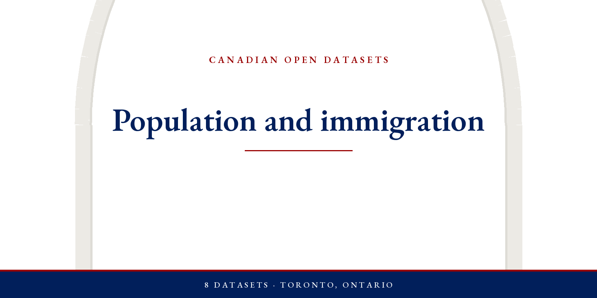

<p align="center"></p>

# Canada interprovincial migration

*Quarterly in and out migration between Canadian provinces and territories*

**Theme:** [Population and immigration](../../README.md#population-and-immigration) · **Coverage:** July 1961 to April 2026 · **Kaggle:** [https://www.kaggle.com/datasets/johnnykhan1/canada-interprovincial-migration](https://www.kaggle.com/datasets/johnnykhan1/canada-interprovincial-migration)

## What it is

Canada interprovincial migration, tidied from Statistics Canada Table 17-10-0020-01. The full table was downloaded on November 9, 2026 and laid out as a long CSV plus a wide CSV so it is easier to chart.

Source table: [17-10-0020-01](https://www150.statcan.gc.ca/t1/tbl1/en/tv.action?pid=1710002001).

## Who it helps

Newcomers, settlement agencies, planners, school boards, businesses choosing locations and demographers.

## Files

| File | Size | Where |
|---|---:|---|
| [`BUILD_RESULT.json`](data/BUILD_RESULT.json) | 1 KB | in this repository |
| [`cover.png`](data/cover.png) | 183 KB | in this repository |
| [`data_dictionary.csv`](data/data_dictionary.csv) | 6 KB | in this repository |
| [`interprovincial_migration_long.csv`](data/interprovincial_migration_long.csv) | 627 KB | in this repository |
| [`net_interprovincial_migration.csv`](data/net_interprovincial_migration.csv) | 176 KB | in this repository |
| [`net_interprovincial_migration_by_geo.csv`](data/net_interprovincial_migration_by_geo.csv) | 26 KB | in this repository |
| [`statcan_table_metadata.csv`](data/statcan_table_metadata.csv) | 6 KB | in this repository |

## Columns

### `data_dictionary.csv`

Column dictionary for every CSV in this dataset.

| Column | Type | Description |
|---|---|---|
| `file` | Text | File that contains the column |
| `column` | Text | Name of the column being described |
| `type` | Text | Data type of the column |
| `description` | Text | Plain-language description of the column |

### `interprovincial_migration_long.csv`

Tidy long file of quarterly in-migrants and out-migrants by geography.

| Column | Type | Description |
|---|---|---|
| `ref_date` | Date | Reference period as published by Statistics Canada (YYYY-MM-DD). For monthly tables this is the first day of the month. For quarterly tables it is the first day of the quarter. For annual tables it is January 1 of the year. |
| `geo` | Text | Geography name as published by Statistics Canada. |
| `dguid` | Text | Statistics Canada Dissemination Geography Unique Identifier for the geography. |
| `migration_flow` | Text | In-migrants to this geography from other provinces or territories, or out-migrants from this geography. |
| `unit_of_measure` | Text | Unit of measure for value, as published. |
| `unit_of_measure_id` | Text | Statistics Canada numeric code for the unit of measure. |
| `scalar_factor` | Text | Scale of value (for example units, thousands or millions). Value is already expressed at this scale. |
| `scalar_id` | Text | Statistics Canada numeric code for the scalar factor. |
| `vector` | Text | Statistics Canada vector identifier for the series (for example v41690973). Useful if you want to pull the same series again. |
| `coordinate` | Float | Statistics Canada coordinate string that locates the series inside the table. |
| `value` | Integer | The published value. Empty when Statistics Canada did not publish a figure for that period (see status and symbol). |
| `status` | Text | Statistics Canada status symbol when a value is missing or qualified. Empty means a regular published value. See the symbol legend in statcan_table_metadata.csv. |
| `symbol` | Text | Additional Statistics Canada symbol when present, otherwise empty. |
| `terminated` | Boolean | t if Statistics Canada has terminated this series, otherwise empty. |
| `decimals` | Integer | Number of decimal places Statistics Canada uses when displaying the value. |

### `net_interprovincial_migration.csv`

Quarterly in-migrants, out-migrants and net migrants (in minus out) by geography.

| Column | Type | Description |
|---|---|---|
| `ref_date` | Date | Reference period as published by Statistics Canada (YYYY-MM-DD). For monthly tables this is the first day of the month. For quarterly tables it is the first day of the quarter. For annual tables it is January 1 of the year. |
| `geo` | Text | Geography name as published by Statistics Canada. |
| `dguid` | Text | Statistics Canada Dissemination Geography Unique Identifier for the geography. |
| `in_migrants` | Integer | Number of in-migrants to this geography from other provinces or territories in the quarter. |
| `out_migrants` | Integer | Number of out-migrants from this geography to other provinces or territories in the quarter. |
| `net_migrants` | Integer | In-migrants minus out-migrants for the geography and quarter, calculated from the two published flows. A positive number means a net gain. |

### `net_interprovincial_migration_by_geo.csv`

Net interprovincial migrants, one column per geography.

| Column | Type | Description |
|---|---|---|
| `ref_date` | Date | Reference period as published by Statistics Canada (YYYY-MM-DD). For monthly tables this is the first day of the month. For quarterly tables it is the first day of the quarter. For annual tables it is January 1 of the year. |
| `alberta` | Float | Published value for alberta. See unit_of_measure and scalar_factor in the long file for the unit. |
| `british_columbia` | Float | Published value for british columbia. See unit_of_measure and scalar_factor in the long file for the unit. |
| `canada` | Float | Published value for canada. See unit_of_measure and scalar_factor in the long file for the unit. |
| `manitoba` | Float | Published value for manitoba. See unit_of_measure and scalar_factor in the long file for the unit. |
| `new_brunswick` | Float | Published value for new brunswick. See unit_of_measure and scalar_factor in the long file for the unit. |
| `newfoundland_and_labrador` | Float | Published value for newfoundland and labrador. See unit_of_measure and scalar_factor in the long file for the unit. |
| `northwest_territories` | Float | Published value for northwest territories. See unit_of_measure and scalar_factor in the long file for the unit. |
| `northwest_territories_including_nunavut` | Float | Published value for northwest territories including nunavut. See unit_of_measure and scalar_factor in the long file for the unit. |
| `nova_scotia` | Float | Published value for nova scotia. See unit_of_measure and scalar_factor in the long file for the unit. |
| `nunavut` | Float | Published value for nunavut. See unit_of_measure and scalar_factor in the long file for the unit. |
| `ontario` | Float | Published value for ontario. See unit_of_measure and scalar_factor in the long file for the unit. |
| `prince_edward_island` | Float | Published value for prince edward island. See unit_of_measure and scalar_factor in the long file for the unit. |
| `quebec` | Float | Published value for quebec. See unit_of_measure and scalar_factor in the long file for the unit. |
| `saskatchewan` | Float | Published value for saskatchewan. See unit_of_measure and scalar_factor in the long file for the unit. |
| `yukon` | Float | Published value for yukon. See unit_of_measure and scalar_factor in the long file for the unit. |

### `statcan_table_metadata.csv`

Official Statistics Canada cube metadata shipped with the table download, including notes and the symbol legend. Layout is as published, not tidied.

| Column | Type | Description |
|---|---|---|
| `Cube Title` | Text | — |
| `Product Id` | Text | — |
| `CANSIM Id` | Text | — |
| `URL` | Text | — |
| `Cube Notes` | Text | — |
| `Archive Status` | Text | — |
| `Frequency` | Text | — |
| `Start Reference Period` | Text | — |
| `End Reference Period` | Date | — |
| `Total number of dimensions` | Integer | — |

## Source and licence

**Source:** Statistics Canada Table 17-10-0020-01, https://www150.statcan.gc.ca/t1/tbl1/en/tv.action?pid=1710002001. Full table CSV downloaded on November 9, 2026 from https://www150.statcan.gc.ca/n1/tbl/csv/17100020-eng.zip. Prepared by John Khan in Toronto, Ontario. Shared under the Statistics Canada Open Licence, https://www.statcan.gc.ca/en/terms-conditions/open-licence.

- **Licence:** [Statistics Canada Open Licence](https://www.statcan.gc.ca/en/terms-conditions/open-licence). Source: Statistics Canada. This is an adaptation of Statistics Canada data; it does not constitute an endorsement by Statistics Canada.

The published values were not changed beyond what is described here. The full licence terms for this folder are in [LICENSE.md](LICENSE.md).

## Citation

No DOI has been minted for this dataset yet; please cite the Kaggle page.

```bibtex
@misc{khan2026canadainterprovincialmigration,
  author    = {Khan, John},
  title     = {Canada interprovincial migration},
  year      = {2026},
  publisher = {Kaggle},
  address   = {Toronto, Ontario, Canada},
  url       = {https://www.kaggle.com/datasets/johnnykhan1/canada-interprovincial-migration}
}
```

APA: Khan, J. (2026). *Canada interprovincial migration* [Data set]. Kaggle. https://www.kaggle.com/datasets/johnnykhan1/canada-interprovincial-migration

<details><summary>Full notes from the Kaggle page</summary>

## What this is

Canada interprovincial migration, tidied from Statistics Canada Table 17-10-0020-01. The full table was downloaded on November 9, 2026 and laid out as a long CSV plus a wide CSV so it is easier to chart.

Source table: [17-10-0020-01](https://www150.statcan.gc.ca/t1/tbl1/en/tv.action?pid=1710002001).

## Coverage

The long file keeps the full published table: in-migrants and out-migrants for Canada, the ten provinces and the territories, quarterly from July 1, 1961 through April 1, 2026. A second file adds net migrants, and a wide file spreads net migrants across geographies.

## Updates

This upload is a snapshot from November 9, 2026 and is not refreshed on a schedule. Statistics Canada usually updates quarterly demographic estimates four times a year. If you need a later month, download the table again from Statistics Canada.

## A few numbers from this snapshot

* Ontario's net interprovincial migration was -7,063 in the quarter starting 2026-04-01.
* Alberta's net interprovincial migration was 5,893 in the quarter starting 2026-04-01.
* Net migrants equals in-migrants minus out-migrants for the same geography and quarter. That difference is calculated in this dataset and is not a separate Statistics Canada column.

## Example uses

* See which provinces are gaining or losing people to the rest of Canada in a given quarter.
* Build a long history of Alberta, Ontario or Atlantic Canada net migration.
* Join the figures with the quarterly population estimates to show the migration share of population change.

## Caveats

These are estimates and they are revised, including when new census results arrive. Canada totals of in-migrants and out-migrants count moves between provinces, so they are not international migration. Northwest Territories and Nunavut are shown separately only once they exist as separate territories; the combined series is also in the file. The latest quarters can be preliminary.

## Files

* `interprovincial_migration_long.csv`: Tidy long file of quarterly in-migrants and out-migrants by geography.
* `net_interprovincial_migration.csv`: Quarterly in-migrants, out-migrants and net migrants (in minus out) by geography.
* `net_interprovincial_migration_by_geo.csv`: Net interprovincial migrants, one column per geography.
* `data_dictionary.csv`: column dictionary.
* `statcan_table_metadata.csv`: official Statistics Canada notes, survey name and symbol legend.
* `cover.png`: cover chart drawn from this snapshot.

## Licence

This dataset is shared under the [Statistics Canada Open Licence](https://www.statcan.gc.ca/en/terms-conditions/open-licence). Source: Statistics Canada, Table 17-10-0020-01. The published values were not changed. Columns were renamed, the file layout was tidied, and some dimensions were filtered as described above. This is not an official Statistics Canada product and Statistics Canada does not endorse it.

Author: John Khan, Toronto, Ontario.

</details>

---
Compiled by John Khan, Toronto, Ontario. Part of the [Canadian Open Datasets](../../README.md) catalogue.
