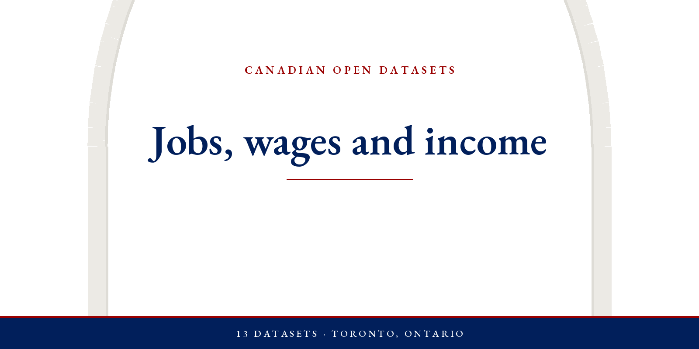

<p align="center"></p>

# Canada labour force survey monthly

*Seasonally adjusted labour force, employment and unemployment by province*

**Theme:** [Jobs, wages and income](../../README.md#jobs-wages-and-income) · **Coverage:** January 1976 to October 2026 · **Kaggle:** [https://www.kaggle.com/datasets/johnnykhan1/canada-labour-force-survey-monthly](https://www.kaggle.com/datasets/johnnykhan1/canada-labour-force-survey-monthly)

## What it is

Canada labour force survey monthly, tidied from Statistics Canada Table 14-10-0287-01. The full table was downloaded on November 9, 2026 and laid out as a long CSV plus a wide CSV so it is easier to chart.

Source table: [14-10-0287-01](https://www150.statcan.gc.ca/t1/tbl1/en/tv.action?pid=1410028701).

## Who it helps

Job seekers, employers, unions, policy analysts, poverty researchers and students looking at work and income across Canada.

## Files

| File | Size | Where |
|---|---:|---|
| [`BUILD_RESULT.json`](data/BUILD_RESULT.json) | 1 KB | in this repository |
| [`cover.png`](data/cover.png) | 145 KB | in this repository |
| [`data_dictionary.csv`](data/data_dictionary.csv) | 5 KB | in this repository |
| [`statcan_table_metadata.csv`](data/statcan_table_metadata.csv) | 15 KB | in this repository |
| [`unemployment_rate_15plus_by_province.csv`](data/unemployment_rate_15plus_by_province.csv) | 36 KB | in this repository |
| `lfs_seasonally_adjusted_estimates_long.csv` | 185.9 MB (13.4 MB gzipped) | [release download](https://github.com/ALENZACODES/canadian-open-datasets/releases/download/data-2026-11-15/canada-labour-force-survey-monthly--lfs_seasonally_adjusted_estimates_long.csv.gz) |

Files over 50 MB are kept as gzipped downloads on the [release page](https://github.com/ALENZACODES/canadian-open-datasets/releases/tag/data-2026-11-15) so the repository stays light. Unzip with `gunzip` or read directly with `pandas.read_csv(url)`.

## Columns

### `data_dictionary.csv`

Column dictionary for every CSV in this dataset.

| Column | Type | Description |
|---|---|---|
| `file` | Text | File that contains the column |
| `column` | Text | Name of the column being described |
| `type` | Text | Data type of the column |
| `description` | Text | Plain-language description of the column |

### `lfs_seasonally_adjusted_estimates_long.csv`

Seasonally adjusted Labour Force Survey estimates in tidy long form.

| Column | Type | Description |
|---|---|---|
| `ref_date` | Date | Reference period as published by Statistics Canada (YYYY-MM-DD). For monthly tables this is the first day of the month. For quarterly tables it is the first day of the quarter. For annual tables it is January 1 of the year. |
| `geo` | Text | Geography name as published by Statistics Canada. |
| `dguid` | Text | Statistics Canada Dissemination Geography Unique Identifier for the geography. |
| `labour_force_characteristic` | Text | Labour force concept: population, labour force, employment, full-time employment, part-time employment, unemployment, unemployment rate, participation rate or employment rate. |
| `gender` | Text | Gender grouping published by the Labour Force Survey (Total - Gender, Men+ or Women+). |
| `age_group` | Text | Age group published by the Labour Force Survey. |
| `statistic` | Text | The kind of figure. This file keeps official estimates only. |
| `data_type` | Text | Seasonally adjusted, trend-cycle or unadjusted, as published. |
| `unit_of_measure` | Text | Unit of measure for value, as published. |
| `unit_of_measure_id` | Text | Statistics Canada numeric code for the unit of measure. |
| `scalar_factor` | Text | Scale of value (for example units, thousands or millions). Value is already expressed at this scale. |
| `scalar_id` | Text | Statistics Canada numeric code for the scalar factor. |
| `vector` | Text | Statistics Canada vector identifier for the series (for example v41690973). Useful if you want to pull the same series again. |
| `coordinate` | Text | Statistics Canada coordinate string that locates the series inside the table. |
| `value` | Float | The published value. Empty when Statistics Canada did not publish a figure for that period (see status and symbol). |
| `status` | Text | Statistics Canada status symbol when a value is missing or qualified. Empty means a regular published value. See the symbol legend in statcan_table_metadata.csv. |
| `symbol` | Text | Additional Statistics Canada symbol when present, otherwise empty. |
| `terminated` | Text | t if Statistics Canada has terminated this series, otherwise empty. |
| `decimals` | Integer | Number of decimal places Statistics Canada uses when displaying the value. |

### `statcan_table_metadata.csv`

Official Statistics Canada cube metadata shipped with the table download, including notes and the symbol legend. Layout is as published, not tidied.

| Column | Type | Description |
|---|---|---|
| `Cube Title` | Text | — |
| `Product Id` | Text | — |
| `CANSIM Id` | Text | — |
| `URL` | Text | — |
| `Cube Notes` | Text | — |
| `Archive Status` | Text | — |
| `Frequency` | Text | — |
| `Start Reference Period` | Text | — |
| `End Reference Period` | Date | — |
| `Total number of dimensions` | Integer | — |

### `unemployment_rate_15plus_by_province.csv`

Unemployment rate, 15 years and over, total gender, one column per province plus Canada.

| Column | Type | Description |
|---|---|---|
| `ref_date` | Date | Reference period as published by Statistics Canada (YYYY-MM-DD). For monthly tables this is the first day of the month. For quarterly tables it is the first day of the quarter. For annual tables it is January 1 of the year. |
| `alberta` | Float | Published value for alberta. See unit_of_measure and scalar_factor in the long file for the unit. |
| `british_columbia` | Float | Published value for british columbia. See unit_of_measure and scalar_factor in the long file for the unit. |
| `canada` | Float | Published value for canada. See unit_of_measure and scalar_factor in the long file for the unit. |
| `manitoba` | Float | Published value for manitoba. See unit_of_measure and scalar_factor in the long file for the unit. |
| `new_brunswick` | Float | Published value for new brunswick. See unit_of_measure and scalar_factor in the long file for the unit. |
| `newfoundland_and_labrador` | Float | Published value for newfoundland and labrador. See unit_of_measure and scalar_factor in the long file for the unit. |
| `nova_scotia` | Float | Published value for nova scotia. See unit_of_measure and scalar_factor in the long file for the unit. |
| `ontario` | Float | Published value for ontario. See unit_of_measure and scalar_factor in the long file for the unit. |
| `prince_edward_island` | Float | Published value for prince edward island. See unit_of_measure and scalar_factor in the long file for the unit. |
| `quebec` | Float | Published value for quebec. See unit_of_measure and scalar_factor in the long file for the unit. |
| `saskatchewan` | Float | Published value for saskatchewan. See unit_of_measure and scalar_factor in the long file for the unit. |

## Source and licence

**Source:** Statistics Canada Table 14-10-0287-01, https://www150.statcan.gc.ca/t1/tbl1/en/tv.action?pid=1410028701. Full table CSV downloaded on November 9, 2026 from https://www150.statcan.gc.ca/n1/tbl/csv/14100287-eng.zip. Prepared by John Khan in Toronto, Ontario. Shared under the Statistics Canada Open Licence, https://www.statcan.gc.ca/en/terms-conditions/open-licence.

- **Licence:** [Statistics Canada Open Licence](https://www.statcan.gc.ca/en/terms-conditions/open-licence). Source: Statistics Canada. This is an adaptation of Statistics Canada data; it does not constitute an endorsement by Statistics Canada.

The published values were not changed beyond what is described here. The full licence terms for this folder are in [LICENSE.md](LICENSE.md).

## Citation

No DOI has been minted for this dataset yet; please cite the Kaggle page.

```bibtex
@misc{khan2026canadalabourforcesurveymonthly,
  author    = {Khan, John},
  title     = {Canada labour force survey monthly},
  year      = {2026},
  publisher = {Kaggle},
  address   = {Toronto, Ontario, Canada},
  url       = {https://www.kaggle.com/datasets/johnnykhan1/canada-labour-force-survey-monthly}
}
```

APA: Khan, J. (2026). *Canada labour force survey monthly* [Data set]. Kaggle. https://www.kaggle.com/datasets/johnnykhan1/canada-labour-force-survey-monthly

<details><summary>Full notes from the Kaggle page</summary>

## What this is

Canada labour force survey monthly, tidied from Statistics Canada Table 14-10-0287-01. The full table was downloaded on November 9, 2026 and laid out as a long CSV plus a wide CSV so it is easier to chart.

Source table: [14-10-0287-01](https://www150.statcan.gc.ca/t1/tbl1/en/tv.action?pid=1410028701).

## Coverage

This file keeps official estimates that are seasonally adjusted, for Canada and the ten provinces, all published labour force characteristics, all three gender groups, and all nine age groups, from January 1976 through October 2026. Trend-cycle values, unadjusted values, and the three standard error series in the original table were left out so the file stays a manageable size.

## Updates

This upload is a snapshot from November 9, 2026 and is not refreshed on a schedule. Statistics Canada usually publishes this table on the first Friday of each month, for the previous month. If you need a later month, download the table again from Statistics Canada.

## A few numbers from this snapshot

* The seasonally adjusted unemployment rate for Canada, 15 years and over, was 6.7% in 2026-10.
* Employment for the same group was 21,100 (see scalar_factor for the scale) in 2026-10.
* The long file starts in January 1976 for series that exist back that far, and runs through October 2026.

## Example uses

* Track the national or provincial unemployment rate and employment level through a downturn or a recovery.
* Compare youth (15 to 24) and core age (25 to 54) employment rates in a province.
* Look at employment and unemployment for Men+ and Women+ side by side.

## Caveats

These figures are seasonally adjusted estimates from the Labour Force Survey and can be revised. Gender labels use Statistics Canada's Men+ and Women+ categories. Rates are in percent. Levels (employment, labour force, population, unemployment) use the unit and scalar_factor columns, often thousands of persons. Territories are not in this table.

## Files

* `lfs_seasonally_adjusted_estimates_long.csv`: Seasonally adjusted Labour Force Survey estimates in tidy long form.
* `unemployment_rate_15plus_by_province.csv`: Unemployment rate, 15 years and over, total gender, one column per province plus Canada.
* `data_dictionary.csv`: column dictionary.
* `statcan_table_metadata.csv`: official Statistics Canada notes, survey name and symbol legend.
* `cover.png`: cover chart drawn from this snapshot.

## Licence

This dataset is shared under the [Statistics Canada Open Licence](https://www.statcan.gc.ca/en/terms-conditions/open-licence). Source: Statistics Canada, Table 14-10-0287-01. The published values were not changed. Columns were renamed, the file layout was tidied, and some dimensions were filtered as described above. This is not an official Statistics Canada product and Statistics Canada does not endorse it.

Author: John Khan, Toronto, Ontario.

</details>

---
Compiled by John Khan, Toronto, Ontario. Part of the [Canadian Open Datasets](../../README.md) catalogue.
