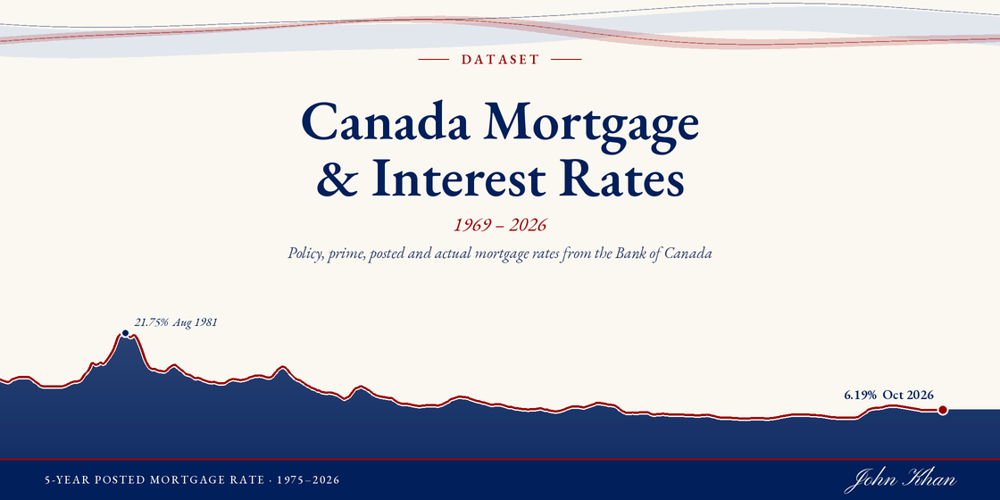

<p align="center"></p>

# Canada Mortgage and Interest Rates 1969 to 2026

*Policy, prime, posted and actual mortgage rates, mortgage volumes and CPI*

**Theme:** [Interest rates, credit and markets](../../README.md#interest-rates-credit-and-markets) · **Coverage:** 1 January 1969 to 15 October 2026 · **Kaggle:** [https://www.kaggle.com/datasets/johnnykhan1/canada-mortgage-interest-rates](https://www.kaggle.com/datasets/johnnykhan1/canada-mortgage-interest-rates)

## What it is

Canadian mortgage and interest rate series from the Bank of Canada Valet API, plus total CPI, saved as CSV files on October 17, 2026. It covers the policy rate and CORRA, Government of Canada bond yields, chartered bank prime and posted mortgage rates, the rates and dollar volumes on new and outstanding mortgages split by insured status and term, residential mortgage credit back to 1969, the Senior Loan Officer Survey and total CPI. A monthly panel joins it all from January 2013, with spreads already worked out.

## Who it helps

Borrowers, mortgage professionals, lenders, investors, finance students and economists tracking Canadian rates, credit and the dollar.

## Files

| File | Size | Where |
|---|---:|---|
| [`KAGGLE_NOTES.md`](data/KAGGLE_NOTES.md) | 5 KB | in this repository |
| [`boc_policy_rate_daily.csv`](data/boc_policy_rate_daily.csv) | 168 KB | in this repository |
| [`canada_mortgage_monthly_panel.csv`](data/canada_mortgage_monthly_panel.csv) | 80 KB | in this repository |
| [`chartered_bank_posted_rates_weekly.csv`](data/chartered_bank_posted_rates_weekly.csv) | 105 KB | in this repository |
| [`cpi_total_monthly.csv`](data/cpi_total_monthly.csv) | 8 KB | in this repository |
| [`goc_benchmark_bond_yields_daily.csv`](data/goc_benchmark_bond_yields_daily.csv) | 206 KB | in this repository |
| [`mortgage_lending_rates_monthly.csv`](data/mortgage_lending_rates_monthly.csv) | 27 KB | in this repository |
| [`mortgage_lending_volumes_monthly.csv`](data/mortgage_lending_volumes_monthly.csv) | 29 KB | in this repository |
| [`residential_mortgage_credit_monthly_1969_2020.csv`](data/residential_mortgage_credit_monthly_1969_2020.csv) | 28 KB | in this repository |
| [`scripts/build_dataset.py`](data/scripts/build_dataset.py) | 8 KB | in this repository |
| [`series_catalog.csv`](data/series_catalog.csv) | 11 KB | in this repository |
| [`slos_mortgage_lending_quarterly.csv`](data/slos_mortgage_lending_quarterly.csv) | 1 KB | in this repository |

## Columns

### `boc_policy_rate_daily.csv`

Canadian Overnight Repo Rate Average, Target for the overnight rate

| Column | Type | Description |
|---|---|---|
| `date` | Date | — |
| `policy_rate_target` | Text | Target for the overnight rate |
| `corra` | Float | Canadian Overnight Repo Rate Average (CORRA) |

### `canada_mortgage_monthly_panel.csv`

Joined monthly panel 2013-01 to 2026-10 (October partial)

| Column | Type | Description |
|---|---|---|
| `month` | Date | First day of the month the value refers to (YYYY-MM-DD) |
| `policy_rate_target` | Float | Target for the overnight rate (V39079, %), last business day value in the month |
| `corra` | Float | Canadian Overnight Repo Rate Average (CORRA) (AVG.INTWO, %), last business day value in the month |
| `goc_2y_yield_avg` | Float | Government of Canada benchmark bond yield, 2y (BD.CDN.2YR.DQ.YLD, %), monthly average of daily values |
| `goc_5y_yield_avg` | Float | Government of Canada benchmark bond yield, 5y (BD.CDN.5YR.DQ.YLD, %), monthly average of daily values |
| `goc_10y_yield_avg` | Float | Government of Canada benchmark bond yield, 10y (BD.CDN.10YR.DQ.YLD, %), monthly average of daily values |
| `prime_rate` | Float | Prime rate (V80691311, %), last weekly value in the month |
| `posted_1y_conventional_mortgage` | Float | Conventional mortgage, 1-year (V80691333, %), last weekly value in the month |
| `posted_3y_conventional_mortgage` | Float | Conventional mortgage, 3-year (V80691334, %), last weekly value in the month |
| `posted_5y_conventional_mortgage` | Float | Conventional mortgage, 5-year (posted / benchmark) (V80691335, %), last weekly value in the month |
| `rate_new_insured_total` | Float | Residential mortgages, insured, Total - Funds advanced (V122667775, %), monthly value |
| `rate_new_insured_variable` | Float | Residential mortgages, insured, Variable rate - Funds advanced (V122667776, %), monthly value |
| `rate_new_insured_fixed_lt1y` | Float | Residential mortgages, insured, Fixed rate, <1 year - Funds advanced (V122667777, %), monthly value |
| `rate_new_insured_fixed_1to3y` | Float | Residential mortgages, insured, Fixed rate, 1 to <3 years - Funds advanced (V122667778, %), monthly value |
| `rate_new_insured_fixed_3to5y` | Float | Residential mortgages, insured, Fixed rate, 3 to <5 years - Funds advanced (V122667779, %), monthly value |
| `rate_new_insured_fixed_5yplus` | Float | Residential mortgages, insured, Fixed rate, 5 years and over - Funds advanced (V122667780, %), monthly value |
| `rate_new_uninsured_total` | Float | Residential mortgages, uninsured, Total - Funds advanced (V122667781, %), monthly value |
| `rate_new_uninsured_variable` | Float | Residential mortgages, uninsured, Variable rate - Funds advanced (V122667782, %), monthly value |
| `rate_new_uninsured_fixed_lt1y` | Float | Residential mortgages, uninsured, Fixed rate, <1 year - Funds advanced (V122667783, %), monthly value |
| `rate_new_uninsured_fixed_1to3y` | Float | Residential mortgages, uninsured, Fixed rate, 1 to <3 years - Funds advanced (V122667784, %), monthly value |
| `rate_new_uninsured_fixed_3to5y` | Float | Residential mortgages, uninsured, Fixed rate, 3 to <5 years - Funds advanced (V122667785, %), monthly value |
| `rate_new_uninsured_fixed_5yplus` | Float | Residential mortgages, uninsured, Fixed rate, 5 years and over - Funds advanced (V122667786, %), monthly value |
| `rate_outstanding_insured_total` | Float | Residential mortgages, insured, Total - Outstanding balances (V122667787, %), monthly value |
| `rate_outstanding_insured_variable` | Float | Residential mortgages, insured, Variable rate - Outstanding balances (V122667788, %), monthly value |
| `rate_outstanding_insured_fixed_lt1y` | Float | Residential mortgages, insured, Fixed rate, <1 year - Outstanding balances (V122667789, %), monthly value |
| `rate_outstanding_insured_fixed_1to3y` | Float | Residential mortgages, insured, Fixed rate, 1 to <3 years - Outstanding balances (V122667790, %), monthly value |
| `rate_outstanding_insured_fixed_3to5y` | Float | Residential mortgages, insured, Fixed rate, 3 to <5 years - Outstanding balances (V122667791, %), monthly value |
| `rate_outstanding_insured_fixed_5yplus` | Float | Residential mortgages, insured, Fixed rate, 5 years and over - Outstanding balances (V122667792, %), monthly value |
| `rate_outstanding_uninsured_total` | Float | Residential mortgages, uninsured, Total - Outstanding balances (V122667793, %), monthly value |
| `rate_outstanding_uninsured_variable` | Float | Residential mortgages, uninsured, Variable rate - Outstanding balances (V122667794, %), monthly value |
| `rate_outstanding_uninsured_fixed_lt1y` | Float | Residential mortgages, uninsured, Fixed rate, <1 year - Outstanding balances (V122667795, %), monthly value |
| `rate_outstanding_uninsured_fixed_1to3y` | Float | Residential mortgages, uninsured, Fixed rate, 1 to <3 years - Outstanding balances (V122667796, %), monthly value |
| `rate_outstanding_uninsured_fixed_3to5y` | Float | Residential mortgages, uninsured, Fixed rate, 3 to <5 years - Outstanding balances (V122667797, %), monthly value |
| `rate_outstanding_uninsured_fixed_5yplus` | Float | Residential mortgages, uninsured, Fixed rate, 5 years and over - Outstanding balances (V122667798, %), monthly value |
| `cad_mn_new_insured_total` | Float | Residential mortgages, insured, Total - Funds advanced (V122667724, CAD millions), monthly value |
| `cad_mn_new_insured_variable` | Float | Residential mortgages, insured, Variable rate - Funds advanced (V122667725, CAD millions), monthly value |
| `cad_mn_new_insured_fixed_lt1y` | Float | Residential mortgages, insured, Fixed rate, <1 year - Funds advanced (V122667726, CAD millions), monthly value |
| `cad_mn_new_insured_fixed_1to3y` | Float | Residential mortgages, insured, Fixed rate, 1 to <3 years - Funds advanced (V122667727, CAD millions), monthly value |
| `cad_mn_new_insured_fixed_3to5y` | Float | Residential mortgages, insured, Fixed rate, 3 to <5 years - Funds advanced (V122667728, CAD millions), monthly value |
| `cad_mn_new_insured_fixed_5yplus` | Float | Residential mortgages, insured, Fixed rate, 5 years and over - Funds advanced (V122667729, CAD millions), monthly value |
| `cad_mn_new_uninsured_total` | Float | Residential mortgages, uninsured, Total - Funds advanced (V122667730, CAD millions), monthly value |
| `cad_mn_new_uninsured_variable` | Float | Residential mortgages, uninsured, Variable rate - Funds advanced (V122667731, CAD millions), monthly value |
| `cad_mn_new_uninsured_fixed_lt1y` | Float | Residential mortgages, uninsured, Fixed rate, <1 year - Funds advanced (V122667732, CAD millions), monthly value |
| `cad_mn_new_uninsured_fixed_1to3y` | Float | Residential mortgages, uninsured, Fixed rate, 1 to <3 years - Funds advanced (V122667733, CAD millions), monthly value |
| `cad_mn_new_uninsured_fixed_3to5y` | Float | Residential mortgages, uninsured, Fixed rate, 3 to <5 years - Funds advanced (V122667734, CAD millions), monthly value |
| `cad_mn_new_uninsured_fixed_5yplus` | Float | Residential mortgages, uninsured, Fixed rate, 5 years and over - Funds advanced (V122667735, CAD millions), monthly value |
| `cad_mn_outstanding_insured_total` | Float | Residential mortgages, insured, Total - Outstanding balances (V122667736, CAD millions), monthly value |
| `cad_mn_outstanding_insured_variable` | Float | Residential mortgages, insured, Variable rate - Outstanding balances (V122667737, CAD millions), monthly value |
| `cad_mn_outstanding_insured_fixed_lt1y` | Float | Residential mortgages, insured, Fixed rate, <1 year - Outstanding balances (V122667738, CAD millions), monthly value |
| `cad_mn_outstanding_insured_fixed_1to3y` | Float | Residential mortgages, insured, Fixed rate, 1 to <3 years - Outstanding balances (V122667739, CAD millions), monthly value |
| `cad_mn_outstanding_insured_fixed_3to5y` | Float | Residential mortgages, insured, Fixed rate, 3 to <5 years - Outstanding balances (V122667740, CAD millions), monthly value |
| `cad_mn_outstanding_insured_fixed_5yplus` | Float | Residential mortgages, insured, Fixed rate, 5 years and over - Outstanding balances (V122667741, CAD millions), monthly value |
| `cad_mn_outstanding_uninsured_total` | Float | Residential mortgages, uninsured, Total - Outstanding balances (V122667742, CAD millions), monthly value |
| `cad_mn_outstanding_uninsured_variable` | Float | Residential mortgages, uninsured, Variable rate - Outstanding balances (V122667743, CAD millions), monthly value |
| `cad_mn_outstanding_uninsured_fixed_lt1y` | Float | Residential mortgages, uninsured, Fixed rate, <1 year - Outstanding balances (V122667744, CAD millions), monthly value |
| `cad_mn_outstanding_uninsured_fixed_1to3y` | Float | Residential mortgages, uninsured, Fixed rate, 1 to <3 years - Outstanding balances (V122667745, CAD millions), monthly value |
| `cad_mn_outstanding_uninsured_fixed_3to5y` | Float | Residential mortgages, uninsured, Fixed rate, 3 to <5 years - Outstanding balances (V122667746, CAD millions), monthly value |
| `cad_mn_outstanding_uninsured_fixed_5yplus` | Float | Residential mortgages, uninsured, Fixed rate, 5 years and over - Outstanding balances (V122667747, CAD millions), monthly value |
| `cpi_total` | Float | Total CPI (Statistics Canada vector, served by Bank of Canada) (V41690973, index 2002=100), monthly value |
| `cpi_yoy_pct` | Float | Total CPI change from the same month a year earlier, in percent (worked out from cpi_total) |
| `spread_5y_posted_minus_goc5y` | Float | Posted 5 year conventional mortgage rate minus the monthly average 5 year Government of Canada benchmark yield, in percentage points |
| `spread_prime_minus_policy` | Float | Prime rate minus the target for the overnight rate, in percentage points |

### `chartered_bank_posted_rates_weekly.csv`

Conventional mortgage, 1-year, Conventional mortgage, 3-year, Conventional mortgage, 5-year, Prime rate

| Column | Type | Description |
|---|---|---|
| `date` | Date | — |
| `prime_rate` | Float | Prime rate |
| `posted_1y_conventional_mortgage` | Float | Conventional mortgage, 1-year |
| `posted_3y_conventional_mortgage` | Float | Conventional mortgage, 3-year |
| `posted_5y_conventional_mortgage` | Float | Conventional mortgage, 5-year (posted / benchmark) |

### `cpi_total_monthly.csv`

Total CPI

| Column | Type | Description |
|---|---|---|
| `date` | Date | — |
| `cpi_total` | Float | Total CPI (Statistics Canada vector, served by Bank of Canada) |

### `goc_benchmark_bond_yields_daily.csv`

Government of Canada benchmark bond yield, 10y, Government of Canada benchmark bond yield, 2y, Government of Canada benchmark bond yield, 5y

| Column | Type | Description |
|---|---|---|
| `date` | Date | — |
| `goc_2y_yield` | Float | Government of Canada benchmark bond yield, 2y |
| `goc_5y_yield` | Float | Government of Canada benchmark bond yield, 5y |
| `goc_10y_yield` | Float | Government of Canada benchmark bond yield, 10y |

### `mortgage_lending_rates_monthly.csv`

Residential mortgages, insured, Fixed rate, 1 to <3 years - Funds advanced, Residential mortgages, insured, Fixed rate, 1 to <3 years - Outstanding balances, Residential mortgages, insured, Fixed rate, 3 to <5 years - Funds advanced, Residential mort

| Column | Type | Description |
|---|---|---|
| `date` | Date | — |
| `rate_new_insured_total` | Float | Residential mortgages, insured, Total - Funds advanced |
| `rate_new_insured_variable` | Float | Residential mortgages, insured, Variable rate - Funds advanced |
| `rate_new_insured_fixed_lt1y` | Float | Residential mortgages, insured, Fixed rate, <1 year - Funds advanced |
| `rate_new_insured_fixed_1to3y` | Float | Residential mortgages, insured, Fixed rate, 1 to <3 years - Funds advanced |
| `rate_new_insured_fixed_3to5y` | Float | Residential mortgages, insured, Fixed rate, 3 to <5 years - Funds advanced |
| `rate_new_insured_fixed_5yplus` | Float | Residential mortgages, insured, Fixed rate, 5 years and over - Funds advanced |
| `rate_new_uninsured_total` | Float | Residential mortgages, uninsured, Total - Funds advanced |
| `rate_new_uninsured_variable` | Float | Residential mortgages, uninsured, Variable rate - Funds advanced |
| `rate_new_uninsured_fixed_lt1y` | Float | Residential mortgages, uninsured, Fixed rate, <1 year - Funds advanced |
| `rate_new_uninsured_fixed_1to3y` | Float | Residential mortgages, uninsured, Fixed rate, 1 to <3 years - Funds advanced |
| `rate_new_uninsured_fixed_3to5y` | Float | Residential mortgages, uninsured, Fixed rate, 3 to <5 years - Funds advanced |
| `rate_new_uninsured_fixed_5yplus` | Float | Residential mortgages, uninsured, Fixed rate, 5 years and over - Funds advanced |
| `rate_outstanding_insured_total` | Float | Residential mortgages, insured, Total - Outstanding balances |
| `rate_outstanding_insured_variable` | Float | Residential mortgages, insured, Variable rate - Outstanding balances |
| `rate_outstanding_insured_fixed_lt1y` | Float | Residential mortgages, insured, Fixed rate, <1 year - Outstanding balances |
| `rate_outstanding_insured_fixed_1to3y` | Float | Residential mortgages, insured, Fixed rate, 1 to <3 years - Outstanding balances |
| `rate_outstanding_insured_fixed_3to5y` | Float | Residential mortgages, insured, Fixed rate, 3 to <5 years - Outstanding balances |
| `rate_outstanding_insured_fixed_5yplus` | Float | Residential mortgages, insured, Fixed rate, 5 years and over - Outstanding balances |
| `rate_outstanding_uninsured_total` | Float | Residential mortgages, uninsured, Total - Outstanding balances |
| `rate_outstanding_uninsured_variable` | Float | Residential mortgages, uninsured, Variable rate - Outstanding balances |
| `rate_outstanding_uninsured_fixed_lt1y` | Float | Residential mortgages, uninsured, Fixed rate, <1 year - Outstanding balances |
| `rate_outstanding_uninsured_fixed_1to3y` | Float | Residential mortgages, uninsured, Fixed rate, 1 to <3 years - Outstanding balances |
| `rate_outstanding_uninsured_fixed_3to5y` | Float | Residential mortgages, uninsured, Fixed rate, 3 to <5 years - Outstanding balances |
| `rate_outstanding_uninsured_fixed_5yplus` | Float | Residential mortgages, uninsured, Fixed rate, 5 years and over - Outstanding balances |

### `mortgage_lending_volumes_monthly.csv`

Residential mortgages, insured, Fixed rate, 1 to <3 years - Funds advanced, Residential mortgages, insured, Fixed rate, 1 to <3 years - Outstanding balances, Residential mortgages, insured, Fixed rate, 3 to <5 years - Funds advanced, Residential mort

| Column | Type | Description |
|---|---|---|
| `date` | Date | — |
| `cad_mn_new_insured_total` | Integer | Residential mortgages, insured, Total - Funds advanced |
| `cad_mn_new_insured_variable` | Integer | Residential mortgages, insured, Variable rate - Funds advanced |
| `cad_mn_new_insured_fixed_lt1y` | Integer | Residential mortgages, insured, Fixed rate, <1 year - Funds advanced |
| `cad_mn_new_insured_fixed_1to3y` | Integer | Residential mortgages, insured, Fixed rate, 1 to <3 years - Funds advanced |
| `cad_mn_new_insured_fixed_3to5y` | Integer | Residential mortgages, insured, Fixed rate, 3 to <5 years - Funds advanced |
| `cad_mn_new_insured_fixed_5yplus` | Integer | Residential mortgages, insured, Fixed rate, 5 years and over - Funds advanced |
| `cad_mn_new_uninsured_total` | Integer | Residential mortgages, uninsured, Total - Funds advanced |
| `cad_mn_new_uninsured_variable` | Integer | Residential mortgages, uninsured, Variable rate - Funds advanced |
| `cad_mn_new_uninsured_fixed_lt1y` | Integer | Residential mortgages, uninsured, Fixed rate, <1 year - Funds advanced |
| `cad_mn_new_uninsured_fixed_1to3y` | Integer | Residential mortgages, uninsured, Fixed rate, 1 to <3 years - Funds advanced |
| `cad_mn_new_uninsured_fixed_3to5y` | Integer | Residential mortgages, uninsured, Fixed rate, 3 to <5 years - Funds advanced |
| `cad_mn_new_uninsured_fixed_5yplus` | Integer | Residential mortgages, uninsured, Fixed rate, 5 years and over - Funds advanced |
| `cad_mn_outstanding_insured_total` | Float | Residential mortgages, insured, Total - Outstanding balances |
| `cad_mn_outstanding_insured_variable` | Float | Residential mortgages, insured, Variable rate - Outstanding balances |
| `cad_mn_outstanding_insured_fixed_lt1y` | Float | Residential mortgages, insured, Fixed rate, <1 year - Outstanding balances |
| `cad_mn_outstanding_insured_fixed_1to3y` | Float | Residential mortgages, insured, Fixed rate, 1 to <3 years - Outstanding balances |
| `cad_mn_outstanding_insured_fixed_3to5y` | Float | Residential mortgages, insured, Fixed rate, 3 to <5 years - Outstanding balances |
| `cad_mn_outstanding_insured_fixed_5yplus` | Float | Residential mortgages, insured, Fixed rate, 5 years and over - Outstanding balances |
| `cad_mn_outstanding_uninsured_total` | Float | Residential mortgages, uninsured, Total - Outstanding balances |
| `cad_mn_outstanding_uninsured_variable` | Float | Residential mortgages, uninsured, Variable rate - Outstanding balances |
| `cad_mn_outstanding_uninsured_fixed_lt1y` | Float | Residential mortgages, uninsured, Fixed rate, <1 year - Outstanding balances |
| `cad_mn_outstanding_uninsured_fixed_1to3y` | Float | Residential mortgages, uninsured, Fixed rate, 1 to <3 years - Outstanding balances |
| `cad_mn_outstanding_uninsured_fixed_3to5y` | Float | Residential mortgages, uninsured, Fixed rate, 3 to <5 years - Outstanding balances |
| `cad_mn_outstanding_uninsured_fixed_5yplus` | Float | Residential mortgages, uninsured, Fixed rate, 5 years and over - Outstanding balances |

### `residential_mortgage_credit_monthly_1969_2020.csv`

household credit total nsa, res mortgage credit banks nsa, res mortgage credit banks sa, res mortgage credit total nsa, res mortgage credit total sa

| Column | Type | Description |
|---|---|---|
| `date` | Date | — |
| `res_mortgage_credit_total_nsa` | Integer | res mortgage credit total nsa |
| `res_mortgage_credit_total_sa` | Integer | res mortgage credit total sa |
| `res_mortgage_credit_banks_nsa` | Integer | res mortgage credit banks nsa |
| `res_mortgage_credit_banks_sa` | Integer | res mortgage credit banks sa |
| `household_credit_total_nsa` | Integer | household credit total nsa |

### `series_catalog.csv`

Column to source-series lookup

| Column | Type | Description |
|---|---|---|
| `file` | Text | — |
| `column` | Text | — |
| `boc_series_id` | Text | — |
| `label` | Text | — |
| `frequency` | Text | — |
| `unit` | Text | — |

### `slos_mortgage_lending_quarterly.csv`

Mortgage non-price lending conditions, balance of opinion, Mortgage price lending conditions, balance of opinion

| Column | Type | Description |
|---|---|---|
| `date` | Date | — |
| `slos_mortgage_price_conditions` | Float | Mortgage price lending conditions, balance of opinion |
| `slos_mortgage_nonprice_conditions` | Float | Mortgage non-price lending conditions, balance of opinion |

## Source and licence

**Source:** Bank of Canada Valet API, https://www.bankofcanada.ca/valet/docs (policy rate, CORRA, chartered bank posted and prime rates, mortgage lending rates and volumes, residential mortgage credit, Senior Loan Officer Survey, Government of Canada benchmark yields) and Statistics Canada CPI (table 18-10-0004-01) as served by the same API. Collected by John Khan on 2026-10-17 with scripts/build_dataset.py; JSON converted to CSV and columns renamed, values unchanged.

- **Licence:** [Statistics Canada Open Licence](https://www.statcan.gc.ca/en/terms-conditions/open-licence). Source: Statistics Canada. This is an adaptation of Statistics Canada data; it does not constitute an endorsement by Statistics Canada.
- **Licence:** [Bank of Canada terms of use](https://www.bankofcanada.ca/terms/). Source: Bank of Canada. Content may be used, copied and distributed for free with credit to the Bank of Canada and a note of changes made. Not endorsed by the Bank of Canada.

The published values were not changed beyond what is described here. The full licence terms for this folder are in [LICENSE.md](LICENSE.md).

## Citation

No DOI has been minted for this dataset yet; please cite the Kaggle page.

```bibtex
@misc{khan2026canadamortgageinterestrates,
  author    = {Khan, John},
  title     = {Canada Mortgage and Interest Rates 1969 to 2026},
  year      = {2026},
  publisher = {Kaggle},
  address   = {Toronto, Ontario, Canada},
  url       = {https://www.kaggle.com/datasets/johnnykhan1/canada-mortgage-interest-rates}
}
```

APA: Khan, J. (2026). *Canada Mortgage and Interest Rates 1969 to 2026* [Data set]. Kaggle. https://www.kaggle.com/datasets/johnnykhan1/canada-mortgage-interest-rates

<details><summary>Full notes from the Kaggle page</summary>

## What this is

Canadian mortgage and interest rate series from the Bank of Canada Valet API, plus total CPI, saved as CSV files on October 17, 2026. It covers the policy rate and CORRA, Government of Canada bond yields, chartered bank prime and posted mortgage rates, the rates and dollar volumes on new and outstanding mortgages split by insured status and term, residential mortgage credit back to 1969, the Senior Loan Officer Survey and total CPI. A monthly panel joins it all from January 2013, with spreads already worked out.

## Files

| File | Frequency | Coverage | What is in it |
|---|---|---|---|
| `canada_mortgage_monthly_panel.csv` | Monthly | January 2013 to October 2026 | One row per month joining the files below, plus CPI inflation, the posted 5 year rate minus the 5 year bond, and prime minus the policy rate |
| `boc_policy_rate_daily.csv` | Business daily | August 1997 to October 2026 | Target for the overnight rate (from April 2009) and CORRA |
| `goc_benchmark_bond_yields_daily.csv` | Business daily | January 2001 to October 2026 | 2, 5 and 10 year Government of Canada benchmark yields |
| `chartered_bank_posted_rates_weekly.csv` | Weekly (Wednesday) | January 1975 to October 2026 | Prime rate and the 1, 3 and 5 year conventional posted mortgage rates (1 and 3 year from 1980) |
| `mortgage_lending_rates_monthly.csv` | Monthly | January 2013 to July 2026 | Effective rates on new and outstanding mortgages at chartered banks, insured and uninsured, by variable and fixed term |
| `mortgage_lending_volumes_monthly.csv` | Monthly | January 2013 to July 2026 | The same breakdown in millions of dollars (outstanding balances from July 2016) |
| `residential_mortgage_credit_monthly_1969_2020.csv` | Monthly | January 1969 to September 2020 | Total and chartered bank residential mortgage credit, seasonally adjusted and not, plus total household credit |
| `slos_mortgage_lending_quarterly.csv` | Quarterly | 2017 Q1 to 2026 Q2 | Senior Loan Officer Survey balance of opinion on mortgage price and non price lending conditions |
| `cpi_total_monthly.csv` | Monthly | January 1995 to August 2026 | Total CPI, 2002 = 100 |
| `series_catalog.csv` | | | Source series ID, label, frequency and unit for every column |
| `scripts/build_dataset.py` | | | Rebuilds every file from the public API |

## Column naming

Rates on mortgages follow `rate_{new or outstanding}_{insured or uninsured}_{term}` and are in percent. Volumes follow the same pattern with a `cad_mn_` prefix and are in millions of Canadian dollars. Terms are total, variable, fixed under 1 year, 1 to 3 years, 3 to 5 years and 5 years and over.

## How it was built

`scripts/build_dataset.py` calls the Valet API for each series, converts the JSON to CSV and renames the columns. Values are not changed. In the monthly panel, daily and weekly series take the last value in the month and bond yields take the monthly mean. Missing values are left empty and nothing is interpolated.

## Sources

* Bank of Canada Valet API, https://www.bankofcanada.ca/valet/docs
  * Policy rate V39079, CORRA AVG.INTWO, bond yields BD.CDN.2YR.DQ.YLD, BD.CDN.5YR.DQ.YLD and BD.CDN.10YR.DQ.YLD
  * Posted rates V80691311, V80691333, V80691334 and V80691335
  * Mortgage lending rates and volumes, groups A4_RATES_MORTGAGES and A4_FUNDS_MORTGAGES
  * Residential mortgage credit V122736, V122746, V122738, V122748 and V36408
  * Senior Loan Officer Survey SLOS_ML_LEND_PC and SLOS_ML_LEND_NP
* Total CPI V41690973, a Statistics Canada series served through the same API

## Updates

This is a snapshot pulled on October 17, 2026 (daily data to October 15, weekly to October 14, monthly lending data to July 2026). Run the build script with internet on to pull newer values.

## Caveats

* The October 2026 row of the panel is a partial month.
* Posted rates are advertised rates. Most borrowers pay less, and the effective rates file shows what was actually charged.
* The Bank stopped publishing the residential mortgage credit table after September 2020, so that file ends there.
* The Bank may revise past values, so a fresh pull can differ slightly from this snapshot.

## Notebooks that use it

* [Canada's Mortgage Rate Cycle, 2013 to 2026](https://www.kaggle.com/code/johnnykhan1/canada-mortgage-rate-cycle-eda-2013-2026)
* [Canada Mortgage Rate Nowcaster](https://www.kaggle.com/code/johnnykhan1/canada-mortgage-rate-nowcaster) and the model it trains, [Canada Mortgage Rate Nowcaster on Kaggle Models](https://www.kaggle.com/models/johnnykhan1/canada-mortgage-rate-nowcaster)
* [Using the Canada Mortgage Rate Nowcaster](https://www.kaggle.com/code/johnnykhan1/using-the-canada-mortgage-rate-nowcaster)
* [Fifty Years of Canadian Mortgage Credit](https://www.kaggle.com/code/johnnykhan1/fifty-years-of-canadian-mortgage-credit) (R Markdown)
* [canada-macro-utils](https://www.kaggle.com/code/johnnykhan1/canada-macro-utils), a small loader script for this and my three other Bank of Canada datasets

## Licence

Bank of Canada content may be used, copied and distributed for free with credit to the Bank of Canada as the source and a note of changes made, without implying endorsement ([Bank of Canada terms of use](https://www.bankofcanada.ca/terms/)). Changes made here: JSON converted to CSV, columns renamed, and monthly resampling and derived spreads in the panel file. CPI comes from Statistics Canada under the [Statistics Canada Open Licence](https://www.statcan.gc.ca/en/terms-conditions/open-licence). This dataset is not endorsed by the Bank of Canada or Statistics Canada.

Author: John Khan

</details>

---
Compiled by John Khan, Toronto, Ontario. Part of the [Canadian Open Datasets](../../README.md) catalogue.
