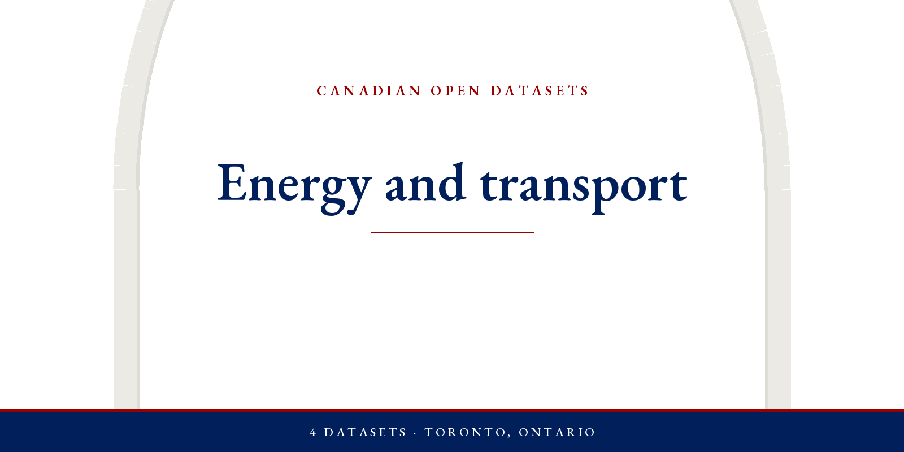

<p align="center"></p>

# Canada railway grade crossings

*Transport Canada inventory of location, protection and traffic*

**Theme:** [Energy and transport](../../README.md#energy-and-transport) · **Coverage:** See the notes below · **Kaggle:** [https://www.kaggle.com/datasets/johnnykhan1/canada-railway-grade-crossings](https://www.kaggle.com/datasets/johnnykhan1/canada-railway-grade-crossings)

## What it is

A tidy extract of Transport Canada's Grade Crossings Inventory: one row for each railway grade crossing in the official English 2023 update, with location, railway, protection, traffic estimates, and five-year accident, fatality and injury counts.

Source dataset: [Grade Crossings Inventory](https://open.canada.ca/data/en/dataset/d0f54727-6c0b-4e5a-aa04-ea1463cf9f4c) (Transport Canada). The official English CSV, data dictionary and preamble were downloaded from the Open Government Portal on November 9, 2026. The inventory file is named en-grade-crossing-inventory-2023-update.csv (last modified 9 October 2024 on the portal). The official preamble states that the current list was compiled using data as of December 5th, 2022, and that the list was first published in April 2016 and is updated annually.

## Who it helps

Drivers and fleet owners, energy analysts, rail and road safety staff, and anyone tracking Canada's power and fuel mix.

## Files

| File | Size | Where |
|---|---:|---|
| [`cover.png`](data/cover.png) | 36 KB | in this repository |
| [`crossings_by_province.csv`](data/crossings_by_province.csv) | 1 KB | in this repository |
| [`data_dictionary.csv`](data/data_dictionary.csv) | 6 KB | in this repository |
| [`grade_crossings.csv`](data/grade_crossings.csv) | 4.1 MB | in this repository |
| [`official_column_dictionary.csv`](data/official_column_dictionary.csv) | 7 KB | in this repository |

## Columns

### `crossings_by_province.csv`

Counts and official 5-year accident, fatality and injury totals by province or territory, summed from this inventory.

| Column | Type | Description |
|---|---|---|
| `province` | Text | Official province or territory code as published (column Province). |
| `province_name` | Text | English province or territory name corresponding to the official code. Added in this extract for readability. |
| `n_crossings` | Integer | Count of official inventory rows in that province or territory. |
| `n_with_coordinates` | Integer | Count of official rows in that province or territory that have both latitude and longitude. |
| `accidents_sum` | Integer | Sum of official 5-year accident counts in that province or territory. |
| `fatalities_sum` | Integer | Sum of official 5-year fatality counts in that province or territory. |
| `injuries_sum` | Integer | Sum of official 5-year serious injury counts in that province or territory. |
| `n_public` | Integer | Count of official rows with Access equal to Public. |
| `n_private` | Integer | Count of official rows with Access equal to Private. |
| `n_federal` | Integer | Count of official rows with Jurisdiction equal to F. |
| `n_provincial` | Integer | Count of official rows with Jurisdiction equal to P. |
| `n_urban` | Integer | Count of official rows with IsUrban equal to Y. |
| `n_not_urban` | Integer | Count of official rows with IsUrban equal to N. |

### `data_dictionary.csv`

Column dictionary for every CSV in this dataset.

| Column | Type | Description |
|---|---|---|
| `file` | Text | CSV file the column belongs to. |
| `column` | Text | Column name in that file. |
| `type` | Text | Field type (datetime, string, number or integer). |
| `description` | Text | What the column contains. |

### `grade_crossings.csv`

Tidy extract of the official English Grade Crossings Inventory, one row per crossing.

| Column | Type | Description |
|---|---|---|
| `risk_rank` | Integer | Official GradeX relative risk rank in this inventory (column Rank). 1 is the highest ranked crossing in this list. The official preamble explains the factors used and their limits. |
| `tc_number` | Integer | Official Transport Canada crossing identifier (column TC Number). |
| `railway_company` | Text | Responsible railway company as published (column Railway Company). |
| `region` | Text | Official Transport Canada region code as published (column Region). |
| `province` | Text | Official province or territory code as published (column Province). |
| `province_name` | Text | English province or territory name corresponding to the official code. Added in this extract for readability. |
| `access` | Text | Public or Private as published, or blank when the official file has a hyphen. |
| `jurisdiction` | Text | F for federal or P for provincial, as published, or blank when the official file has a hyphen. |
| `mile` | Float | Railway mileage on the subdivision, in miles, as published. |
| `subdivision` | Text | Subdivision name as published. |
| `spur_mile_point` | Float | Mileage on the spur, in miles, when the crossing is on a spur. Blank when the official file has a hyphen. |
| `spur_name` | Text | Spur name as published, or blank when the official file has a hyphen. |
| `location` | Text | Location or road name as published, or blank when the official file has a hyphen. |
| `latitude` | Text | Latitude as published. Blank when the official file has a hyphen. |
| `longitude` | Text | Longitude as published. Blank when the official file has a hyphen. |
| `road_authority` | Text | Road authority as published (official CSV header is Road  Authority, with two spaces). |
| `protection` | Text | Warning system as published: Passive, Active - FLB, Active - FLBG, Other, or blank when the official file has a hyphen. |
| `accidents` | Integer | Number of accidents at this crossing over the last 5 years, as published, from Transportation Safety Board data according to the official dictionary. |
| `fatalities` | Integer | Number of fatalities at this crossing over the last 5 years, as published, from Transportation Safety Board data according to the official dictionary. Official CSV header: Fatality. |
| `injuries` | Integer | Number of persons seriously injured at this crossing over the last 5 years, as published, from Transportation Safety Board data according to the official dictionary. Official CSV header: Injury. |
| `trains_daily` | Float | Estimated daily train movements as published, or blank when the official file has a hyphen. |
| `vehicles_daily` | Integer | Estimated daily road vehicles as published, or blank when the official file has a hyphen. |
| `train_max_speed_mph` | Integer | Estimated maximum train speed in miles per hour as published, or blank when the official file has a hyphen. |
| `road_speed_kmh` | Integer | Estimated road speed in kilometres per hour as published (official CSV header: Road Speed (km/h); official dictionary header: Road Max Speed (km/h)). Blank when the official file has a hyphen. |
| `lanes` | Integer | Number of road lanes as published, or blank when the official file has a hyphen. |
| `tracks` | Integer | Number of railway tracks as published, or blank when the official file has a hyphen. |
| `is_urban` | Boolean | Y or N as published, or blank when the official file has a hyphen. Official CSV header: IsUrban. |

### `official_column_dictionary.csv`

English and French field definitions from the official Transport Canada data dictionary workbook.

| Column | Type | Description |
|---|---|---|
| `tidy_column` | Text | Column name used in grade_crossings.csv. |
| `official_csv_header` | Text | Header in the official English inventory CSV. |
| `dictionary_header_english` | Text | English header printed in the official data dictionary workbook. |
| `dictionary_header_french` | Text | French header printed in the official data dictionary workbook. |
| `definition_english` | Text | English definition from the official data dictionary workbook. |
| `definition_french` | Text | French definition from the official data dictionary workbook. |
| `data_element` | Integer | Official data element number from the dictionary workbook. |
| `data_type` | Text | Official data type text from the data dictionary workbook. |
| `header_note` | Text | Note when the official inventory CSV header and the official dictionary header are not identical. |

## Source and licence

**Source:** Transport Canada, Grade Crossings Inventory, https://open.canada.ca/data/en/dataset/d0f54727-6c0b-4e5a-aa04-ea1463cf9f4c. Official English inventory CSV (https://open.canada.ca/data/dataset/d0f54727-6c0b-4e5a-aa04-ea1463cf9f4c/resource/a53fda5b-134f-449d-a639-9b896065fc21/download/en-grade-crossing-inventory-2023-update.csv), data dictionary workbook (https://open.canada.ca/data/dataset/d0f54727-6c0b-4e5a-aa04-ea1463cf9f4c/resource/594a421b-e1d2-4cf2-b71c-ac7689338f25/download/grade_crossing_inventory_data_dictionary.xls), and preamble PDF (https://open.canada.ca/data/dataset/d0f54727-6c0b-4e5a-aa04-ea1463cf9f4c/resource/6c6d0d30-4a78-4217-9f24-5846414345a8/download/preamble_to_grade_crossings_list-_2023_bilingual_open_data.pdf), downloaded on November 9, 2026. The inventory file on the portal is dated 9 October 2024. The official preamble states the list was compiled using data as of December 5th, 2022. Downloaded from the official open data release and reshaped into tidy CSV files by John Khan, November 2026.

- **Licence:** [Open Government Licence – Canada 2.0](https://open.canada.ca/en/open-government-licence-canada). Contains information licensed under the Open Government Licence – Canada.

The published values were not changed beyond what is described here. The full licence terms for this folder are in [LICENSE.md](LICENSE.md).

## Citation

No DOI has been minted for this dataset yet; please cite the Kaggle page.

```bibtex
@misc{khan2026canadarailwaygradecrossings,
  author    = {Khan, John},
  title     = {Canada railway grade crossings},
  year      = {2026},
  publisher = {Kaggle},
  address   = {Toronto, Ontario, Canada},
  url       = {https://www.kaggle.com/datasets/johnnykhan1/canada-railway-grade-crossings}
}
```

APA: Khan, J. (2026). *Canada railway grade crossings* [Data set]. Kaggle. https://www.kaggle.com/datasets/johnnykhan1/canada-railway-grade-crossings

<details><summary>Full notes from the Kaggle page</summary>

## What this is

A tidy extract of Transport Canada's Grade Crossings Inventory: one row for each railway grade crossing in the official English 2023 update, with location, railway, protection, traffic estimates, and five-year accident, fatality and injury counts.

Source dataset: [Grade Crossings Inventory](https://open.canada.ca/data/en/dataset/d0f54727-6c0b-4e5a-aa04-ea1463cf9f4c) (Transport Canada). The official English CSV, data dictionary and preamble were downloaded from the Open Government Portal on November 9, 2026. The inventory file is named en-grade-crossing-inventory-2023-update.csv (last modified 9 October 2024 on the portal). The official preamble states that the current list was compiled using data as of December 5th, 2022, and that the list was first published in April 2016 and is updated annually.

## Coverage

24,852 crossings and 11 official province or territory codes, each with a distinct TC Number. Official access: 16,239 public, 8,562 private, and the rest blank where the official file has a hyphen. Official jurisdiction: 20,021 federal (F) and 4,785 provincial (P), with the rest blank where the official file has a hyphen.

Crossings by official province or territory code, from this inventory: Quebec 6,837, Saskatchewan 4,744, Ontario 4,582, Alberta 2,898, British Columbia 2,264, Manitoba 2,159, New Brunswick 926, Nova Scotia 401, Newfoundland and Labrador 20, Northwest Territories 18, Yukon 3.

The official five-year counts in this inventory sum to 600 accidents, 75 fatalities and 227 serious injuries. 1,128 rows are missing latitude or longitude because the official file has a hyphen in that field. Those rows are kept.

## Updates

This upload is a snapshot of the official 2023 update pulled on November 9, 2026, and is not refreshed on a schedule. For a later extract, use the official Open Government Portal record.

## Methodology

Downloaded from the official open data release and reshaped into tidy CSV files by John Khan, November 2026.

Column names were changed to snake_case. Official hyphens used as placeholders were stored as blank cells. An English province or territory name was added from the official code. No crossings were dropped, and official ranks, traffic estimates and five-year counts were not altered. crossings_by_province.csv is a summary of this same inventory, not a separate official table.

A few official inventory headers differ from the official data dictionary workbook, which is itself titled Grade Crossings Inventory, 2022 Update. Those differences are recorded in official_column_dictionary.csv. The inventory CSV is the source for values in this extract.

## A few numbers from this snapshot

* 24,852 official crossings in the 2023 inventory update.
* Official five-year totals in this file: 600 accidents, 75 fatalities, 227 serious injuries.
* Quebec has the largest official count in this inventory, 6,837 crossings.

## Example uses

* Map crossings that have official coordinates, and compare protection type with official daily train and vehicle estimates.
* Compare official five-year accident counts by province or by protection type, remembering that the counts are for five years at the time of this inventory, not a live feed.
* Look at the official risk rank alongside traffic and protection, after reading the official preamble on what that rank does and does not include.

## Caveats

The official preamble says the list ranks crossings according to their risk using Transport Canada's GradeX tool, based on TSB occurrence data, road and railway traffic, speeds, tracks and lanes, urban or rural setting, and warning systems. It also says this is not a comprehensive list of risk factors, and that risk is not the same as danger: a higher official rank does not by itself mean a crossing is unsafe.

The official dictionary says accident, fatality and injury counts are for the last 5 years at that location and come from the Transportation Safety Board. Traffic and speed fields are official estimates. Many official fields use a hyphen when a value is not provided; those are blank here.

Latitude and longitude are kept as published. Some official coordinates may be imprecise or may not sit exactly on the crossing. Do not treat a missing coordinate as zero.

This inventory is not a list of every current occurrence, and it is not the Transportation Safety Board's Rail Occurrence Database. Company names, road names and authorities are kept as published.

## Licence

Contains information licensed under the [Open Government Licence Canada](https://open.canada.ca/en/open-government-licence-canada). Credit: Transport Canada, Grade Crossings Inventory, https://open.canada.ca/data/en/dataset/d0f54727-6c0b-4e5a-aa04-ea1463cf9f4c.

## Files

* `grade_crossings.csv`: one row per official crossing in the English 2023 inventory update.
* `crossings_by_province.csv`: official row counts and five-year count totals by province or territory, summed from this inventory.
* `official_column_dictionary.csv`: field definitions from the official data dictionary workbook.
* `data_dictionary.csv`: column dictionary for the files in this extract.


</details>

---
Compiled by John Khan, Toronto, Ontario. Part of the [Canadian Open Datasets](../../README.md) catalogue.
