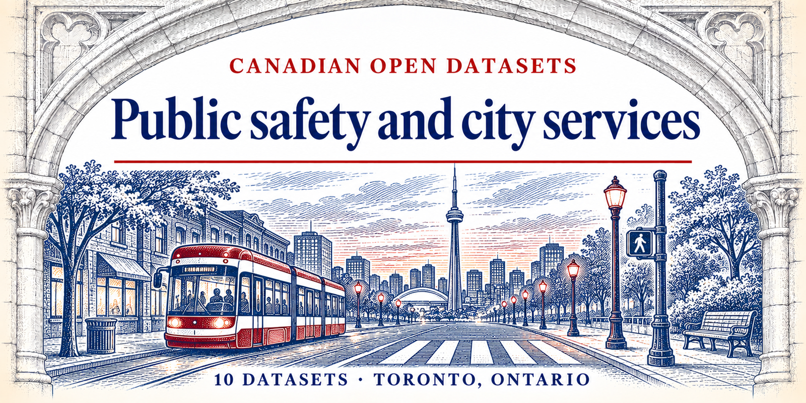

<p align="center"></p>

# Canada and Toronto religion hate crimes

*Jewish, Muslim and other religion targets from StatCan and TPS*

**Theme:** [Public safety and city services](../../README.md#public-safety-and-city-services) · **Coverage:** 2014 to 2025 · **Kaggle:** [https://www.kaggle.com/datasets/johnnykhan1/canada-toronto-religion-hate-crimes](https://www.kaggle.com/datasets/johnnykhan1/canada-toronto-religion-hate-crimes)

## What it is

Religion-motivated hate crimes for Canada and Toronto in one place, with a religion target column so anti-Jewish and anti-Muslim rows are clearly broken out. Other religions are kept as published.

National and regional figures come from Statistics Canada Table [35-10-0066](https://www150.statcan.gc.ca/t1/tbl1/en/tv.action?pid=3510006601). Toronto figures come from the Toronto Police Service Hate Crime Unit open data on the City of Toronto Open Data portal.

Aggregated counts only. No personal information.

## Who it helps

Residents, community groups, road safety advocates, city councillors, reporters and researchers in Toronto and other Canadian cities.

## Files

| File | Size | Where |
|---|---:|---|
| [`DATA_GAPS.txt`](data/DATA_GAPS.txt) | 1 KB | in this repository |
| [`canada_religion_detail_by_year.csv`](data/canada_religion_detail_by_year.csv) | 10 KB | in this repository |
| [`combined_religion_targets_canada_toronto.csv`](data/combined_religion_targets_canada_toronto.csv) | 9 KB | in this repository |
| [`cover.png`](data/cover.png) | 59 KB | in this repository |
| [`data_dictionary.csv`](data/data_dictionary.csv) | 6 KB | in this repository |
| [`jewish_muslim_by_year_and_region.csv`](data/jewish_muslim_by_year_and_region.csv) | 3 KB | in this repository |
| [`region_religion_total_by_year.csv`](data/region_religion_total_by_year.csv) | 11 KB | in this repository |
| [`religion_hate_crimes_statcan_long.csv`](data/religion_hate_crimes_statcan_long.csv) | 20 KB | in this repository |
| [`statcan_table_metadata.csv`](data/statcan_table_metadata.csv) | 10 KB | in this repository |
| [`toronto_religion_by_year.csv`](data/toronto_religion_by_year.csv) | 3 KB | in this repository |
| [`toronto_religion_events.csv`](data/toronto_religion_events.csv) | 150 KB | in this repository |

## Columns

### `canada_religion_detail_by_year.csv`

Canada only, detailed religion targets by year.

| Column | Type | Description |
|---|---|---|
| `year` | Integer | Calendar year of the count. |
| `ref_date` | Date | Reference date as YYYY-MM-DD (January 1 for annual figures). |
| `geo` | Text | Geography name as published, or Toronto for citywide TPS rows. |
| `geo_level` | Text | Geography level: canada, region, province_or_canada, cma_or_ca, city or neighbourhood. |
| `dguid` | Text | Statistics Canada Dissemination Geography Unique Identifier. |
| `motivation` | Text | Hate crime motivation as published (for example Jewish or Muslim (Islam)). |
| `motivation_group` | Text | religion_total for the Religion aggregate, or religion_detail for a specific target. |
| `incidents` | Integer | Number of police-reported hate crime incidents. |
| `source` | Text | Data source short name. |

### `combined_religion_targets_canada_toronto.csv`

Side by side Canada (StatCan) and Toronto (TPS) yearly religion target counts.

| Column | Type | Description |
|---|---|---|
| `year` | Integer | Calendar year of the count. |
| `geo` | Text | Geography name as published, or Toronto for citywide TPS rows. |
| `geo_level` | Text | Geography level: canada, region, province_or_canada, cma_or_ca, city or neighbourhood. |
| `religion_target` | Text | Religion or belief target recorded on the occurrence. |
| `events` | Integer | Count of verified hate crime occurrences or religion-bias mentions. |
| `source` | Text | Data source short name. |

### `data_dictionary.csv`

Column descriptions for every file.

| Column | Type | Description |
|---|---|---|
| `file` | Text | Name of the column being described |
| `column` | Text | File that contains the column |
| `type` | Text | Data type of the column |
| `description` | Text | Plain-language description of the column |

### `jewish_muslim_by_year_and_region.csv`

Jewish and Muslim (Islam) counts by year for Canada and selected regions.

| Column | Type | Description |
|---|---|---|
| `year` | Integer | Calendar year of the count. |
| `ref_date` | Date | Reference date as YYYY-MM-DD (January 1 for annual figures). |
| `geo` | Text | Geography name as published, or Toronto for citywide TPS rows. |
| `geo_level` | Text | Geography level: canada, region, province_or_canada, cma_or_ca, city or neighbourhood. |
| `dguid` | Text | Statistics Canada Dissemination Geography Unique Identifier. |
| `motivation` | Text | Hate crime motivation as published (for example Jewish or Muslim (Islam)). |
| `motivation_group` | Text | religion_total for the Religion aggregate, or religion_detail for a specific target. |
| `incidents` | Integer | Number of police-reported hate crime incidents. |
| `source` | Text | Data source short name. |

### `region_religion_total_by_year.csv`

Religion aggregate counts by Canada and selected regions by year.

| Column | Type | Description |
|---|---|---|
| `year` | Integer | Calendar year of the count. |
| `ref_date` | Date | Reference date as YYYY-MM-DD (January 1 for annual figures). |
| `geo` | Text | Geography name as published, or Toronto for citywide TPS rows. |
| `geo_level` | Text | Geography level: canada, region, province_or_canada, cma_or_ca, city or neighbourhood. |
| `dguid` | Text | Statistics Canada Dissemination Geography Unique Identifier. |
| `motivation` | Text | Hate crime motivation as published (for example Jewish or Muslim (Islam)). |
| `motivation_group` | Text | religion_total for the Religion aggregate, or religion_detail for a specific target. |
| `incidents` | Integer | Number of police-reported hate crime incidents. |
| `source` | Text | Data source short name. |

### `religion_hate_crimes_statcan_long.csv`

StatCan 35-10-0066 religion motivations by year and region, including Jewish and Muslim (Islam).

| Column | Type | Description |
|---|---|---|
| `year` | Integer | Calendar year of the count. |
| `ref_date` | Date | Reference date as YYYY-MM-DD (January 1 for annual figures). |
| `geo` | Text | Geography name as published, or Toronto for citywide TPS rows. |
| `geo_level` | Text | Geography level: canada, region, province_or_canada, cma_or_ca, city or neighbourhood. |
| `dguid` | Text | Statistics Canada Dissemination Geography Unique Identifier. |
| `motivation` | Text | Hate crime motivation as published (for example Jewish or Muslim (Islam)). |
| `motivation_group` | Text | religion_total for the Religion aggregate, or religion_detail for a specific target. |
| `incidents` | Integer | Number of police-reported hate crime incidents. |
| `source` | Text | Data source short name. |

### `statcan_table_metadata.csv`

Official Statistics Canada cube metadata shipped with the table download, including notes and the symbol legend. Layout is as published, not tidied.

| Column | Type | Description |
|---|---|---|
| `Cube Title` | Text | — |
| `Product Id` | Text | — |
| `CANSIM Id` | Text | — |
| `URL` | Text | — |
| `Cube Notes` | Text | — |
| `Archive Status` | Text | — |
| `Frequency` | Text | — |
| `Start Reference Period` | Text | — |
| `End Reference Period` | Date | — |
| `Total number of dimensions` | Integer | — |

### `toronto_religion_by_year.csv`

Toronto Police Service verified religion-bias mentions by reported year and religion target.

| Column | Type | Description |
|---|---|---|
| `year` | Integer | Calendar year of the count. |
| `religion_target` | Text | Religion or belief target recorded on the occurrence. |
| `events` | Integer | Count of verified hate crime occurrences or religion-bias mentions. |
| `geo` | Text | Geography name as published, or Toronto for citywide TPS rows. |
| `geo_level` | Text | Geography level: canada, region, province_or_canada, cma_or_ca, city or neighbourhood. |
| `source` | Text | Data source short name. |

### `toronto_religion_events.csv`

Toronto religion-bias occurrence mentions with neighbourhood and offence detail.

| Column | Type | Description |
|---|---|---|
| `reported_year` | Integer | Year the occurrence was reported to police. |
| `occurrence_year` | Integer | Year the occurrence took place. |
| `neighbourhood_id` | Text | Toronto 158-neighbourhood model number, or NSA when not mapped. |
| `neighbourhood_name` | Text | Toronto neighbourhood name. |
| `division` | Text | Toronto Police Service division code. |
| `location_type` | Text | Type of location as published by TPS. |
| `primary_offence` | Text | Primary offence as recorded by the Hate Crime Unit. |
| `religion_target` | Text | Religion or belief target recorded on the occurrence. |
| `multiple_bias` | Boolean | Whether more than one bias category was recorded. |
| `arrest_made` | Boolean | Whether an arrest was recorded. |
| `source` | Text | Data source short name. |

## Source and licence

**Source:** Statistics Canada Table 35-10-0066 (November 9, 2026). Toronto Police Service Hate Crimes Open Data. Prepared by John Khan in Toronto, Ontario.

- **Licence:** [Statistics Canada Open Licence](https://www.statcan.gc.ca/en/terms-conditions/open-licence). Source: Statistics Canada. This is an adaptation of Statistics Canada data; it does not constitute an endorsement by Statistics Canada.
- **Licence:** [Open Government Licence – Toronto](https://open.toronto.ca/open-data-licence/). Contains information licensed under the Open Government Licence – Toronto.

The published values were not changed beyond what is described here. The full licence terms for this folder are in [LICENSE.md](LICENSE.md).

## Citation

No DOI has been minted for this dataset yet; please cite the Kaggle page.

```bibtex
@misc{khan2026canadatorontoreligionhatecrimes,
  author    = {Khan, John},
  title     = {Canada and Toronto religion hate crimes},
  year      = {2026},
  publisher = {Kaggle},
  address   = {Toronto, Ontario, Canada},
  url       = {https://www.kaggle.com/datasets/johnnykhan1/canada-toronto-religion-hate-crimes}
}
```

APA: Khan, J. (2026). *Canada and Toronto religion hate crimes* [Data set]. Kaggle. https://www.kaggle.com/datasets/johnnykhan1/canada-toronto-religion-hate-crimes

<details><summary>Full notes from the Kaggle page</summary>

## What this is

Religion-motivated hate crimes for Canada and Toronto in one place, with a religion target column so anti-Jewish and anti-Muslim rows are clearly broken out. Other religions are kept as published.

National and regional figures come from Statistics Canada Table [35-10-0066](https://www150.statcan.gc.ca/t1/tbl1/en/tv.action?pid=3510006601). Toronto figures come from the Toronto Police Service Hate Crime Unit open data on the City of Toronto Open Data portal.

Aggregated counts only. No personal information.

## Files

| File | What is in it |
|---|---|
| `religion_hate_crimes_statcan_long.csv` | StatCan religion motivations by year and region |
| `canada_religion_detail_by_year.csv` | Canada detailed religion targets by year |
| `region_religion_total_by_year.csv` | Religion aggregate by Canada and regions |
| `jewish_muslim_by_year_and_region.csv` | Jewish and Muslim counts by year and region |
| `toronto_religion_by_year.csv` | Toronto yearly counts by religion target |
| `toronto_religion_events.csv` | Toronto religion-bias occurrence mentions |
| `combined_religion_targets_canada_toronto.csv` | Canada and Toronto yearly targets side by side |
| `data_dictionary.csv` | Column descriptions |
| `statcan_table_metadata.csv` | Official StatCan cube notes |
| `cover.png` | Cover chart |

## Coverage

StatCan: years with published values in this snapshot run through 2025. Geographies are Canada (selected police services) and selected regions (Atlantic, Quebec, Ontario, Manitoba, Saskatchewan, Alberta, British Columbia, Territories). Detailed religion targets include Jewish, Muslim (Islam), Catholic, Christian Orthodox, Sikh, Hindu, Buddhist, and other published categories.

Toronto: verified occurrences reported 2018 through 2025. Religion bias detail is recorded on the occurrence (for example Jewish or Muslim). Multi-target events are expanded so each listed religion appears once.

## A few numbers from this snapshot

* In 2025, Statistics Canada recorded 788 police-reported hate crimes motivated by anti-Jewish bias in Canada (selected police services).
* In the same year, 204 were motivated by anti-Muslim (Islam) bias.
* In Toronto, the Hate Crime Unit recorded 96 Jewish-target religion-bias mentions in reported year 2025.
* In Toronto, Muslim-target religion-bias mentions were 17 in reported year 2025.

## Caveats

* Police-reported hate crimes include confirmed and suspected incidents. Not every hate incident is reported to police.
* StatCan region rows and the Canada total are not independent samples. Do not sum regions to rebuild Canada without checking the survey notes.
* The Religion aggregate row is a total for religion motivation. Detailed targets sit under it. Do not add the Religion row to the detail rows.
* Toronto counts are verified Hate Crime Unit occurrences. An event can carry more than one bias. The Toronto yearly file counts religion-bias mentions by target after expanding multi-target strings.
* StatCan table 35-10-0066 does not publish religion detail by CMA. Table 35-10-0191 has CMA hate crime totals without a religion breakdown.
* Counts can be revised when Statistics Canada or TPS update their files.

## Sources

Statistics Canada, Table 35-10-0066, downloaded November 9, 2026: https://www150.statcan.gc.ca/t1/tbl1/en/tv.action?pid=3510006601

Toronto Police Service Hate Crime Unit, Hate Crimes Open Data: https://open.toronto.ca/dataset/hate-crimes-open-data/

## Licence

StatCan figures are shared under the [Statistics Canada Open Licence](https://www.statcan.gc.ca/en/terms-conditions/open-licence). Toronto figures contain information licensed under the [Open Government Licence – Toronto](https://open.toronto.ca/open-data-licence/). TPS Public Safety Data Portal terms also apply. This dataset is not an official Statistics Canada or Toronto Police Service product.

Author: John Khan. Location: Toronto, Ontario.


</details>

---
Compiled by John Khan, Toronto, Ontario. Part of the [Canadian Open Datasets](../../README.md) catalogue.
