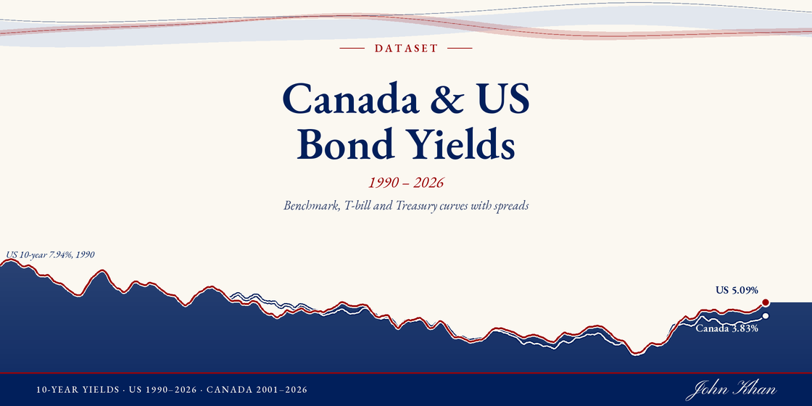

<p align="center"></p>

# Canada and US Government Bond Yields 1990 to 2026

*Daily Canadian benchmark and US Treasury yields, weekly bills and spreads*

**Theme:** [Interest rates, credit and markets](../../README.md#interest-rates-credit-and-markets) · **Coverage:** 2 January 1990 to 16 October 2026 · **Kaggle:** [https://www.kaggle.com/datasets/johnnykhan1/canada-us-government-bond-yields](https://www.kaggle.com/datasets/johnnykhan1/canada-us-government-bond-yields)

## What it is

Government bond and treasury bill yields for Canada and the United States, pulled October 17, 2026. From the Bank of Canada: benchmark yields at 2, 3, 5, 7 and 10 years plus the long bond and the Real Return Bond, every business day from January 2001, average yields by maturity band, weekly treasury bill yields from 2000 and treasury bill auction results. From the US Department of the Treasury: the nominal par yield curve from 1 month to 30 years, daily from January 1990, and the real yield curve from 2003. A joined daily panel from January 2001 adds Canada minus US spreads at 2 and 10 years and the slope of each curve. Yields are in percent a year.

## Who it helps

Borrowers, mortgage professionals, lenders, investors, finance students and economists tracking Canadian rates, credit and the dollar.

## Files

| File | Size | Where |
|---|---:|---|
| [`KAGGLE_NOTES.md`](data/KAGGLE_NOTES.md) | 5 KB | in this repository |
| [`canada_benchmark_bond_yields_daily.csv`](data/canada_benchmark_bond_yields_daily.csv) | 292 KB | in this repository |
| [`canada_marketable_bond_avg_yields_daily.csv`](data/canada_marketable_bond_avg_yields_daily.csv) | 197 KB | in this repository |
| [`canada_tbill_auction_yields.csv`](data/canada_tbill_auction_yields.csv) | 19 KB | in this repository |
| [`canada_tbill_yields_weekly.csv`](data/canada_tbill_yields_weekly.csv) | 43 KB | in this repository |
| [`canada_us_yields_daily_panel.csv`](data/canada_us_yields_daily_panel.csv) | 572 KB | in this repository |
| [`scripts/build_dataset.py`](data/scripts/build_dataset.py) | 6 KB | in this repository |
| [`us_treasury_par_yield_curve_daily.csv`](data/us_treasury_par_yield_curve_daily.csv) | 620 KB | in this repository |
| [`us_treasury_real_yield_curve_daily.csv`](data/us_treasury_real_yield_curve_daily.csv) | 208 KB | in this repository |

## Columns

### `canada_benchmark_bond_yields_daily.csv`

Government of Canada benchmark bond yields, daily

| Column | Type | Description |
|---|---|---|
| `date` | Date | — |
| `ca_2y` | Float | — |
| `ca_3y` | Float | — |
| `ca_5y` | Float | — |
| `ca_7y` | Float | — |
| `ca_10y` | Float | — |
| `ca_long` | Float | — |
| `ca_real_return_long` | Float | — |

### `canada_marketable_bond_avg_yields_daily.csv`

Average yields of GoC marketable bonds by maturity band, daily

| Column | Type | Description |
|---|---|---|
| `date` | Date | — |
| `ca_avg_1to3y` | Float | — |
| `ca_avg_3to5y` | Float | — |
| `ca_avg_5to10y` | Float | — |
| `ca_avg_over10y` | Float | — |

### `canada_tbill_auction_yields.csv`

Government of Canada treasury bill average auction yields

| Column | Type | Description |
|---|---|---|
| `date` | Date | — |
| `auction_1m_2024_2025` | Float | — |
| `auction_3m` | Float | — |
| `auction_6m` | Float | — |
| `auction_1y` | Float | — |

### `canada_tbill_yields_weekly.csv`

Government of Canada treasury bill yields, weekly

| Column | Type | Description |
|---|---|---|
| `date` | Date | — |
| `tbill_1m` | Float | — |
| `tbill_3m` | Float | — |
| `tbill_6m` | Float | — |
| `tbill_1y` | Float | — |

### `canada_us_yields_daily_panel.csv`

Joined daily Canada-US panel with spreads and slopes

| Column | Type | Description |
|---|---|---|
| `date` | Date | Observation date |
| `ca_2y` | Float | Government of Canada 2-year benchmark bond yield (%) |
| `ca_5y` | Float | GoC 5-year benchmark bond yield (%) |
| `ca_10y` | Float | GoC 10-year benchmark bond yield (%) |
| `ca_long` | Float | GoC long-term benchmark bond yield (%) |
| `ca_real_return_long` | Float | GoC long-term Real Return Bond yield (real, %) |
| `us_3m` | Float | US Treasury par yield, 3 months (%) |
| `us_2y` | Float | US Treasury par yield, 2 years (%) |
| `us_5y` | Float | US Treasury par yield, 5 years (%) |
| `us_10y` | Float | US Treasury par yield, 10 years (%) |
| `us_30y` | Float | US Treasury par yield, 30 years (%) |
| `ca_tbill_3m_last_weekly` | Float | Latest weekly GoC 3-month T-bill yield on or before the date (%) |
| `spread_2y_ca_minus_us` | Float | ca_2y minus us_2y (percentage points) |
| `spread_10y_ca_minus_us` | Float | ca_10y minus us_10y (percentage points) |
| `slope_ca_10y_minus_2y` | Float | ca_10y minus ca_2y (percentage points) |
| `slope_us_10y_minus_2y` | Float | us_10y minus us_2y (percentage points) |
| `slope_us_10y_minus_3m` | Float | us_10y minus us_3m (percentage points) |

### `us_treasury_par_yield_curve_daily.csv`

US Treasury daily par yield curve, 1990 onward

| Column | Type | Description |
|---|---|---|
| `date` | Date | — |
| `us_1m` | Text | — |
| `us_6w` | Text | — |
| `us_2m` | Text | — |
| `us_3m` | Float | — |
| `us_4m` | Text | — |
| `us_6m` | Float | — |
| `us_1y` | Float | — |
| `us_2y` | Float | — |
| `us_3y` | Float | — |
| `us_5y` | Float | — |
| `us_7y` | Float | — |
| `us_10y` | Float | — |
| `us_20y` | Float | — |
| `us_30y` | Float | — |

### `us_treasury_real_yield_curve_daily.csv`

US Treasury daily real (TIPS) par yield curve, 2003 onward

| Column | Type | Description |
|---|---|---|
| `date` | Date | — |
| `us_real_5y` | Float | — |
| `us_real_7y` | Float | — |
| `us_real_10y` | Float | — |
| `us_real_20y` | Float | — |
| `us_real_30y` | Text | — |

## Source and licence

**Source:** Bank of Canada Valet API, https://www.bankofcanada.ca/valet/docs (benchmark bond yields, marketable bond average yields, treasury bill yields and auction results) and US Department of the Treasury daily par and real yield curve rates, https://home.treasury.gov/policy-issues/financing-the-government/interest-rate-statistics. Collected by John Khan on 2026-10-17 with scripts/build_dataset.py; spreads are simple differences of the published series.

- **Licence:** [Bank of Canada terms of use](https://www.bankofcanada.ca/terms/). Source: Bank of Canada. Content may be used, copied and distributed for free with credit to the Bank of Canada and a note of changes made. Not endorsed by the Bank of Canada.

The published values were not changed beyond what is described here. The full licence terms for this folder are in [LICENSE.md](LICENSE.md).

## Citation

No DOI has been minted for this dataset yet; please cite the Kaggle page.

```bibtex
@misc{khan2026canadausgovernmentbondyields,
  author    = {Khan, John},
  title     = {Canada and US Government Bond Yields 1990 to 2026},
  year      = {2026},
  publisher = {Kaggle},
  address   = {Toronto, Ontario, Canada},
  url       = {https://www.kaggle.com/datasets/johnnykhan1/canada-us-government-bond-yields}
}
```

APA: Khan, J. (2026). *Canada and US Government Bond Yields 1990 to 2026* [Data set]. Kaggle. https://www.kaggle.com/datasets/johnnykhan1/canada-us-government-bond-yields

<details><summary>Full notes from the Kaggle page</summary>

## What this is

Government bond and treasury bill yields for Canada and the United States, pulled October 17, 2026. From the Bank of Canada: benchmark yields at 2, 3, 5, 7 and 10 years plus the long bond and the Real Return Bond, every business day from January 2001, average yields by maturity band, weekly treasury bill yields from 2000 and treasury bill auction results. From the US Department of the Treasury: the nominal par yield curve from 1 month to 30 years, daily from January 1990, and the real yield curve from 2003. A joined daily panel from January 2001 adds Canada minus US spreads at 2 and 10 years and the slope of each curve. Yields are in percent a year.

## Files

| File | Frequency | Coverage | What is in it |
|---|---|---|---|
| `canada_us_yields_daily_panel.csv` | Business daily (days both markets published) | January 2001 to October 2026 | Canada 2, 5 and 10 year, long bond and Real Return Bond; US 3 month, 2, 5, 10 and 30 year; the latest weekly Canadian 3 month bill; Canada minus US spreads at 2 and 10 years; 10 year minus 2 year slopes for both; US 10 year minus 3 month slope |
| `canada_benchmark_bond_yields_daily.csv` | Business daily | January 2001 to October 2026 | `ca_2y`, `ca_3y`, `ca_5y`, `ca_7y`, `ca_10y`, `ca_long`, `ca_real_return_long` |
| `canada_marketable_bond_avg_yields_daily.csv` | Business daily | January 2001 to October 2026 | Average yields of Government of Canada marketable bonds: 1 to 3 years, 3 to 5 years, 5 to 10 years, over 10 years |
| `canada_tbill_yields_weekly.csv` | Weekly (Wednesday) | January 2000 to October 2026 | Treasury bill yields: 1 month, 3 months, 6 months, 1 year |
| `canada_tbill_auction_yields.csv` | Each auction (about every two weeks) | January 2000 to October 2026 | Average auction yields: 3 months, 6 months, 1 year, plus the 1 month bills issued May 2024 to July 2025 |
| `us_treasury_par_yield_curve_daily.csv` | Business daily | January 1990 to October 2026 | Par yields from 1 month to 30 years (`us_1m` to `us_30y`) |
| `us_treasury_real_yield_curve_daily.csv` | Business daily | January 2003 to October 2026 | Real par yields at 5, 7, 10, 20 and 30 years |
| `scripts/build_dataset.py` | | | Rebuilds every file from the public sources (`--refresh` to download again) |

## Column notes

* `ca_long` is the Government of Canada long term benchmark bond, around 30 years.
* `ca_real_return_long` is the long Real Return Bond yield, a real yield. `ca_long` minus `ca_real_return_long` gives a simple breakeven inflation rate.
* `ca_tbill_3m_last_weekly` in the panel is the most recent weekly 3 month bill yield on or before that date, up to 7 days old.
* Spreads and slopes are in percentage points. For example, `spread_2y_ca_minus_us` is `ca_2y` minus `us_2y`.

## Coverage notes

Values are left empty where the source did not publish. Nothing is interpolated.

* US par curve: 1 month from July 31, 2001; 2 month from October 16, 2018; 4 month from October 19, 2022; 6 week (`us_6w`) from February 18, 2025; 20 year from October 1, 1993. The 30 year has a gap from February 2002 to February 2006, when the Treasury suspended the bond.
* US real curve: 20 year from July 27, 2004; 30 year from February 22, 2010.
* Canadian 1 month auction bills were issued only from May 2024 to July 2025, during the move away from Bankers' Acceptances after CDOR ended.

## How it was built

The build script pulls the Bank of Canada Valet groups `bond_yields_all` and `TBILL_ALL` and the Treasury's daily par and real yield curve files, combines them into one CSV per series group and renames the columns. The panel is joined on dates both markets published, and spreads and slopes are simple differences of the published series.

## Sources

* Bank of Canada Valet API, https://www.bankofcanada.ca/valet/docs (series `BD.CDN.2YR.DQ.YLD` to `BD.CDN.10YR.DQ.YLD`, `BD.CDN.LONG.DQ.YLD`, `BD.CDN.RRB.DQ.YLD`, `CDN.AVG.*`; bills V80691342 and V80691344 to V80691346; auctions V80691303 to V80691305 and V1592248173)
* US Department of the Treasury, Daily Treasury Par Yield Curve Rates and Daily Treasury Par Real Yield Curve Rates, https://home.treasury.gov/policy-issues/financing-the-government/interest-rate-statistics

## Updates

This is a snapshot pulled on October 17, 2026. Bank of Canada data runs to October 15, 2026 and US Treasury data to October 16, 2026. Run the build script with internet on to pull newer values.

## Notebooks that use it

* [Canada vs US Yield Curves, 2001 to 2026](https://www.kaggle.com/code/johnnykhan1/canada-vs-us-yield-curves-eda)
* [Rate Spreads and the Loonie, 2007 to 2026](https://www.kaggle.com/code/johnnykhan1/rate-spreads-and-the-loonie-in-r) (R)
* [canada-macro-utils](https://www.kaggle.com/code/johnnykhan1/canada-macro-utils), a small loader script for this and my three other Bank of Canada datasets

The companion dataset [Canadian Dollar Exchange Rates 2007 to 2026](https://www.kaggle.com/datasets/johnnykhan1/canadian-dollar-exchange-rates) joins on date.

## Suggested uses

* Yield curve inversion and recession studies
* Modelling the Canada and US rate gap and the Canadian dollar
* Fitting term structure models such as Nelson Siegel
* Breakeven inflation and real rates

## Licence

* Bank of Canada data may be used, copied and distributed for free with credit to the Bank of Canada as the source and a note of changes made, without implying endorsement ([Bank of Canada terms of use](https://www.bankofcanada.ca/terms/)).
* US Treasury data is a work of the US federal government and in the public domain in the United States.
* Changes made here: JSON and yearly CSV files combined into one CSV per series group, columns renamed, and the panel joined on common dates with derived spreads and slopes.
* This dataset is not endorsed by the Bank of Canada or the US Treasury.

Author: John Khan

</details>

---
Compiled by John Khan, Toronto, Ontario. Part of the [Canadian Open Datasets](../../README.md) catalogue.
