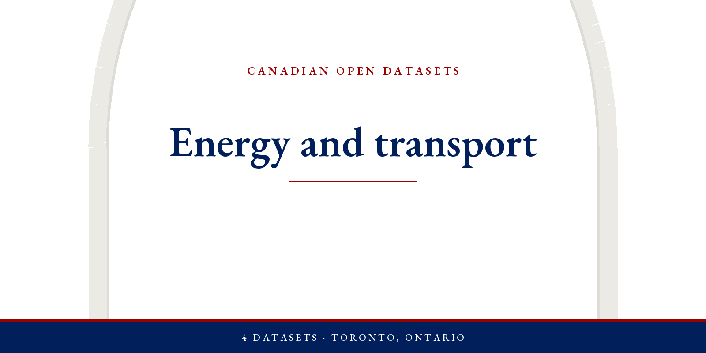

<p align="center"></p>

# Canada new vehicle registrations by fuel

*Official quarterly new registrations, 2017 to 2026, not a stock*

**Theme:** [Energy and transport](../../README.md#energy-and-transport) · **Coverage:** January 2017 to September 2026 · **Kaggle:** [https://www.kaggle.com/datasets/johnnykhan1/canada-vehicle-registrations-fuel](https://www.kaggle.com/datasets/johnnykhan1/canada-vehicle-registrations-fuel)

## What it is

Official quarterly new motor vehicle registrations by fuel type and vehicle type, tidied from [Table 20-10-0025-01](https://www150.statcan.gc.ca/t1/tbl1/en/tv.action?pid=2010002501). These are new registrations, a flow, not a stock of vehicles. The file keeps Canada, the provinces and territories, and census metropolitan areas only, with the official fuel type, a documented fuel group, an adapted BEV and PHEV share whose denominator is official All fuel types new registrations, and flags for Random Tabular Adjustment and partial years.

## Who it helps

Drivers and fleet owners, energy analysts, rail and road safety staff, and anyone tracking Canada's power and fuel mix.

## Files

| File | Size | Where |
|---|---:|---|
| [`CITATION.txt`](data/CITATION.txt) | 1 KB | in this repository |
| [`METHODS.md`](data/METHODS.md) | 3 KB | in this repository |
| [`SOURCE_MANIFEST.csv`](data/SOURCE_MANIFEST.csv) | 1 KB | in this repository |
| [`cover.png`](data/cover.png) | 84 KB | in this repository |
| [`data_dictionary.csv`](data/data_dictionary.csv) | 10 KB | in this repository |
| [`fuel_type_crosswalk.csv`](data/fuel_type_crosswalk.csv) | 1 KB | in this repository |
| [`new_vehicle_fuel_shares_quarterly.csv`](data/new_vehicle_fuel_shares_quarterly.csv) | 2.8 MB | in this repository |
| [`new_vehicle_registrations_annual_adapted.csv`](data/new_vehicle_registrations_annual_adapted.csv) | 186 KB | in this repository |
| [`new_vehicle_registrations_quarterly.csv`](data/new_vehicle_registrations_quarterly.csv) | 20.7 MB | in this repository |
| [`statcan_metadata_20-10-0025.csv`](data/statcan_metadata_20-10-0025.csv) | 276 KB | in this repository |

## Columns

### `SOURCE_MANIFEST.csv`

| Column | Type | Description |
|---|---|---|
| `source_id` | Text | — |
| `title` | Text | — |
| `url` | Text | — |
| `licence` | Text | — |
| `release_date` | Date | — |
| `retrieval_date` | Date | — |
| `file_name` | Text | — |
| `checksum_sha256` | Text | — |
| `notes` | Text | Methods note for a documented fuel group or for the adapted annual sum. |

### `data_dictionary.csv`

| Column | Type | Description |
|---|---|---|
| `column` | Text | — |
| `file` | Text | — |
| `type` | Text | — |
| `description` | Text | — |

### `fuel_type_crosswalk.csv`

| Column | Type | Description |
|---|---|---|
| `official_fuel_type` | Text | Official Statistics Canada fuel type name. |
| `fuel_group` | Text | Documented group from fuel_type_crosswalk.csv. It is not an official Statistics Canada label. |
| `notes` | Text | Methods note for a documented fuel group or for the adapted annual sum. |

### `new_vehicle_fuel_shares_quarterly.csv`

| Column | Type | Description |
|---|---|---|
| `geo` | Text | Geography name as published by Statistics Canada, with extra whitespace removed. |
| `dguid` | Text | Dissemination Geography Unique Identifier as published by Statistics Canada, when the source provides one. |
| `geo_level` | Text | Canada, province, territory or CMA. Census agglomerations and census subdivisions were dropped. |
| `year` | Integer | Calendar year of the official quarter or of the adapted annual sum. |
| `quarter` | Integer | Official quarter, 1 to 4. |
| `ref_date` | Date | Reference period as published by Statistics Canada. Monthly tables use the first day of the month, quarterly tables use the first day of the quarter, and annual tables use the calendar year. |
| `vehicle_type` | Text | Official vehicle type as published. |
| `official_all_fuel_types` | Float | Official number of new registrations, All fuel types. This is the denominator for share calculations. |
| `official_battery_electric` | Float | Official number of new battery electric registrations. |
| `official_plugin_hybrid` | Float | Official number of new plug-in hybrid electric registrations. |
| `official_all_zero_emission` | Float | Official All zero-emission vehicles subtotal, as published. |
| `denominator` | Text | Stated denominator for the share columns: official All fuel types new registrations, same geography, quarter and vehicle type. |
| `bev_phev_sum` | Float | Sum of official battery electric and official plug-in hybrid electric new registrations. Because of Random Tabular Adjustment, this may not equal the official zero-emission subtotal. |
| `bev_phev_share_pct` | Float | 100 times (official battery electric plus official plug-in hybrid electric) divided by official All fuel types new registrations in the same geography, quarter and vehicle type. This share is adapted. |
| `official_zev_share_pct` | Float | 100 times the official All zero-emission vehicles subtotal divided by official All fuel types new registrations in the same geography, quarter and vehicle type. The numerator and denominator are official; the share is adapted. |
| `rta_adjusted` | Boolean | True for every row. Table note 3 states that Random Tabular Adjustment was applied to the official estimates, including totals and subtotals. |
| `registration_concept` | Text | These figures are new motor vehicle registrations, a flow from the New Motor Vehicle Registration Survey. They are not a stock of vehicles in use. |
| `iso3166_2` | Text | ISO 3166-2:CA code for a province or territory, such as CA-ON. Empty for Canada and for geography groups that are not a single province or territory. |
| `sgc` | Integer | Standard Geographic Classification code. 11124 is Canada. Two-digit codes are provinces or territories. Empty when a code is not available for this geography. |

### `new_vehicle_registrations_annual_adapted.csv`

| Column | Type | Description |
|---|---|---|
| `geo` | Text | Geography name as published by Statistics Canada, with extra whitespace removed. |
| `dguid` | Text | Dissemination Geography Unique Identifier as published by Statistics Canada, when the source provides one. |
| `geo_level` | Text | Canada, province, territory or CMA. Census agglomerations and census subdivisions were dropped. |
| `year` | Integer | Calendar year of the official quarter or of the adapted annual sum. |
| `n_quarters` | Integer | Number of official quarters included in the adapted annual sum. |
| `official_quarterly_values_summed` | Float | Adapted sum of official quarterly new registrations. Not an official annual total. |
| `n_available_values` | Integer | Number of official quarterly values that were not missing. |
| `is_partial_year` | Boolean | True when fewer than four official quarters are available. In this snapshot, 2026 has only the first two quarters. |
| `registration_concept` | Text | These figures are new motor vehicle registrations, a flow from the New Motor Vehicle Registration Survey. They are not a stock of vehicles in use. |
| `rta_adjusted` | Boolean | True for every row. Table note 3 states that Random Tabular Adjustment was applied to the official estimates, including totals and subtotals. |
| `notes` | Text | Methods note for a documented fuel group or for the adapted annual sum. |
| `iso3166_2` | Text | ISO 3166-2:CA code for a province or territory, such as CA-ON. Empty for Canada and for geography groups that are not a single province or territory. |
| `sgc` | Integer | Standard Geographic Classification code. 11124 is Canada. Two-digit codes are provinces or territories. Empty when a code is not available for this geography. |

### `new_vehicle_registrations_quarterly.csv`

| Column | Type | Description |
|---|---|---|
| `ref_date` | Date | Reference period as published by Statistics Canada. Monthly tables use the first day of the month, quarterly tables use the first day of the quarter, and annual tables use the calendar year. |
| `geo` | Text | Geography name as published by Statistics Canada, with extra whitespace removed. |
| `dguid` | Text | Dissemination Geography Unique Identifier as published by Statistics Canada, when the source provides one. |
| `fuel_type` | Text | Official Statistics Canada fuel type. |
| `vehicle_type` | Text | Official vehicle type as published. |
| `statistic` | Text | Official statistic name: Number of vehicles, meaning the number of new motor vehicle registrations in the quarter. |
| `unit_of_measure` | Text | Unit of measure for value, as published. |
| `unit_of_measure_id` | Text | Statistics Canada numeric code for the unit of measure. |
| `scalar_factor` | Text | Scale of value (for example units, thousands or millions). Value is already expressed at this scale. |
| `scalar_id` | Text | Statistics Canada numeric code for the scalar factor. |
| `vector` | Text | Statistics Canada vector identifier for the series. Useful if you want to pull the same series again. |
| `coordinate` | Text | Statistics Canada coordinate string that locates the series inside the table. |
| `value` | Float | The published value. Empty when Statistics Canada did not publish a figure for that period (see status and symbol). |
| `status` | Text | Statistics Canada status symbol when a value is missing or qualified. Empty means a regular published value. See the symbol legend in the official metadata file. |
| `symbol` | Text | Additional Statistics Canada symbol when present, otherwise empty. |
| `terminated` | Text | t if Statistics Canada has terminated this series, otherwise empty. |
| `decimals` | Integer | Number of decimal places Statistics Canada uses when displaying the value. |
| `ref_period` | Date | Reference period as published. |
| `year` | Integer | Calendar year of the official quarter or of the adapted annual sum. |
| `quarter` | Integer | Official quarter, 1 to 4. |
| `geo_level` | Text | Canada, province, territory or CMA. Census agglomerations and census subdivisions were dropped. |
| `registration_concept` | Text | These figures are new motor vehicle registrations, a flow from the New Motor Vehicle Registration Survey. They are not a stock of vehicles in use. |
| `fuel_group` | Text | Documented group from fuel_type_crosswalk.csv. It is not an official Statistics Canada label. |
| `rta_adjusted` | Boolean | True for every row. Table note 3 states that Random Tabular Adjustment was applied to the official estimates, including totals and subtotals. |
| `geography_vintage` | Text | 2021 Standard Geographic Classification for Canada, provinces and territories. 2016 CMA delineation for CMA rows, as published in the cube DGUID. |
| `iso3166_2` | Text | ISO 3166-2:CA code for a province or territory, such as CA-ON. Empty for Canada and for geography groups that are not a single province or territory. |
| `sgc` | Integer | Standard Geographic Classification code. 11124 is Canada. Two-digit codes are provinces or territories. Empty when a code is not available for this geography. |

### `statcan_metadata_20-10-0025.csv`

| Column | Type | Description |
|---|---|---|
| `Cube Title` | Text | — |
| `Product Id` | Text | — |
| `CANSIM Id` | Text | — |
| `URL` | Text | — |
| `Cube Notes` | Text | — |
| `Archive Status` | Text | — |
| `Frequency` | Text | — |
| `Start Reference Period` | Text | — |
| `End Reference Period` | Date | — |
| `Total number of dimensions` | Integer | — |

## Source and licence

- **Licence:** [Statistics Canada Open Licence](https://www.statcan.gc.ca/en/terms-conditions/open-licence). Source: Statistics Canada. This is an adaptation of Statistics Canada data; it does not constitute an endorsement by Statistics Canada.

The published values were not changed beyond what is described here. The full licence terms for this folder are in [LICENSE.md](LICENSE.md).

## Citation

No DOI has been minted for this dataset yet; please cite the Kaggle page.

```bibtex
@misc{khan2026canadavehicleregistrationsfuel,
  author    = {Khan, John},
  title     = {Canada new vehicle registrations by fuel},
  year      = {2026},
  publisher = {Kaggle},
  address   = {Toronto, Ontario, Canada},
  url       = {https://www.kaggle.com/datasets/johnnykhan1/canada-vehicle-registrations-fuel}
}
```

APA: Khan, J. (2026). *Canada new vehicle registrations by fuel* [Data set]. Kaggle. https://www.kaggle.com/datasets/johnnykhan1/canada-vehicle-registrations-fuel

<details><summary>Full notes from the Kaggle page</summary>

## What this is

Official quarterly new motor vehicle registrations by fuel type and vehicle type, tidied from [Table 20-10-0025-01](https://www150.statcan.gc.ca/t1/tbl1/en/tv.action?pid=2010002501). These are new registrations, a flow, not a stock of vehicles. The file keeps Canada, the provinces and territories, and census metropolitan areas only, with the official fuel type, a documented fuel group, an adapted BEV and PHEV share whose denominator is official All fuel types new registrations, and flags for Random Tabular Adjustment and partial years.

## Coverage

2017 Q1 to 2026 Q2 as published. Canada, provinces and territories, and 2016-delineation CMAs. Newfoundland and Labrador and Alberta are officially not available (table note 2).

## Updates

This upload is a snapshot downloaded on 15 November 2026. The official table release date was 2026-09-08. 2026 is a partial year.

## A few numbers from this snapshot

* The quarterly file has 72,960 official rows for Canada, the provinces and territories, and 34 census metropolitan areas. Census agglomerations and census subdivisions were dropped.
* These figures are new motor vehicle registrations, a quarterly flow from the New Motor Vehicle Registration Survey (survey 5307). They are not a stock of registered vehicles.
* In 2025 Q4, Canada had 412,746 new motor vehicle registrations, all fuel types, total vehicle type, as published in table 20-10-0025.
* The adapted sum of the four official 2025 quarters for that Canada total is 1,867,797. 2026 is a partial year, with two official quarters summing to 945,274. Those annual sums are adapted, not official annual totals.
* Table note 2 states that data for Newfoundland and Labrador and Alberta are currently not available. Table note 3 states that Random Tabular Adjustment was applied. The rta_adjusted flag is true for every row.

## Example uses

* Use official quarterly new registrations, labelled as a flow, not a stock.
* Compare battery electric and plug-in hybrid shares against official All fuel types new registrations.
* Treat 2026 as a partial year, and treat Newfoundland and Labrador and Alberta as not available.

## Caveats

Do not treat these figures as a stock of registered vehicles. Random Tabular Adjustment means official categories may not sum to official totals, and an adapted sum of quarters is not an official annual total. Newfoundland and Labrador and Alberta are not available. CMA geography follows the 2016 delineation published in the cube.

## Files

* `new_vehicle_registrations_quarterly.csv`: Official quarterly new motor vehicle registrations by fuel type and vehicle type, for Canada, the provinces and territories, and census metropolitan areas only. These are new registrations (a flow), not a vehicle stock.
* `new_vehicle_fuel_shares_quarterly.csv`: Official quarterly new-registration counts for all fuel types, battery electric, plug-in hybrid electric and the official zero-emission subtotal, plus an adapted BEV and PHEV share whose denominator is official All fuel types new registrations.
* `new_vehicle_registrations_annual_adapted.csv`: Adapted calendar-year sums of official quarterly new registrations, All fuel types and total vehicle type. 2026 is a partial year (two official quarters). This is not an official annual table.
* `fuel_type_crosswalk.csv`: Official Statistics Canada fuel type, a documented fuel_group code, and notes, including the official zero-emission subtotal.
* `SOURCE_MANIFEST.csv`: Source table identifier, release date, retrieval date and checksum.
* `data_dictionary.csv`: Column dictionary.
* `METHODS.md`: Methods note.
* `CITATION.txt`: Suggested citation, with DOI pending.
* `statcan_metadata_20-10-0025.csv`: Official Statistics Canada cube metadata for Table 20-10-0025-01, including notes on Random Tabular Adjustment and unavailable Newfoundland and Labrador and Alberta figures.

## Licence

This dataset contains information licensed under the Statistics Canada Open Licence (https://www.statcan.gc.ca/en/reference/licence). Source: Statistics Canada, Table 20-10-0025. This file is adapted from Statistics Canada official tables. Published values were not changed. Derived columns, such as shares, gaps, indexes or per capita figures, are calculated here and are not official Statistics Canada estimates. This is not an official Statistics Canada product and Statistics Canada does not endorse it.

Suggested citation: John Khan. 2026. Canada new vehicle registrations by fuel [Data set]. Kaggle. https://www.kaggle.com/datasets/johnnykhan1/canada-vehicle-registrations-fuel. DOI pending.

</details>

---
Compiled by John Khan, Toronto, Ontario. Part of the [Canadian Open Datasets](../../README.md) catalogue.
