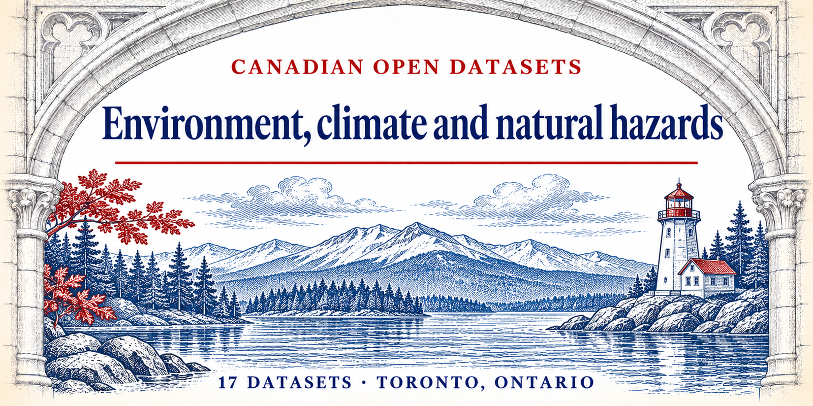

<p align="center"></p>

# Canada wildfire area burned by cause

*Province and territory area burned by cause class, 1990 to 2020*

**Theme:** [Environment, climate and natural hazards](../../README.md#environment-climate-and-natural-hazards) · **Coverage:** 1990 to 2020 · **Kaggle:** [https://www.kaggle.com/datasets/johnnykhan1/canada-wildfire-area-burned-cause](https://www.kaggle.com/datasets/johnnykhan1/canada-wildfire-area-burned-cause)

## What it is

Canada wildfire area burned by cause class, tidied from the National Forestry Database table published through the Open Government Portal. The English columns were kept, French duplicates were dropped, and the file was laid out as tidy CSVs.

Source dataset: [Area burned by cause class](https://open.canada.ca/data/en/dataset/d13b8843-decb-46cb-a745-4269ddf3336d) (Natural Resources Canada, National Forestry Database).

Pulled on November 9, 2026 from the Open Government Portal CSV resource.

## Who it helps

Climate researchers, farmers, emergency planners, insurers, conservation groups, teachers and students.

## Files

| File | Size | Where |
|---|---:|---|
| [`BUILD_RESULT.json`](data/BUILD_RESULT.json) | 1 KB | in this repository |
| [`area_burned_by_cause_long.csv`](data/area_burned_by_cause_long.csv) | 40 KB | in this repository |
| [`area_burned_by_jurisdiction_annual.csv`](data/area_burned_by_jurisdiction_annual.csv) | 12 KB | in this repository |
| [`canada_area_burned_by_cause_annual.csv`](data/canada_area_burned_by_cause_annual.csv) | 3 KB | in this repository |
| [`canada_area_burned_by_cause_wide.csv`](data/canada_area_burned_by_cause_wide.csv) | 2 KB | in this repository |
| [`cover.png`](data/cover.png) | 95 KB | in this repository |
| [`data_dictionary.csv`](data/data_dictionary.csv) | 2 KB | in this repository |

## Columns

### `area_burned_by_cause_long.csv`

Tidy long file of area burned by year, jurisdiction and cause.

| Column | Type | Description |
|---|---|---|
| `year` | Integer | Calendar year of the reported burned area. |
| `iso` | Text | Two letter jurisdiction code used by the National Forestry Database (for example ON, BC, PC for Parks Canada). |
| `jurisdiction` | Text | English name of the province, territory or Parks Canada. |
| `cause` | Text | Cause class: Human activity, Lightning, Unspecified or Reburn. |
| `area_hectares` | Float | Area burned in hectares for that year, jurisdiction and cause. |
| `data_qualifier` | Text | National Forestry Database data qualifier code as published (often a). |

### `area_burned_by_jurisdiction_annual.csv`

Total area burned by year and jurisdiction (all causes).

| Column | Type | Description |
|---|---|---|
| `year` | Integer | Calendar year of the reported burned area. |
| `iso` | Text | Two letter jurisdiction code used by the National Forestry Database (for example ON, BC, PC for Parks Canada). |
| `jurisdiction` | Text | English name of the province, territory or Parks Canada. |
| `area_hectares` | Float | Area burned in hectares for that year, jurisdiction and cause. |

### `canada_area_burned_by_cause_annual.csv`

Canada national totals by year and cause.

| Column | Type | Description |
|---|---|---|
| `year` | Integer | Calendar year of the reported burned area. |
| `cause` | Text | Cause class: Human activity, Lightning, Unspecified or Reburn. |
| `area_hectares` | Float | Area burned in hectares for that year, jurisdiction and cause. |

### `canada_area_burned_by_cause_wide.csv`

Canada national area burned, one column per cause.

| Column | Type | Description |
|---|---|---|
| `year` | Integer | Calendar year of the reported burned area. |
| `human_activity` | Float | National total area burned by human activity in hectares for the year. |
| `lightning` | Float | National total area burned by lightning in hectares for the year. |
| `reburn` | Float | National total area burned classed as reburn in hectares for the year. |
| `unspecified` | Float | National total area burned with unspecified cause in hectares for the year. |

### `data_dictionary.csv`

- `column`: Name of the column being described - `file`: File that contains the column - `type`: Data type of the column - `description`: Plain-language description of the column

| Column | Type | Description |
|---|---|---|
| `file` | Text | File that contains the column |
| `column` | Text | Name of the column being described |
| `type` | Text | Data type of the column |
| `description` | Text | Plain-language description of the column |

## Source and licence

**Source:** Natural Resources Canada, National Forestry Database, Area burned by cause class, via open.canada.ca, Open Government Licence Canada

- **Licence:** [Open Government Licence – Canada 2.0](https://open.canada.ca/en/open-government-licence-canada). Contains information licensed under the Open Government Licence – Canada.

The published values were not changed beyond what is described here. The full licence terms for this folder are in [LICENSE.md](LICENSE.md).

## Citation

No DOI has been minted for this dataset yet; please cite the Kaggle page.

```bibtex
@misc{khan2026canadawildfireareaburnedcause,
  author    = {Khan, John},
  title     = {Canada wildfire area burned by cause},
  year      = {2026},
  publisher = {Kaggle},
  address   = {Toronto, Ontario, Canada},
  url       = {https://www.kaggle.com/datasets/johnnykhan1/canada-wildfire-area-burned-cause}
}
```

APA: Khan, J. (2026). *Canada wildfire area burned by cause* [Data set]. Kaggle. https://www.kaggle.com/datasets/johnnykhan1/canada-wildfire-area-burned-cause

<details><summary>Full notes from the Kaggle page</summary>

## What this is

Canada wildfire area burned by cause class, tidied from the National Forestry Database table published through the Open Government Portal. The English columns were kept, French duplicates were dropped, and the file was laid out as tidy CSVs.

Source dataset: [Area burned by cause class](https://open.canada.ca/data/en/dataset/d13b8843-decb-46cb-a745-4269ddf3336d) (Natural Resources Canada, National Forestry Database).

Pulled on November 9, 2026 from the Open Government Portal CSV resource.

## Coverage

Years 1990 through 2020. Jurisdictions include the ten provinces, the territories that report, and Parks Canada (ISO code PC). Cause classes are Human activity, Lightning, Unspecified and Reburn.

## Updates

This upload is a snapshot from November 9, 2026 and is not refreshed on a schedule. The National Forestry Database usually updates forest fire tables once a year. If you need a later year, download the table again from the Open Government Portal.

## A few numbers from this snapshot

* Across all jurisdictions and causes, 1995 had the largest burned area in this file: 7,375,319 hectares.
* In 2020, the latest year in the file, total burned area was 227,477 hectares.
* Lightning made up about 88% of the summed area burned across the whole file.

## Example uses

* Chart national or provincial burned area by cause over three decades.
* Compare lightning versus human caused area share by province.
* Join to provincial climate or drought series for fire season studies.

## Caveats

Agency reporting methods differ and change over time. The data qualifier column carries the National Forestry Database flag as published. Reburn is a separate cause class and is not double counted into Human activity or Lightning in this table. Parks Canada (PC) is a reporting agency, not a province. Values are hectares, not square kilometres.

## Files

* `area_burned_by_cause_long.csv`: Tidy long file of area burned by year, jurisdiction and cause.
* `canada_area_burned_by_cause_annual.csv`: Canada national totals by year and cause.
* `canada_area_burned_by_cause_wide.csv`: Canada national area burned, one column per cause.
* `area_burned_by_jurisdiction_annual.csv`: Total area burned by year and jurisdiction (all causes).
* `data_dictionary.csv`: column dictionary.
* `cover.png`: cover chart drawn from this snapshot.

## Licence

Contains information licensed under the [Open Government Licence – Canada](https://open.canada.ca/en/open-government-licence-canada). Source: Natural Resources Canada, National Forestry Database, Area burned by cause class. The published values were not changed. Columns were renamed, French duplicate columns were dropped, and national and jurisdiction rollups were added. This is not an official Government of Canada product and Natural Resources Canada does not endorse it.

Author: John Khan, Toronto, Ontario.

</details>

---
Compiled by John Khan, Toronto, Ontario. Part of the [Canadian Open Datasets](../../README.md) catalogue.
