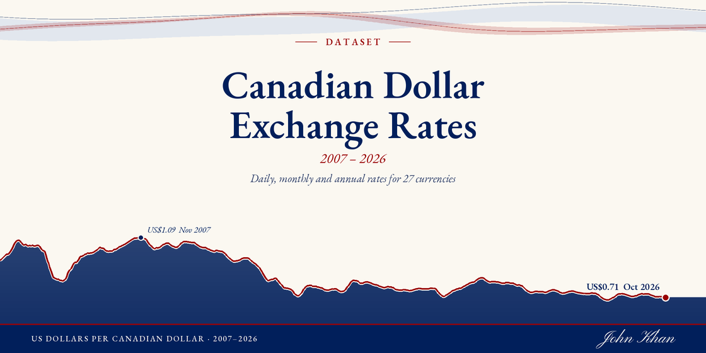

<p align="center"></p>

# Canadian Dollar Exchange Rates 2007 to 2026

*Bank of Canada daily, monthly and annual FX rates for 27 currencies plus CEER*

**Theme:** [Interest rates, credit and markets](../../README.md#interest-rates-credit-and-markets) · **Coverage:** 1 January 1999 to 16 October 2026 · **Kaggle:** [https://www.kaggle.com/datasets/johnnykhan1/canadian-dollar-exchange-rates](https://www.kaggle.com/datasets/johnnykhan1/canadian-dollar-exchange-rates)

## What it is

Official Bank of Canada exchange rates for the Canadian dollar, pulled from the Valet API on October 17, 2026. Daily average rates cover 27 currencies from January 2017, with the Bank's monthly and annual averages. The older daily noon rates cover about 60 currencies from May 2007 to April 2017. One joined USD/CAD series runs every business day from May 2007 to October 2026. The Canadian effective exchange rate (CEER) indices come daily and monthly since 1999.

Every rate is Canadian dollars per one unit of the other currency. For example, `cad_per_usd = 1.4154` means one US dollar cost C$1.4154. The CEER files hold index values, not rates.

## Who it helps

Borrowers, mortgage professionals, lenders, investors, finance students and economists tracking Canadian rates, credit and the dollar.

## Files

| File | Size | Where |
|---|---:|---|
| [`KAGGLE_NOTES.md`](data/KAGGLE_NOTES.md) | 4 KB | in this repository |
| [`ceer_daily_1999_2026.csv`](data/ceer_daily_1999_2026.csv) | 278 KB | in this repository |
| [`ceer_monthly_1999_2026.csv`](data/ceer_monthly_1999_2026.csv) | 21 KB | in this repository |
| [`fx_annual_2017_2025.csv`](data/fx_annual_2017_2025.csv) | 2 KB | in this repository |
| [`fx_daily_2017_2026.csv`](data/fx_daily_2017_2026.csv) | 461 KB | in this repository |
| [`fx_monthly_2017_2026.csv`](data/fx_monthly_2017_2026.csv) | 22 KB | in this repository |
| [`fx_noon_daily_2007_2017.csv`](data/fx_noon_daily_2007_2017.csv) | 1.2 MB | in this repository |
| [`scripts/build_dataset.py`](data/scripts/build_dataset.py) | 5 KB | in this repository |
| [`series_catalog.csv`](data/series_catalog.csv) | 19 KB | in this repository |
| [`usd_cad_daily_2007_2026.csv`](data/usd_cad_daily_2007_2026.csv) | 177 KB | in this repository |

## Columns

### `ceer_daily_1999_2026.csv`

Daily nominal Canadian effective exchange rate indices (1999 = 100)

| Column | Type | Description |
|---|---|---|
| `date` | Date | — |
| `ceer_broad` | Float | The daily value of the nominal Canadian effective exchange rate (CEER) index, calculated by using a weighted average of bilateral exchange rates against a basket of major trading partners’ currencies. The index is set to 100 for the base year 1999. |
| `ceer_broad_ex_us` | Float | The daily value of the nominal Canadian effective exchange rate (CEER) index, excluding the US dollar from the basket of currencies. The index is set to 100 for the base year 1999. |
| `ceer_major_currencies` | Float | The daily value of the nominal Canadian effective exchange rate (CEER) index, calculated against a basket of major currencies. The index is set to 100 for the base year 1999. |
| `ceer_other_partners` | Float | The daily value of the nominal Canadian effective exchange rate (CEER) index, calculated against the currencies of other important trading partners. The index is set to 100 for the base year 1999. |

### `ceer_monthly_1999_2026.csv`

Monthly nominal and real Canadian effective exchange rate indices (1999 = 100)

| Column | Type | Description |
|---|---|---|
| `date` | Date | — |
| `ceer_broad_nominal` | Float | The monthly value of the nominal Canadian effective exchange rate (CEER) index, calculated using a weighted average of bilateral exchange rates against a basket of major trading partners’ currencies. The index is set to 100 for the base year 1999. |
| `ceer_broad_ex_us_nominal` | Float | The monthly value of the nominal Canadian effective exchange rate (CEER) index, excluding the US dollar from the basket of currencies. The index is set to 100 for the base year 1999. |
| `ceer_major_currencies_nominal` | Float | The monthly value of the nominal Canadian effective exchange rate (CEER) index, calculated against a basket of major currencies. The index is set to 100 for the base year 1999. |
| `ceer_other_partners_nominal` | Float | The monthly value of the nominal Canadian effective exchange rate (CEER) index, calculated against the currencies of other important trading partners. The index is set to 100 for the base year 1999. |
| `ceer_broad_real` | Float | The monthly value of the real Canadian effective exchange rate (CEER) index, calculated using a weighted average of bilateral exchange rates against a basket of major trading partners’ currencies. The index is set to 100 for the base year 1999. |
| `ceer_broad_ex_us_real` | Float | The monthly value of the real Canadian effective exchange rate (CEER) index, excluding the US dollar from the basket of currencies. The index is set to 100 for the base year 1999. |
| `ceer_major_currencies_real` | Float | The monthly value of the real Canadian effective exchange rate (CEER) index, calculated against a basket of major currencies. The index is set to 100 for the base year 1999. |
| `ceer_other_partners_real` | Float | The monthly value of the real Canadian effective exchange rate (CEER) index, calculated against the currencies of other important trading partners. The index is set to 100 for the base year 1999. |

### `fx_annual_2017_2025.csv`

Annual average exchange rates published by the Bank of Canada

| Column | Type | Description |
|---|---|---|
| `year` | Integer | — |
| `cad_per_aud` | Float | Daily average exchange rate of the Australian dollar in Canadian dollars. |
| `cad_per_brl` | Float | Daily average exchange rate of the Brazilian real in Canadian dollars. |
| `cad_per_cny` | Float | Daily average exchange rate of the Chinese renminbi in Canadian dollars. |
| `cad_per_eur` | Float | Daily average exchange rate of the euro in Canadian dollars. |
| `cad_per_hkd` | Float | Daily average exchange rate of the Hong Kong dollar in Canadian dollars. |
| `cad_per_inr` | Float | Daily average exchange rate of the Indian rupee in Canadian dollars. |
| `cad_per_idr` | Float | Daily average exchange rate of the Indonesian rupiah in Canadian dollars. |
| `cad_per_jpy` | Float | Daily average exchange rate of the Japanese yen in Canadian dollars. |
| `cad_per_myr` | Float | Daily average exchange rate of the Malaysian ringgit in Canadian dollars. |
| `cad_per_mxn` | Float | Daily average exchange rate of the Mexican peso in Canadian dollars. |
| `cad_per_nzd` | Float | Daily average exchange rate of the New Zealand dollar in Canadian dollars. |
| `cad_per_nok` | Float | Daily average exchange rate of the Norwegian krone in Canadian dollars. |
| `cad_per_pen` | Float | Daily average exchange rate of the Peruvian new sol in Canadian dollars. |
| `cad_per_pln` | Text | Daily average exchange rate of the Polish zloty in Canadian dollars. |
| `cad_per_rub` | Float | Daily average exchange rate — historical series of the Russian ruble in Canadian dollars. |
| `cad_per_sar` | Float | Daily average exchange rate — historical series of the Saudi riyal in Canadian dollars. |
| `cad_per_sgd` | Float | Daily average exchange rate of the Singapore dollar in Canadian dollars. |
| `cad_per_zar` | Float | Daily average exchange rate of the South African rand in Canadian dollars. |
| `cad_per_krw` | Float | Daily average exchange rate of the South Korean won in Canadian dollars. |
| `cad_per_sek` | Float | Daily average exchange rate of the Swedish krona in Canadian dollars. |
| `cad_per_chf` | Float | Daily average exchange rate of the Swiss franc in Canadian dollars. |
| `cad_per_twd` | Float | Daily average exchange rate of the Taiwanese dollar in Canadian dollars. |
| `cad_per_thb` | Float | Daily average exchange rate of the Thai baht in Canadian dollars. |
| `cad_per_try` | Float | Daily average exchange rate of the Turkish lira in Canadian dollars. |
| `cad_per_gbp` | Float | Daily average exchange rate of the UK pound sterling in Canadian dollars. |
| `cad_per_usd` | Float | Daily average exchange rate of the US dollar in Canadian dollars. |
| `cad_per_vnd` | Float | Daily average exchange rate — historical series of the Vietnamese dong in Canadian dollars. |

### `fx_daily_2017_2026.csv`

Bank of Canada daily average exchange rates, 27 currencies, CAD per unit

| Column | Type | Description |
|---|---|---|
| `date` | Date | — |
| `cad_per_aud` | Float | Daily average exchange rate of the Australian dollar in Canadian dollars. |
| `cad_per_brl` | Float | Daily average exchange rate of the Brazilian real in Canadian dollars. |
| `cad_per_cny` | Float | Daily average exchange rate of the Chinese renminbi in Canadian dollars. |
| `cad_per_eur` | Float | Daily average exchange rate of the euro in Canadian dollars. |
| `cad_per_hkd` | Float | Daily average exchange rate of the Hong Kong dollar in Canadian dollars. |
| `cad_per_inr` | Float | Daily average exchange rate of the Indian rupee in Canadian dollars. |
| `cad_per_idr` | Float | Daily average exchange rate of the Indonesian rupiah in Canadian dollars. |
| `cad_per_jpy` | Float | Daily average exchange rate of the Japanese yen in Canadian dollars. |
| `cad_per_myr` | Float | Daily average exchange rate of the Malaysian ringgit in Canadian dollars. |
| `cad_per_mxn` | Float | Daily average exchange rate of the Mexican peso in Canadian dollars. |
| `cad_per_nzd` | Float | Daily average exchange rate of the New Zealand dollar in Canadian dollars. |
| `cad_per_nok` | Float | Daily average exchange rate of the Norwegian krone in Canadian dollars. |
| `cad_per_pen` | Float | Daily average exchange rate of the Peruvian new sol in Canadian dollars. |
| `cad_per_pln` | Text | Daily average exchange rate of the Polish zloty in Canadian dollars. |
| `cad_per_rub` | Float | Daily average exchange rate — historical series of the Russian ruble in Canadian dollars. |
| `cad_per_sar` | Float | Daily average exchange rate — historical series of the Saudi riyal in Canadian dollars. |
| `cad_per_sgd` | Float | Daily average exchange rate of the Singapore dollar in Canadian dollars. |
| `cad_per_zar` | Float | Daily average exchange rate of the South African rand in Canadian dollars. |
| `cad_per_krw` | Float | Daily average exchange rate of the South Korean won in Canadian dollars. |
| `cad_per_sek` | Float | Daily average exchange rate of the Swedish krona in Canadian dollars. |
| `cad_per_chf` | Float | Daily average exchange rate of the Swiss franc in Canadian dollars. |
| `cad_per_twd` | Float | Daily average exchange rate of the Taiwanese dollar in Canadian dollars. |
| `cad_per_thb` | Float | Daily average exchange rate of the Thai baht in Canadian dollars. |
| `cad_per_try` | Float | Daily average exchange rate of the Turkish lira in Canadian dollars. |
| `cad_per_gbp` | Float | Daily average exchange rate of the UK pound sterling in Canadian dollars. |
| `cad_per_usd` | Float | Daily average exchange rate of the US dollar in Canadian dollars. |
| `cad_per_vnd` | Float | Daily average exchange rate — historical series of the Vietnamese dong in Canadian dollars. |

### `fx_monthly_2017_2026.csv`

Monthly average exchange rates published by the Bank of Canada

| Column | Type | Description |
|---|---|---|
| `date` | Date | — |
| `cad_per_aud` | Float | Daily average exchange rate of the Australian dollar in Canadian dollars. |
| `cad_per_brl` | Float | Daily average exchange rate of the Brazilian real in Canadian dollars. |
| `cad_per_cny` | Float | Daily average exchange rate of the Chinese renminbi in Canadian dollars. |
| `cad_per_eur` | Float | Daily average exchange rate of the euro in Canadian dollars. |
| `cad_per_hkd` | Float | Daily average exchange rate of the Hong Kong dollar in Canadian dollars. |
| `cad_per_inr` | Float | Daily average exchange rate of the Indian rupee in Canadian dollars. |
| `cad_per_idr` | Float | Daily average exchange rate of the Indonesian rupiah in Canadian dollars. |
| `cad_per_jpy` | Float | Daily average exchange rate of the Japanese yen in Canadian dollars. |
| `cad_per_myr` | Float | Daily average exchange rate of the Malaysian ringgit in Canadian dollars. |
| `cad_per_mxn` | Float | Daily average exchange rate of the Mexican peso in Canadian dollars. |
| `cad_per_nzd` | Float | Daily average exchange rate of the New Zealand dollar in Canadian dollars. |
| `cad_per_nok` | Float | Daily average exchange rate of the Norwegian krone in Canadian dollars. |
| `cad_per_pen` | Float | Daily average exchange rate of the Peruvian new sol in Canadian dollars. |
| `cad_per_pln` | Float | Daily average exchange rate of the Polish zloty in Canadian dollars. |
| `cad_per_rub` | Float | Daily average exchange rate — historical series of the Russian ruble in Canadian dollars. |
| `cad_per_sar` | Float | Daily average exchange rate — historical series of the Saudi riyal in Canadian dollars. |
| `cad_per_sgd` | Float | Daily average exchange rate of the Singapore dollar in Canadian dollars. |
| `cad_per_zar` | Float | Daily average exchange rate of the South African rand in Canadian dollars. |
| `cad_per_krw` | Float | Daily average exchange rate of the South Korean won in Canadian dollars. |
| `cad_per_sek` | Float | Daily average exchange rate of the Swedish krona in Canadian dollars. |
| `cad_per_chf` | Float | Daily average exchange rate of the Swiss franc in Canadian dollars. |
| `cad_per_twd` | Float | Daily average exchange rate of the Taiwanese dollar in Canadian dollars. |
| `cad_per_thb` | Float | Daily average exchange rate of the Thai baht in Canadian dollars. |
| `cad_per_try` | Float | Daily average exchange rate of the Turkish lira in Canadian dollars. |
| `cad_per_gbp` | Float | Daily average exchange rate of the UK pound sterling in Canadian dollars. |
| `cad_per_usd` | Float | Daily average exchange rate of the US dollar in Canadian dollars. |
| `cad_per_vnd` | Float | Daily average exchange rate — historical series of the Vietnamese dong in Canadian dollars. |

### `fx_noon_daily_2007_2017.csv`

Legacy Bank of Canada noon rates, about 60 currencies, May 2007 to April 2017

| Column | Type | Description |
|---|---|---|
| `date` | Date | — |
| `cad_per_ars_local` | Float | Argentine peso (local) |
| `cad_per_ars` | Float | Argentine peso |
| `cad_per_aud` | Float | Daily average exchange rate of the Australian dollar in Canadian dollars. |
| `cad_per_bsd` | Float | Bahamian dollar |
| `cad_per_brl` | Float | Daily average exchange rate of the Brazilian real in Canadian dollars. |
| `cad_per_xaf` | Float | CFA franc |
| `cad_per_xpf` | Float | CFP franc |
| `cad_per_clp` | Float | Chilean peso |
| `cad_per_cny` | Float | Daily average exchange rate of the Chinese renminbi in Canadian dollars. |
| `cad_per_cop` | Float | Colombian peso |
| `cad_per_hrk` | Float | Croatian kuna |
| `cad_per_czk` | Float | Czech Republic koruna |
| `cad_per_dkk` | Float | Danish krone |
| `cad_per_xcd` | Float | East Caribbean dollar |
| `cad_per_eur` | Float | Daily average exchange rate of the euro in Canadian dollars. |
| `cad_per_fjd` | Float | Fiji dollar |
| `cad_per_ghc_old` | Float | Ghanaian cedi (old) |
| `cad_per_ghs` | Float | Ghanaian cedi |
| `cad_per_gtq` | Float | Guatemalan quetzal |
| `cad_per_hnl` | Float | Honduran lempira |
| `cad_per_hkd` | Float | Daily average exchange rate of the Hong Kong dollar in Canadian dollars. |
| `cad_per_huf` | Float | Hungarian forint |
| `cad_per_isk` | Float | Icelandic krona |
| `cad_per_inr` | Float | Daily average exchange rate of the Indian rupee in Canadian dollars. |
| `cad_per_idr` | Float | Daily average exchange rate of the Indonesian rupiah in Canadian dollars. |
| `cad_per_ils` | Float | Israeli new shekel |
| `cad_per_jmd` | Float | Jamaican dollar |
| `cad_per_jpy` | Float | Daily average exchange rate of the Japanese yen in Canadian dollars. |
| `cad_per_myr` | Float | Daily average exchange rate of the Malaysian ringgit in Canadian dollars. |
| `cad_per_mxn` | Float | Daily average exchange rate of the Mexican peso in Canadian dollars. |
| `cad_per_mad` | Float | Moroccan dirham |
| `cad_per_mmk_fixed` | Float | Myanmar (Burma) kyat (fixed) |
| `cad_per_mmk` | Text | Myanmar (Burma) kyat |
| `cad_per_ang` | Float | Neth. Antilles guilder |
| `cad_per_nzd` | Float | Daily average exchange rate of the New Zealand dollar in Canadian dollars. |
| `cad_per_nok` | Float | Daily average exchange rate of the Norwegian krone in Canadian dollars. |
| `cad_per_pkr` | Float | Pakistan rupee |
| `cad_per_pab` | Float | Panamanian balboa |
| `cad_per_pen` | Float | Daily average exchange rate of the Peruvian new sol in Canadian dollars. |
| `cad_per_php` | Float | Philippine peso |
| `cad_per_pln` | Float | Daily average exchange rate of the Polish zloty in Canadian dollars. |
| `cad_per_ron` | Float | Romanian new leu |
| `cad_per_rub` | Float | Daily average exchange rate — historical series of the Russian ruble in Canadian dollars. |
| `cad_per_rsd` | Float | Serbian dinar |
| `cad_per_sgd` | Float | Daily average exchange rate of the Singapore dollar in Canadian dollars. |
| `cad_per_skk` | Float | Slovak koruna |
| `cad_per_zar` | Float | Daily average exchange rate of the South African rand in Canadian dollars. |
| `cad_per_krw` | Float | Daily average exchange rate of the South Korean won in Canadian dollars. |
| `cad_per_lkr` | Float | Sri Lanka rupee |
| `cad_per_sek` | Float | Daily average exchange rate of the Swedish krona in Canadian dollars. |
| `cad_per_chf` | Float | Daily average exchange rate of the Swiss franc in Canadian dollars. |
| `cad_per_twd` | Float | Daily average exchange rate of the Taiwanese dollar in Canadian dollars. |
| `cad_per_thb` | Float | Daily average exchange rate of the Thai baht in Canadian dollars. |
| `cad_per_ttd` | Float | Trinidad and Tobago dollar |
| `cad_per_tnd` | Float | Tunisian dinar |
| `cad_per_try` | Float | Daily average exchange rate of the Turkish lira in Canadian dollars. |
| `cad_per_aed` | Float | U.A.E. dirham |
| `cad_per_veb` | Float | Venezuelan bolivar |
| `cad_per_vef` | Float | Venezuelan bolivar fuerte |
| `cad_per_gbp` | Float | Daily average exchange rate of the UK pound sterling in Canadian dollars. |
| `cad_per_vnd` | Float | Daily average exchange rate — historical series of the Vietnamese dong in Canadian dollars. |
| `cad_per_usd` | Float | Daily average exchange rate of the US dollar in Canadian dollars. |
| `cad_per_usd_90day_forward` | Float | U.S. dollar noon, 90-day |
| `usd_cad_forward_points_3m` | Float | US/Canada noon 3-month forward points spread |
| `usd_cad_forward_points_6m` | Float | US/Canada noon 6-month forward points spread |

### `series_catalog.csv`

Column to Bank of Canada series ID mapping with labels and descriptions

| Column | Type | Description |
|---|---|---|
| `file` | Text | — |
| `column` | Text | — |
| `series_id` | Text | — |
| `label` | Text | — |
| `description` | Text | — |

### `usd_cad_daily_2007_2026.csv`

Joined USD/CAD daily series 2007-2026 (noon rate to 2016, daily average from 2017)

| Column | Type | Description |
|---|---|---|
| `date` | Date | Observation date (YYYY-MM-DD; YYYY-MM in monthly files) |
| `cad_per_usd` | Float | Canadian dollars per US dollar |
| `method` | Text | noon (legacy noon rate) or daily_average (current daily average rate) |
| `usd_per_cad` | Float | US dollars per Canadian dollar (inverse of cad_per_usd) |

## Source and licence

**Source:** Bank of Canada Valet API, https://www.bankofcanada.ca/valet/docs: daily exchange rates (FX series, 2017 onward), legacy noon rates (2007-2017) and the Canadian Effective Exchange Rate (CEER) indices. Collected by John Khan on 2026-10-17 with scripts/build_dataset.py; JSON converted to CSV and columns renamed, values unchanged.

- **Licence:** [Bank of Canada terms of use](https://www.bankofcanada.ca/terms/). Source: Bank of Canada. Content may be used, copied and distributed for free with credit to the Bank of Canada and a note of changes made. Not endorsed by the Bank of Canada.

The published values were not changed beyond what is described here. The full licence terms for this folder are in [LICENSE.md](LICENSE.md).

## Citation

No DOI has been minted for this dataset yet; please cite the Kaggle page.

```bibtex
@misc{khan2026canadiandollarexchangerates,
  author    = {Khan, John},
  title     = {Canadian Dollar Exchange Rates 2007 to 2026},
  year      = {2026},
  publisher = {Kaggle},
  address   = {Toronto, Ontario, Canada},
  url       = {https://www.kaggle.com/datasets/johnnykhan1/canadian-dollar-exchange-rates}
}
```

APA: Khan, J. (2026). *Canadian Dollar Exchange Rates 2007 to 2026* [Data set]. Kaggle. https://www.kaggle.com/datasets/johnnykhan1/canadian-dollar-exchange-rates

<details><summary>Full notes from the Kaggle page</summary>

## What this is

Official Bank of Canada exchange rates for the Canadian dollar, pulled from the Valet API on October 17, 2026. Daily average rates cover 27 currencies from January 2017, with the Bank's monthly and annual averages. The older daily noon rates cover about 60 currencies from May 2007 to April 2017. One joined USD/CAD series runs every business day from May 2007 to October 2026. The Canadian effective exchange rate (CEER) indices come daily and monthly since 1999.

Every rate is Canadian dollars per one unit of the other currency. For example, `cad_per_usd = 1.4154` means one US dollar cost C$1.4154. The CEER files hold index values, not rates.

## Files

| File | Frequency | Coverage | What is in it |
|---|---|---|---|
| `usd_cad_daily_2007_2026.csv` | Business daily | May 2007 to October 2026 | `cad_per_usd`, its inverse `usd_per_cad`, and `method` (`noon` until December 30, 2016, `daily_average` from January 3, 2017) |
| `fx_daily_2017_2026.csv` | Business daily | January 2017 to October 2026 | Daily average rates for 27 currencies (`cad_per_usd`, `cad_per_eur`, `cad_per_gbp`, `cad_per_jpy`, `cad_per_cny` and more) |
| `fx_monthly_2017_2026.csv` | Monthly | January 2017 to September 2026 | Monthly averages published by the Bank, same columns (`date` is `YYYY-MM`) |
| `fx_annual_2017_2025.csv` | Annual | 2017 to 2025 | Annual averages published by the Bank, same columns |
| `fx_noon_daily_2007_2017.csv` | Business daily | May 2007 to April 2017 | Legacy noon rates for about 60 currencies, plus the 90 day forward USD rate and 3 and 6 month USD/CAD forward points |
| `ceer_daily_1999_2026.csv` | Business daily | January 1999 to October 2026 | Nominal CEER: broad, broad excluding the US dollar, major currencies, other important trading partners (1999 = 100) |
| `ceer_monthly_1999_2026.csv` | Monthly | January 1999 to September 2026 | Nominal and real CEER for the same four baskets (real to June 2026) |
| `series_catalog.csv` | | | Each column with its Bank of Canada series ID, label and description |
| `scripts/build_dataset.py` | | | Rebuilds every file from the public API (`--refresh` to download again) |

## Coverage gaps

Values are left empty where the Bank did not publish a rate. Nothing is interpolated.

* VND ends in 2019.
* RUB and SAR end in April 2026.
* MYR and THB are missing from 2020 to April 2026.
* PLN starts in May 2026.
* In the legacy noon file, VEB, SKK, GHC and the fixed MMK rate stop before 2017 because they were redenominated or dropped.

## How it was built

The build script calls the Valet groups `FX_RATES_DAILY`, `FX_RATES_MONTHLY`, `FX_RATES_ANNUAL`, `LEGACY_NOON_RATES`, `CEER_DAILY`, `CEER_MONTHLY_NOMINAL` and `CEER_MONTHLY_REAL`, converts the JSON to CSV and renames the columns. The USD/CAD file joins the noon and daily average series at the 2017 method change, and `usd_per_cad` is added as the inverse of `cad_per_usd`.

## Method notes

* Daily average rates (2017 on) are indicative rates the Bank derives from aggregated quotes from financial institutions and publishes each business day by 16:30 ET.
* Noon rates (2007 to 2017) were the Bank's earlier benchmark, last updated April 28, 2017. The two methods differ slightly, so don't read the January 2017 join as a market move.
* CEER is a trade weighted index of the Canadian dollar against major trading partners' currencies (1999 = 100). A rise means the Canadian dollar strengthened.
* These are not trading rates and should not be used to value transactions.

## Sources

Bank of Canada Valet API, https://www.bankofcanada.ca/valet/docs. The series ID for every column is in `series_catalog.csv`.

## Updates

This is a snapshot pulled on October 17, 2026, with daily data to October 16, 2026. Run the build script with internet on to pull newer values.

## Notebooks that use it

* [The Canadian Dollar Since 2007](https://www.kaggle.com/code/johnnykhan1/canadian-dollar-since-2007-eda)
* [Rate Spreads and the Loonie, 2007 to 2026](https://www.kaggle.com/code/johnnykhan1/rate-spreads-and-the-loonie-in-r) (R)
* [Canada's Commodity Prices, 1972 to 2026](https://www.kaggle.com/code/johnnykhan1/canada-commodity-prices-1972-2026-eda)
* [canada-macro-utils](https://www.kaggle.com/code/johnnykhan1/canada-macro-utils), a small loader script for this and my three other Bank of Canada datasets

Companion datasets that join on date: [Canada and US Government Bond Yields 1990 to 2026](https://www.kaggle.com/datasets/johnnykhan1/canada-us-government-bond-yields) and [Bank of Canada Commodity Price Index 1972 to 2026](https://www.kaggle.com/datasets/johnnykhan1/bank-of-canada-commodity-price-index).

## Suggested uses

* Converting Canadian financial data at official rates
* Studying the Canadian dollar against oil prices and interest rate gaps
* Volatility modelling and forecasting
* Teaching time series methods on a clean daily series

## Licence

Bank of Canada content may be used, copied and distributed for free with credit to the Bank of Canada as the source and a note of changes made, without implying endorsement ([Bank of Canada terms of use](https://www.bankofcanada.ca/terms/)). Changes made here: JSON converted to CSV, columns renamed, USD/CAD joined across the 2017 method change and `usd_per_cad` added. This dataset is not endorsed by the Bank of Canada.

Author: John Khan

</details>

---
Compiled by John Khan, Toronto, Ontario. Part of the [Canadian Open Datasets](../../README.md) catalogue.
