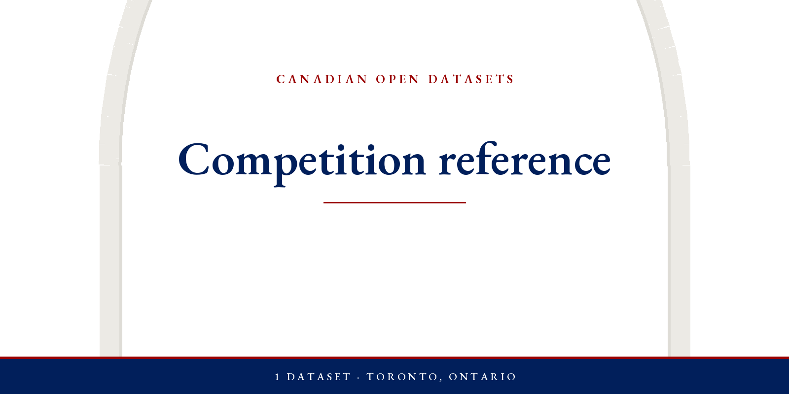

<p align="center"></p>

# Featured Kaggle leaderboard medal lines

*Public ranks and scores for 6 medal competitions, 9 Nov 2026*

**Theme:** [Competition reference](../../README.md#competition-reference) · **Coverage:** 29 October and 9 November 2026 · **Kaggle:** [https://www.kaggle.com/datasets/johnnykhan1/featured-kaggle-leaderboards-medal-lines-oct-2026](https://www.kaggle.com/datasets/johnnykhan1/featured-kaggle-leaderboards-medal-lines-oct-2026)

## What it is

Public leaderboard ranks, scores, submission counts and last submission times for six featured Kaggle competitions that were awarding medals in autumn 2026, from the official leaderboard downloads of 29 October and 9 November 2026. Team names, team ids and user names are removed. It shows where the bronze and silver medal lines sit and how large tie groups are near each line.

## Who it helps

Kaggle competitors checking where medal lines sit on public leaderboards.

## Files

**Link only.** The snapshot is drawn from Kaggle competition leaderboards, which fall under Kaggle's own terms of use rather than an open government licence, so the files stay on Kaggle and this folder links to them.

Download the files from Kaggle: [https://www.kaggle.com/datasets/johnnykhan1/featured-kaggle-leaderboards-medal-lines-oct-2026](https://www.kaggle.com/datasets/johnnykhan1/featured-kaggle-leaderboards-medal-lines-oct-2026)

## Columns

### `data_dictionary.csv`

Column dictionary for every CSV in this dataset.

| Column | Type | Description |
|---|---|---|
| `file` | Text | — |
| `column` | Text | — |
| `type` | Text | — |
| `description` | Text | — |

### `medal_lines_summary_2026-10-29.csv`

Medal-line summary that accompanied the 29 October 2026 snapshot. Team counts in that file included official rank 0 baseline rows.

| Column | Type | Description |
|---|---|---|
| `competition` | Text | — |
| `teams` | Integer | — |
| `bronze_rank` | Integer | — |
| `bronze_score_at_rank` | Float | — |
| `silver_rank` | Integer | — |
| `silver_score_at_rank` | Float | — |
| `top_score` | Float | — |
| `bottom_score` | Float | — |

### `medal_lines_summary_2026-11-10.csv`

One row per competition, with ranked-team counts and the official public scores sitting at the floor of the top 10 percent and top 5 percent of ranked teams, from the 10 November 2026 04:05 UTC downloads.

| Column | Type | Description |
|---|---|---|
| `competition` | Text | — |
| `official_file` | Text | — |
| `official_stamp_utc` | Date | — |
| `n_rows` | Integer | — |
| `n_rank0_baselines` | Integer | — |
| `n_ranked_teams` | Integer | — |
| `bronze_rank` | Integer | — |
| `bronze_score_at_rank` | Float | — |
| `silver_rank` | Integer | — |
| `silver_score_at_rank` | Float | — |
| `top_score` | Float | — |
| `bottom_score` | Float | — |
| `competition_url` | Text | — |

### `public_lb_snapshot_2026-10-29.csv`

Earlier snapshot of the same six public leaderboards, taken 29 October 2026. Team names and member user names are not included. Kept for comparison.

| Column | Type | Description |
|---|---|---|
| `competition` | Text | — |
| `rank` | Integer | — |
| `score` | Float | — |
| `submission_count` | Integer | — |
| `last_submission_utc` | Date | — |

### `public_lb_snapshot_2026-11-10.csv`

One row per public leaderboard entry from the official Kaggle downloads taken 10 November 2026 at 04:05 UTC. Team names and member user names are not included.

| Column | Type | Description |
|---|---|---|
| `competition` | Text | — |
| `rank` | Integer | — |
| `score` | Float | — |
| `submission_count` | Integer | — |
| `last_submission_utc` | Date | — |

## Source and licence

**Source:** Official Kaggle public leaderboard CSV downloads, 29 October and 9 November 2026, reshaped by John Khan, Toronto, Ontario.

- **Licence:** [CC0 1.0 (as set on Kaggle)](https://creativecommons.org/publicdomain/zero/1.0/). 

The published values were not changed beyond what is described here. The full licence terms for this folder are in [LICENSE.md](LICENSE.md).

## Citation

No DOI has been minted for this dataset yet; please cite the Kaggle page.

```bibtex
@misc{khan2026featuredkaggleleaderboardsmedallinesoct2,
  author    = {Khan, John},
  title     = {Featured Kaggle leaderboard medal lines},
  year      = {2026},
  publisher = {Kaggle},
  address   = {Toronto, Ontario, Canada},
  url       = {https://www.kaggle.com/datasets/johnnykhan1/featured-kaggle-leaderboards-medal-lines-oct-2026}
}
```

APA: Khan, J. (2026). *Featured Kaggle leaderboard medal lines* [Data set]. Kaggle. https://www.kaggle.com/datasets/johnnykhan1/featured-kaggle-leaderboards-medal-lines-oct-2026

---
Compiled by John Khan, Toronto, Ontario. Part of the [Canadian Open Datasets](../../README.md) catalogue.
